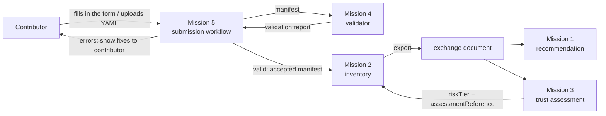

# Two use cases: manifest, validation report, and exchange document

Date: 2026-11-13. This page shows Mission 4's three outputs on two **real, public** capabilities,
and how the other missions are expected to use each one. Every output here was produced by the real
tool (`bin/capability-manifest.js`, schema 0.1).

| Use case | Real capability used | Source |
|---|---|---|
| 1. An MCP server that reads Jira issues, updates their status, and supports summaries | **MCP Atlassian** 0.24.3 | [github.com/sooperset/mcp-atlassian](https://github.com/sooperset/mcp-atlassian) |
| 2. An AI capability that analyses GitHub pull requests and reviews code quality | **PR-Agent** 0.50.0 | [github.com/The-PR-Agent/pr-agent](https://github.com/The-PR-Agent/pr-agent) |

Every value in the manifests was read from the capability's public sources on 2026-11-13: the GitHub
repository API and latest release, PyPI, Docker Hub, the README, and the official documentation.
Each manifest's `provenance` list says where every value comes from (`native`: the project states
it; `linked`: read from a source the project declares; `curated`: written or chosen by the person
filling in the manifest).

**Status:** the way the other missions use these files is Mission 4's proposed design. No other
mission has integrated with them yet (see [mission-understanding.md](../../docs/mission-understanding.md), risk K12).

## What is deliberately left out

Some fields cannot be filled from public sources, and making them up would defeat their purpose:

| Field | Why it is not set | Who sets it |
|---|---|---|
| `riskTier` | Stays `unassessed`. No risk assessment of either tool exists. | Mission 3, after an assessment, together with `assessmentReference` |
| `maturity` | How proven a capability is in *this organisation* | Mission 2 (the inventory) |
| `lifecycleStatus` | Declared by the owner; neither project declares one | The capability owner |

So both manifests reach the `adoptable` completeness level, not `governed`. Both are
production-ready descriptions, but not yet assessed capabilities.

## The three artefacts in one sentence each

| Artefact | What it is | Who writes it | Who reads it |
|---|---|---|---|
| **Manifest** (`*.capability.yaml`) | One capability described in the common format | The capability owner or a curator, through Mission 5's submission UI (or a form that generates it) | The validator; then stored by Mission 2 |
| **Validation report** (JSON) | The validator's verdict on one submission: pass or fail, and every finding with a fix | `capability-manifest validate --format json` | **Mission 5**, at the validate step of its workflow |
| **Exchange document** (JSON) | A bundle of valid manifests, passed through unchanged, each with its completeness level and open caveats | `capability-manifest export` | **Missions 1 and 3** (and anyone else who needs the inventory) |

## The flow



## The two manifests

| | Use case 1 | Use case 2 |
|---|---|---|
| Manifest | [production-set/manifests/mcp-atlassian.capability.yaml](../production-set/manifests/mcp-atlassian.capability.yaml) | [production-set/manifests/pr-agent.capability.yaml](../production-set/manifests/pr-agent.capability.yaml) |
| id | `sooperset/mcp-atlassian` | `the-pr-agent/pr-agent` |
| Type | `mcp_server` | `tool` (a curated choice: it calls itself an agent but has no A2A Agent Card) |
| Version | 0.24.3 (GitHub release and PyPI, 2026-11-12) | 0.50.0 (GitHub release 2026-11-07, PyPI, Docker Hub) |
| Published as | PyPI `mcp-atlassian`; `ghcr.io/sooperset/mcp-atlassian` | PyPI `pr-agent`; `docker.io/pragent/pr-agent`; GitHub Action `the-pr-agent/pr-agent@main` |
| Owner | sooperset (individual maintainer), external | The PR Agent (community organisation), external |
| License | MIT | MIT |
| Setup | `JIRA_URL`, plus `JIRA_USERNAME` + `JIRA_API_TOKEN` (Cloud) or `JIRA_PERSONAL_TOKEN` (Server/DC) | `OPENAI_KEY` (model provider), `GITHUB_TOKEN` |
| Cost | free; Jira licences are your own | `provider_billed`: free software, but every command is a paid model API call |
| Risk | `unassessed` | `unassessed` |
| Completeness | `adoptable` | `adoptable` |
| Source reachable (`--check-sources`) | passed | passed |

Two things the real data showed that the fictional samples did not:

- **MCP Atlassian also covers Confluence.** It is one package and one process, so it is one
  capability. The Jira tools are listed under `embeddedComponents`. It cannot write a summary
  itself: it returns the issue data and the assistant's model writes the summary. The manifest says
  so instead of claiming a summarise tool.
- **PR-Agent moved.** `github.com/qodo-ai/pr-agent` now redirects to `The-PR-Agent/pr-agent`.
  The manifest stores the GitHub `repositoryId` (`662766482`), so the capability can still be matched
  after a move. It also records `distinct_from` Qodo's commercial product, because the README insists
  they are different.

## Step 1 — Mission 5: the contributor submits, the validator answers

There is also a [first draft](first-draft/mcp-atlassian.capability.yaml) of the MCP Atlassian manifest with
typical mistakes. Mission 5 runs:

```bash
capability-manifest validate first-draft --format json
```

and gets [outputs/validation-report-first-draft.json](outputs/validation-report-first-draft.json). Exit
code `1` means "invalid", so the workflow stops and shows the contributor the findings:

| Field | Problem | Fix the contributor is shown |
|---|---|---|
| `/riskTier` | Missing | Use `unassessed` when no assessment has been done |
| `/schemaVersion` | `0.1` is a number | Quote it: `"0.1"` |
| `/capabilityType` | `mcp-server` is not allowed | Did you mean `mcp_server`? |

Each finding has a `code`, a JSON `path`, a `line` and `column`, a `message` and a `hint`. Mission 5's
UI can highlight the form field from `path` and show the `hint` next to it, without parsing text.

Once those three are fixed, a second run raises one more error: an `mcp_server` must declare an
`interfaces` entry with `type: mcp`. That rule only applies once the type is a valid value.

The finished manifests pass with exit code `0`:
[outputs/validation-report.json](outputs/validation-report.json) (run with `--check-sources`, so the
repository URLs were checked). The report still matters when it passes:

- `completeness: "adoptable"` for both: complete enough for a team to adopt;
- `RISK_UNASSESSED` (severity `unverified`) for both: they must not be treated as low risk or
  approved. Mission 5 can use this to trigger a Mission 3 review;
- `LICENSE_NEEDS_REVIEW` for MCP Atlassian: the MIT license was read from the repository as a
  whole, because PyPI states no license. A curator should confirm it covers the package (the
  repository holds only this server) and then set `license.scope: capability`.

Mission 5 can also set a minimum level as a gate, for example `--require-level assessable`.

**What the validation report is not:** it is not an approval. "Valid" means the description is well
formed, not that the capability is safe.

## Step 2 — Mission 2: store it, then export it

Mission 2 keeps the accepted manifests in its database. When another mission needs the inventory,
Mission 2 (or a scheduled job) runs:

```bash
capability-manifest export ../production-set/manifests/mcp-atlassian.capability.yaml ../production-set/manifests/pr-agent.capability.yaml --out exchange-document.json
```

and gets [outputs/exchange-document.json](outputs/exchange-document.json). Its shape:

```json
{
  "exchangeFormatVersion": "0.1",
  "generator": { "name": "capability-manifest", "version": "0.1.0" },
  "schemaVersions": ["0.1"],
  "notice": "Structural validity does not establish ... approved for production.",
  "capabilities": [
    {
      "manifest": { "...": "the mcp-atlassian manifest, field for field" },
      "validation": { "warnings": [], "unverified": ["SOURCE_NOT_CHECKED", "LICENSE_NEEDS_REVIEW", "RISK_UNASSESSED"], "completeness": "adoptable" }
    },
    {
      "manifest": { "...": "the pr-agent manifest, field for field" },
      "validation": { "warnings": [], "unverified": ["SOURCE_NOT_CHECKED", "RISK_UNASSESSED"], "completeness": "adoptable" }
    }
  ],
  "rejected": []
}
```

Invalid manifests never enter `capabilities`; they are listed under `rejected`. The manifests are
copied unchanged, so a consumer reads the same field names it would read in the YAML. `export` does
not check sources, so the document says `SOURCE_NOT_CHECKED` even though the validation run checked
them.

## Step 3 — Mission 1: recommend

A user asks: *"I want an agent to move my Jira tickets to Done and summarise the sprint."*

Mission 1 reads the exchange document and, for each capability, uses these fields. It does not need a
different mapping for an MCP server and a tool:

| Mission 1 question | Field | MCP Atlassian | PR-Agent |
|---|---|---|---|
| Does it fit the need? | `description`, `supportedUseCases` | Read, transition, and create Jira issues; data for summaries | Review pull requests |
| Does it work on my platform? | `publications[].platformCompatibility` (AI hosts, per publication), `integrations` (connected systems), `interfaces` | Claude Desktop, Cursor, GitHub Copilot (the PyPI package); Jira Cloud and Data Center; MCP | No AI host; GitHub, GitLab, Bitbucket, Azure DevOps, Gitea; CLI and PR comments |
| What do I need to set it up? | `setup` | Jira URL and a token (secret) | Model API key and GitHub token (both secret) |
| What are the catches? | `limitations` | Not official Atlassian; write tools on by default; floating image tag | Sends code to a model provider; Action pinned to `@main` |
| Risk? | `riskTier`, `validation.unverified` | **unassessed**: must say so, never rank it as low | **unassessed** |
| Cost? | `costInformation` | `free` | `provider_billed`: the software is free, the model provider bills each call |

The matching and ranking logic is Mission 1's. Mission 4 only guarantees that the fields exist, mean
the same thing for every type, and that `unassessed` is clearly marked.

## Step 4 — Mission 3: assess

Mission 3 reads the same exchange document and filters on `RISK_UNASSESSED` to build its review
queue. Both tools appear. The manifests give the assessor a head start:

| Assessor question | MCP Atlassian | PR-Agent |
|---|---|---|
| Can it change data? | Yes: `jira_create_issue`, `jira_update_issue`, `jira_transition_issue` (`embeddedComponents`); `READ_ONLY_MODE` can switch writes off (`setup`) | It posts comments on pull requests through `GITHUB_TOKEN` |
| What credentials does it hold? | Jira API token or personal access token | Model API key and GitHub token |
| Where does data go? | Stays between the server and Jira; the MCP client's model sees the results | The pull request's code goes to the configured model provider (`limitations`) |
| Who maintains it? | One individual maintainer (`owner`) | A community organisation (`owner`) |
| Known issues? | Not an official Atlassian product | `/help_docs` disabled pending a credential-exposure fix |

When an assessment is done, Mission 3's result goes back into the manifest. Today the write-back path
is not agreed. For example:

```yaml
riskTier: medium          # Mission 3's vocabulary; the tier names are placeholders
assessmentReference:
  id: <Mission 3's assessment id>
  url: <link to the assessment record>
  assessedOn: "<date>"
```

The validator then raises the record to `governed`. An assessed tier without an
`assessmentReference` is an error, so a tier can never appear without evidence.

Gap: the Trust Framework's own questions (data handling, access controls, model risks) have no
dedicated fields yet. Above they are answered from free-text fields. Mission 4 is waiting for
Mission 3 to say what it needs.

## Keeping the manifests current

These are snapshots from 2026-11-13. Both projects release often: MCP Atlassian released 0.24.3 the
day before, PR-Agent 0.50.0 six days before. Re-check `capabilityVersion`, `publications`, and
`limitations` against the sources before relying on them, and update `lastUpdated` and the
`observedAt` dates when you do.

## Regenerate the outputs

From this folder:

```bash
node ../../bin/capability-manifest.js validate first-draft --format json > outputs/validation-report-first-draft.json
node ../../bin/capability-manifest.js validate ../production-set/manifests/mcp-atlassian.capability.yaml ../production-set/manifests/pr-agent.capability.yaml --check-sources --format json > outputs/validation-report.json
node ../../bin/capability-manifest.js export ../production-set/manifests/mcp-atlassian.capability.yaml ../production-set/manifests/pr-agent.capability.yaml --out outputs/exchange-document.json
```
