# AI Capability Ecosystem – Business Workflows, Actors and Use Cases

**Version:** 1.0  
**Date:** 13 November 2026  
**Purpose:** Define the end-to-end business workflows, actors, use cases, mission responsibilities and target logical architecture for the AI Capability Ecosystem across Missions 1–5.

> **Architecture status:** This document combines the mission boundaries provided by the teams with the proposed workflow and architecture interpretation. The four business workflows are the recommended business-level grouping. Mission 4 is a cross-cutting standards capability, not a fifth end-user business workflow. Dashed relationships and items marked as open require confirmation by the relevant mission leads.

---

## 1. Overall business workflow classification

The ecosystem has **four primary business workflows**, supported by one cross-cutting standards workflow.

| # | Business workflow | Primary mission | Supporting missions | Purpose |
|---:|---|---|---|---|
| 1 | Capability Discovery & Recommendation | Mission 1 – Recommendation Engine | M2, M3, M4 | Help users explore available capabilities or describe a problem and receive ranked, explainable recommendations. |
| 2 | Capability Contribution Lifecycle | Mission 5 – Community & Contribution | M2, M3, M4 | Enable contributors to discover, submit, review, validate, publish and improve capabilities. |
| 3 | Capability Landscape & Inventory Management | Mission 2 – AI Capability Landscape | M4, M5, M3 | Discover, catalogue, curate and maintain the organisation's AI capability inventory and radar. |
| 4 | Capability Trust & Governance | Mission 3 – Trust, Security & Governance | M2, M4, designated governance authorities | Assess risks, define controls, escalate reviews and maintain governance assessments. |

### Cross-cutting supporting workflow: Capability Standards & Interoperability Evolution

**Owner:** Mission 4 – Capability Intelligence & Standards.

Mission 4 enables all four business workflows through common metadata structures, capability manifests, schemas, validation rules, versioning conventions and exchange contracts. It does not own the recommendation experience, inventory, governance decisions or end-to-end contribution process.

## 2. Actors involved in the ecosystem

### 2.1 Human actors

| Actor ID | Actor | Description | Primary mission / interaction |
|---|---|---|---|
| A1 | Capability Consumer | Developer, architect or business user looking for existing AI solutions. | M1 / M2 |
| A2 | Capability Contributor | Developer or AI engineer submitting a new capability. | M5 |
| A3 | Capability Owner | Person responsible for an already registered capability and its improvements. | M5 / M2 |
| A4 | Landscape Administrator / Curator | Maintains and manages the organisational capability inventory. | M2 |
| A5 | Trust Assessor | Security, privacy, responsible AI or governance reviewer. | M3 |
| A6 | Designated Approver | Authorised legal, security, privacy or governance decision-maker. | Designated authority |
| A7 | Contribution Reviewer | Reviews submissions and manages reviewer handoffs. | M5 |
| A8 | Standards Maintainer | Defines and evolves the common capability representation. | M4 |

Some actors can be the same person. For example, a developer who submits a capability may also be its owner.

### 2.2 System actors

| System actor | Responsibility |
|---|---|
| Mission 1 Recommendation Engine | Understands needs and generates recommendations. |
| Mission 2 Landscape Application | Provides capability discovery, inventory and radar capabilities. |
| Mission 2 Backend / Database | Stores and manages capability records. |
| Mission 3 Trust Application | Manages risk assessment and governance processes. |
| Mission 4 Schema / Validator | Establishes and validates the common data structure. |
| Mission 5 Contribution Application | Orchestrates the contributor experience and submission lifecycle. |

---

# 3. Workflow 1 – Capability Discovery & Recommendation

**Primary actor:** Capability Consumer  
**Mission ownership:** Mission 1 – Recommendation Engine and Mission 2 – AI Capability Landscape.

This workflow contains two distinct user journeys:

- **Journey 1A – Explore the landscape:** The user wants to know what capabilities already exist.
- **Journey 1B – Get an intelligent recommendation:** The user has a specific requirement and needs help choosing a solution.

These should not be treated as the same experience.

## 3.1 Actors and use cases

| Actor | Use case |
|---|---|
| Capability Consumer | Browse available AI capabilities. |
| Capability Consumer | Search by name, type, function or technology. |
| Capability Consumer | Explore available skills, agents, MCP servers, tools, frameworks and platforms. |
| Capability Consumer | Understand what a capability does. |
| Capability Consumer | Compare available alternatives. |
| Capability Consumer | Describe a business or engineering problem. |
| Capability Consumer | Specify constraints, budget, platform and desired outcomes. |
| Capability Consumer | Receive ranked recommendations. |
| Capability Consumer | Understand why a capability was recommended. |
| Capability Consumer | Review risk, cost, limitations and feasibility. |
| Capability Consumer | Select a capability for further evaluation or adoption. |

## 3.2 Journey 1A – Explore the landscape

**Example:** A developer wants to see which MCP servers are already available within the organisation.

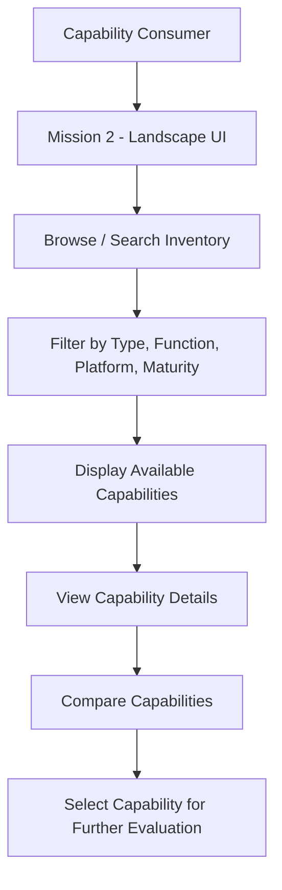

**Expected outcome:** The user understands what capabilities already exist, what they do and where to find them.

Mission 2 owns the inventory and its discovery experience. Mission 1 is not required for this simple browse journey.

## 3.3 Journey 1B – Get an intelligent recommendation

**Example:** A user wants an AI solution that can automate GitHub issue management.

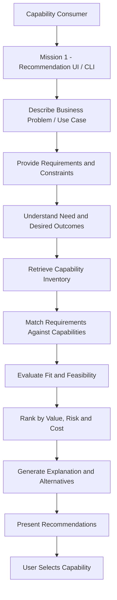

## 3.4 Architecture workflow

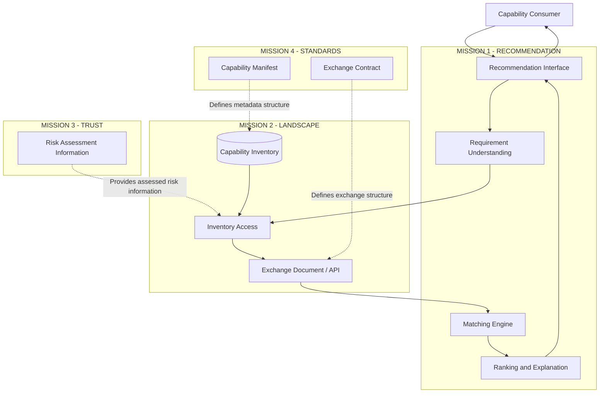

## 3.5 Architecture responsibilities

| Mission | Responsibility |
|---|---|
| M1 | Understand needs, match, rank and explain recommendations. |
| M2 | Provide capability inventory and discovery access. |
| M3 | Provide available risk and governance assessment information. |
| M4 | Ensure consistent manifest and exchange structures. |
| M5 | No direct involvement in the normal consumer journey. |

## 3.6 Information Mission 1 needs

| Matching requirement | Manifest fields |
|---|---|
| What does the capability do? | `description`, `supportedUseCases` |
| What type is it? | `capabilityType` |
| Does it support the required interface? | `interfaces` |
| Is it compatible with the user's platform? | `publications[].platformCompatibility` (AI hosts, per publication) |
| Can the organisation adopt it? | `maturity`, `lifecycleStatus` |
| What are its constraints? | `limitations`, `dependencies` |
| What are its costs? | `costInformation` |
| What is its risk assessment? | `riskTier`, `assessmentReference` |
| What is required to install it? | `setup`, `runtime`, `documentation` |
| Can it legally be used? | `license` |

The recommendation engine belongs to Mission 1. Mission 4 establishes the metadata structure that makes consistent matching possible.

**Current limitation:** The available Mission 4 context reports that Mission 1's initial MVP focuses on skills and approximately 10–20 capabilities. It also reports that no real downstream consumer has integrated with Mission 4 yet. This is the target integration workflow, not an already completed end-to-end implementation.

---

# 4. Workflow 2 – Capability Contribution Lifecycle

**Primary actor:** Capability Contributor  
**Mission ownership:** Mission 5 – Community & Contribution.  
**Supporting missions:** M2, M3 and M4.

This workflow covers the complete journey of a developer who wants to make a newly developed AI capability available to the organisation.

## 4.1 Actors and use cases

| Actor | Use case |
|---|---|
| Capability Contributor | Discover existing capabilities before creating a duplicate. |
| Capability Contributor | Understand contribution guidelines. |
| Capability Contributor | Submit a new AI capability. |
| Capability Contributor | Upload native files or provide capability information. |
| Capability Contributor | Provide ownership, description and technical details. |
| Capability Contributor | Track submission status. |
| Capability Contributor | Respond to review feedback. |
| Capability Contributor | Correct validation errors. |
| Capability Contributor | Resubmit the capability. |
| Capability Contributor | Improve an existing contribution. |
| Capability Owner | Update capability versions and metadata. |
| Contribution Reviewer | Review submitted information. |
| Contribution Reviewer | Request changes or clarification. |
| Contribution Reviewer | Hand off submissions for technical or governance review. |
| Landscape Curator | Review inventory registration and duplication. |
| Trust Assessor | Conduct additional risk assessment when required. |

## 4.2 Detailed business journey

The Mission 5 requirements explicitly define the contribution lifecycle:

`Discover → Submit → Review → Validate → Publish → Improve`

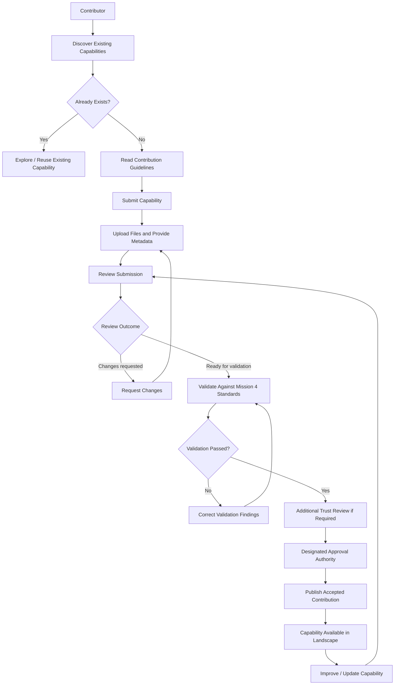

**Note:** This is a proposed logical journey. The exact ordering and handoffs between technical review, validation and trust assessment must be confirmed by Mission 5 and Mission 3. Not every contribution necessarily requires the same governance review or designated approval.

## 4.3 Architecture workflow

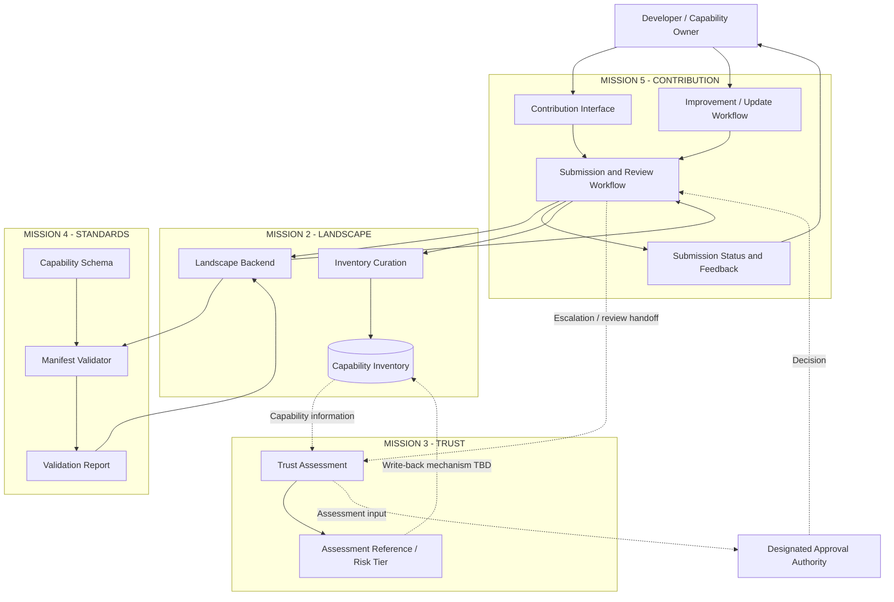

## 4.4 Who provides which information?

The contributor should not be responsible for generating every manifest field.

| Information | Supplied by |
|---|---|
| `schemaVersion` | Workflow |
| `id` | Catalog / contribution workflow, with assignment ownership to be agreed |
| `source` | Workflow, based on the uploaded content |
| `riskTier` | Initially set to `unassessed` by workflow; assessed value belongs to Mission 3 |
| `lastUpdated` | Workflow |
| `name` | Contributor |
| `description` | Contributor |
| `capabilityType` | Contributor, using the agreed vocabulary |
| Interface details | Contributor |
| Owner information | Contributor |
| Version, licence, runtime | Contributor |
| Setup requirements | Contributor |
| Limitations | Contributor |

## 4.5 Validation and decision responsibilities

| Activity | Owner |
|---|---|
| Contributor experience | M5 |
| Submission process | M5 |
| Review and handoffs | M5 |
| Technical manifest validation rules | M4 |
| Validation tool and report contract | M4 |
| Validation step in contribution workflow | M5 |
| Risk assessment framework | M3 |
| Actual security / legal approval | Designated governance authority |
| Inventory registration and maintenance | M2 |
| Publication workflow orchestration | M5, with M2 maintaining the resulting inventory |
| Availability in capability inventory | M2 |

**Important:** A technically valid manifest is not automatically approved for use. Validation, contribution acceptance and governance approval are three different decisions.

---

# 5. Workflow 3 – Capability Landscape & Inventory Management

**Primary actor:** Landscape Administrator / Curator  
**Mission ownership:** Mission 2 – AI Capability Landscape.  
**Supporting missions:** M4, M5 and M3.

This workflow is about maintaining the quality and completeness of the organisation's AI capability landscape. It is not simply storing uploaded records.

Mission 2 must ensure that the inventory provides meaningful visibility into available AI capabilities, maturity, limitations, gaps and opportunities.

## 5.1 Actors and use cases

| Actor | Use case |
|---|---|
| Landscape Administrator | Discover capabilities across the organisation. |
| Landscape Administrator | Catalogue skills, MCP servers, agents, tools, frameworks, platforms and reusable solutions. |
| Landscape Administrator | Import or register capability information. |
| Landscape Administrator | Identify duplicate entries. |
| Landscape Administrator | Group multiple publications of one capability. |
| Landscape Administrator | Maintain capability descriptions and use cases. |
| Landscape Administrator | Track maturity and availability. |
| Landscape Administrator | Record known limitations. |
| Landscape Administrator | Identify capability gaps. |
| Landscape Administrator | Identify emerging AI opportunities. |
| Landscape Administrator | Maintain the AI Capability Radar. |
| Landscape Administrator | Provide inventory information to downstream teams. |
| Capability Owner | Supply corrections and updated capability metadata. |

## 5.2 Business journey

**Example:** The Landscape team wants to establish an inventory of all available AI agents, MCP servers, frameworks and reusable tools across the organisation.

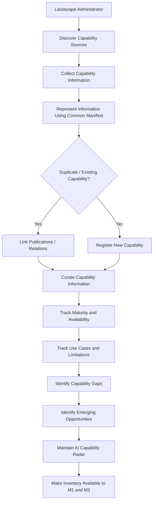

## 5.3 Architecture workflow

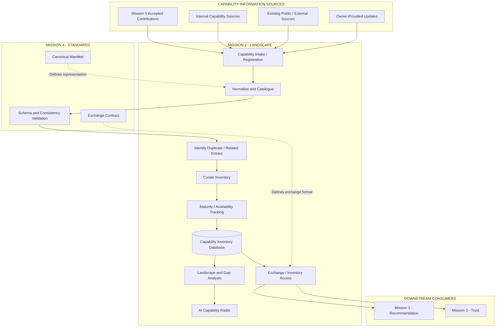

## 5.4 Architecture responsibilities

| Activity | Mission |
|---|---|
| Discover and catalogue capabilities | M2 |
| Define common data structure | M4 |
| Represent capability information | M2 using M4 standard |
| Schema and consistency validation | M4 |
| Functional duplicate analysis | M2 |
| Metadata and inventory curation | M2 |
| Maturity and availability tracking | M2 |
| Trust assessment information | M3 |
| AI Capability Radar | M2 |
| Recommendation input | M1 |

### Important distinction: two different duplicate checks

**Mission 4 – Identifier and structural integrity**

Checks whether multiple manifests reuse the same identifier or publication improperly, and whether relationships are structurally consistent.

**Mission 2 – Functional duplicate analysis**

Determines whether two entries actually represent the same capability, a fork, a wrapper or genuinely different solutions.

Mission 4 provides the structure; Mission 2 makes the inventory decision.

---

# 6. Workflow 4 – Capability Trust & Governance

**Primary actor:** Trust Assessor  
**Mission ownership:** Mission 3 – Trust, Security & Governance.  
**Supporting missions:** M2, M4, M5 and designated governance authorities.

This workflow ensures that capabilities are evaluated before they are adopted or used in contexts where additional review is required.

## 6.1 Actors and use cases

| Actor | Use case |
|---|---|
| Trust Assessor | Review newly submitted capabilities. |
| Trust Assessor | Determine whether additional review is required. |
| Trust Assessor | Assess data handling. |
| Trust Assessor | Evaluate access controls. |
| Trust Assessor | Assess model-related risks. |
| Trust Assessor | Assess third-party dependencies. |
| Trust Assessor | Define required controls. |
| Trust Assessor | Assign a risk classification. |
| Trust Assessor | Escalate high-risk or exceptional cases. |
| Trust Assessor | Record assessment outcomes. |
| Designated Security / Legal / Privacy Authority | Approve or reject matters within its authority. |
| Capability Owner | Provide information and evidence requested during assessment. |
| Landscape Administrator | Maintain assessment references in the inventory. |
| Capability Consumer | Understand risk status and review requirements. |

## 6.2 Business journey

**Example:** A new MCP server is submitted that requires access to internal customer information and external services. The Trust team must determine the applicable controls and whether the capability needs escalation.

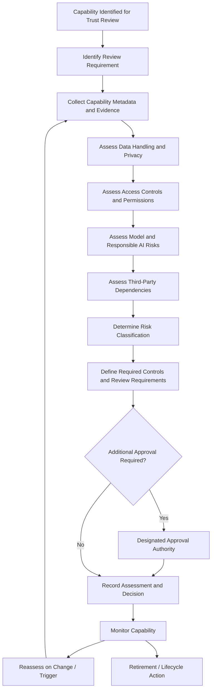

## 6.3 Architecture workflow

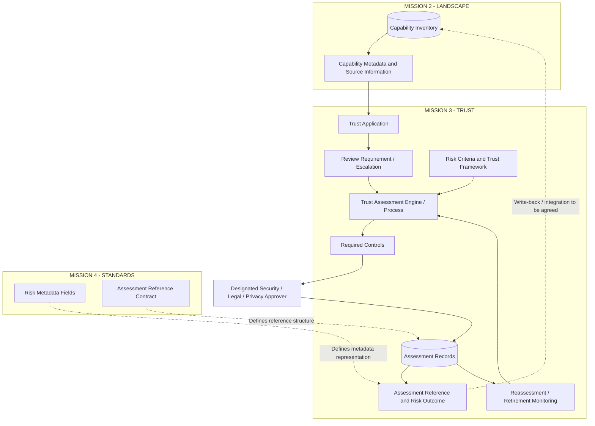

## 6.4 Architecture responsibilities

| Activity | Mission |
|---|---|
| Capability inventory and metadata | M2 |
| Trust Framework and assessment criteria | M3 |
| Risk assessment | M3 |
| Required controls and escalation | M3 |
| Actual approval authority | Designated security / legal / privacy / governance owners |
| Assessment records | M3 |
| Risk metadata structure and reference fields | M4 |
| Risk information in capability inventory | M2, based on M3 assessment |
| Risk and feasibility information for recommendations | M1 consumes relevant information |

**Critical principle:** Mission 3 defines the assessment framework and process. It does not become the sole approval authority for all security, legal, privacy or governance matters.

---

# 7. Cross-cutting workflow – Mission 4 Standards & Interoperability

Although there are four business workflows, the ecosystem must also account for Mission 4's engineering and standards lifecycle.

Mission 4 does not directly own a user-facing business process. Instead, it maintains the shared foundation used by all the workflows.

## 7.1 Actors and use cases

| Actor | Use case |
|---|---|
| Standards Maintainer | Define and update capability metadata. |
| Standards Maintainer | Add or modify manifest fields. |
| Standards Maintainer | Define mandatory and optional field requirements. |
| Standards Maintainer | Define identifiers and versioning. |
| Standards Maintainer | Maintain lifecycle and maturity representations. |
| Standards Maintainer | Validate schema consistency. |
| Standards Maintainer | Check schema compatibility. |
| Standards Maintainer | Publish exchange and validation contracts. |
| Mission teams | Request new fields and metadata requirements. |
| Mission teams | Validate their implementations against common contracts. |

## 7.2 Architecture workflow

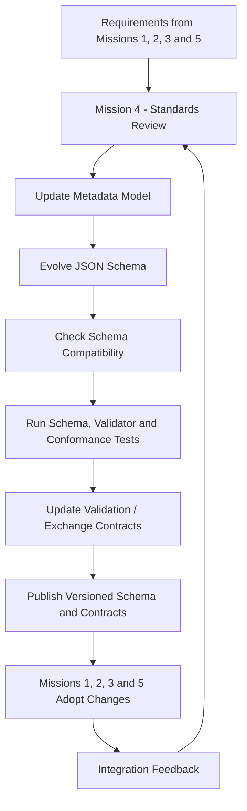

Mission 4's standard must evolve based on actual consumer requirements without independently taking ownership of their business decisions.

---

# 8. Consolidated actor-to-use-case matrix

| Actor | Workflow | Primary use cases | Mission |
|---|---|---|---|
| Capability Consumer | Discovery | Browse, search, filter and compare capabilities. | M2 |
| Capability Consumer | Recommendation | Describe a problem, obtain rankings and explanations. | M1 |
| Capability Consumer | Recommendation | Review cost, fit, risk and limitations. | M1 |
| Capability Contributor | Contribution | Discover existing assets and submit new capabilities. | M5 |
| Capability Contributor | Contribution | Upload files, provide metadata and track submissions. | M5 |
| Contribution Reviewer | Contribution | Review, request changes and hand off submissions. | M5 |
| Capability Owner | Contribution | Update, improve and resubmit existing capabilities. | M5 |
| Landscape Curator | Landscape | Catalogue and curate capabilities. | M2 |
| Landscape Curator | Landscape | Resolve functional duplicates and maintain publications. | M2 |
| Landscape Administrator | Landscape | Track maturity, availability and limitations. | M2 |
| Landscape Administrator | Landscape | Identify gaps and update AI Capability Radar. | M2 |
| Trust Assessor | Governance | Evaluate risk, controls and escalation requirements. | M3 |
| Designated Approver | Governance | Approve or reject matters within delegated authority. | Designated authority |
| Standards Maintainer | Standards | Define manifest, schema and contracts. | M4 |
| Standards Maintainer | Standards | Validate and evolve interoperability rules. | M4 |

---

# 9. Consolidated end-to-end ecosystem architecture

This diagram brings together the four business workflows and shows where Mission 4 supports them.

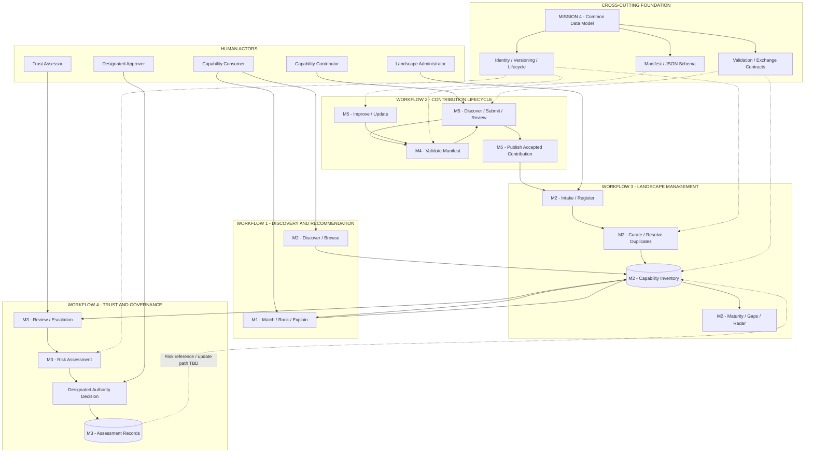

**Diagram note:** This is a target logical business architecture. Dashed relationships represent standards or integrations, not necessarily implemented service calls.

---

# 10. Workflow boundaries and ownership summary

| Business activity | Primary owner | Supporting team(s) |
|---|---|---|
| Browse and explore capabilities | M2 | M4 |
| Understand a business problem and recommend capabilities | M1 | M2, M3, M4 |
| Submit and manage contributions | M5 | M2, M4 |
| Review and improve contributions | M5 | M2, M3 |
| Validate manifest structure and consistency | M4 | M5, M2 |
| Catalogue and maintain inventory | M2 | M4, M5 |
| Resolve functional duplicates | M2 | M4 |
| Assess risks and determine controls | M3 | M2, M4 |
| Grant formal governance approval | Designated authority | M3 |
| Maintain common standards | M4 | All missions |
| Provide accepted capabilities for downstream use | M2 | M1, M3 |
| Manage schema compatibility | M4 | All missions |

---

# 11. Open architectural questions

These decisions should remain visible rather than being assumed in the target architecture.

| # | Question | Teams involved | Why it matters |
|---:|---|---|---|
| 1 | Does Mission 2 offer a dedicated browse/search experience in its application? | M2 | Clarifies the boundary between landscape discovery and recommendation. |
| 2 | Does Mission 1 consume an exchange-document snapshot or a live inventory API? | M1, M2 | Determines the integration mechanism and freshness model. |
| 3 | Does Mission 5's initial discover stage integrate with Mission 2's discovery experience? | M5, M2 | Avoids duplicating discovery functionality. |
| 4 | Does the backend construct manifests from form inputs, or do contributors upload manifests? | M5, M2, M4 | Determines the submission contract and contributor experience. |
| 5 | Who performs technical review, and who handles formal acceptance? | M5, M2 | Establishes review and publication ownership. |
| 6 | At which contribution stage does Mission 3 become involved? | M3, M5 | Defines trust-review triggers and handoffs. |
| 7 | How does Mission 3 write assessment outcomes back to the capability inventory? | M3, M2, M4 | Defines the assessment-reference and risk-update integration. |
| 8 | Who controls publication and the transition to discoverable inventory status? | M5, M2 | Separates contribution acceptance from inventory registration. |
| 9 | What completeness level is required for inventory registration and recommendation? | M1, M2, M5 | Defines acceptance and consumption gates for partial records. |
| 10 | What happens when a capability is updated, deprecated or retired? | M2, M3, M5, M4 | Defines ongoing lifecycle and reassessment behaviour. |

---

# 12. Final consolidated view – 4 + 1 workflow model

## Four business workflows

1. **Capability Discovery & Recommendation** – Consumers explore the landscape or receive ranked recommendations based on their needs.
2. **Capability Contribution Lifecycle** – Contributors discover, submit, review, validate, publish and improve capabilities.
3. **Capability Landscape & Inventory Management** – Landscape administrators discover, catalogue, curate and maintain the inventory and capability radar.
4. **Capability Trust & Governance** – Trust assessors evaluate risks, define controls, escalate reviews and maintain governance assessments.

## One cross-cutting standards workflow

**Mission 4 – Capability Standards & Interoperability Evolution** establishes and evolves the common data model and contracts that connect all four business workflows.

**Five missions, one interconnected ecosystem.**

The four workflows should be used as the baseline for detailed user-journey diagrams, use-case specifications and sequence diagrams. For each workflow, the next design level should define:

- Human actions and system responses.
- Mission ownership and supporting responsibilities.
- Data created, consumed and exchanged.
- Validation points and decision gates.
- Success outcomes and exception paths.
- Integration contracts and unresolved decisions.

This approach moves the ecosystem from a conceptual architecture towards an implementable cross-mission architecture without confusing the responsibilities of the five teams.
