# Mission 4 Explained: What Phase 0 Found, What the Other Missions Are Building, and How It All Connects

| | |
|---|---|
| **What this is** | A guided explanation for readers who are new to the AI mission. It combines three things: the Phase 0 research behind Mission 4's design (the deeper version is [research-explained.md](research-explained.md)); what the other four missions are building, as the Mission 4 team described it; and the architecture question of how the missions should talk to each other |
| **Written** | 2026-11-11, from work done on 2026-11-06, 2026-11-09 and 2026-11-11 |
| **Status** | Nothing here is a final decision. Where the sources are silent, this page says so and labels any suggestion as a proposal |
| **Sources** | The Mission 4 charter (read directly from the `.docx`); [mission-boundaries.md](mission-boundaries.md); [mission-understanding.md](mission-understanding.md); [research-explained.md](research-explained.md); [spikes-1-3-research.md](spikes-1-3-research.md); [poc-report.md](poc-report.md); [phase-1-plan.md](phase-1-plan.md); [skills-and-agents-modelling.md](skills-and-agents-modelling.md); the files in this repository, including [model_capabilities.csv](../research/mission-2/model_capabilities.csv); and statements from the Mission 4 team that are in no document |
| **Handling** | Derived from documents marked "Confidential – Authorized Use Only". Handle this file the same way |

> **How to read the labels.** Every claim has a tag that says how firm it is.
>
> - 📘 **Mission rule**: stated in the charter or the published team boundaries.
> - 📏 **Measured**: counted on real data. The Phase 0 numbers come from [research-explained.md](research-explained.md) and [spikes-1-3-research.md](spikes-1-3-research.md); they were **not re-run** when this page was written.
> - 🧪 **Checked**: I ran it myself between 2026-11-09 and 2026-11-11, with the repository's own tools. The Caveman checks and the CSV profile are in [case-studies/caveman/](../case-studies/caveman/) and [the test results](caveman-manifest-test-results.md). The upload test used scratch files that are **not** in the repository.
> - 🗣️ **Reported**: told to me by the Mission 4 team. It is in no document. Please confirm it.
> - 💡 **Proposal**: a suggestion from the research, the proof of concept, or me. **Not decided.**
> - ❓ **Open**: nobody has answered this yet.
> - 🔗 **Connecting the dots**: a short note that links one section to the next.

---

## Contents

1. The problem in plain words
2. Words you need first
3. Who does what: the five missions
4. What Mission 4 must deliver
5. Phase 0: the research question and how it was tested
6. Phase 0: the sample and what existing formats say
7. Phase 0: findings, journey by journey
8. The standards landscape
9. What counts as one capability?
10. Identity, lifecycle, and versioning
11. The proposed model
12. Mission 4's tools and the three documents it hands over
13. How the missions connect
14. HTTP or events?
15. Case study: a skill with sub-skills (Caveman)
16. Mission 1: a CLI that starts with skills
17. Missions 5 and 2: the upload gap
18. Mission 2's `model_capabilities.csv`
19. What Mission 4 should build next
20. Where things stand
21. Trade-offs, risks, and what this does not prove
22. Open questions and decisions
23. The whole story on one page
24. Test yourself
25. Where to read more

---

## 1. The problem in plain words

### 1.1 An analogy: a library without a common catalogue

Imagine a university library where every publisher writes its own catalogue card, in its own layout.
One card puts the author at the top, another hides it in a footnote, and a third leaves it out. Some
books appear three times under three titles, because three publishers printed them.

Now four departments all need the catalogue:
- a **recommendation desk** suggests books to students;
- a **records office** keeps the master list;
- a **safety office** checks which books are approved for lab use;
- a **donations counter** accepts new books.

Without a common card, each department writes its own translation rules for every publisher. They
make mistakes. The worst mistake is reading a missing safety stamp as "safe".

**AI capabilities have exactly this problem.** An *AI capability* is something a team can adopt and
reuse, such as a skill, an agent, an MCP server, a tool, a plugin, or a workflow (📘 this list of types
is the mission's own). Each arrives with metadata in its own ecosystem's format, and those formats
disagree.

### 1.2 What Mission 4 is for

📘 The charter states the goal as: "establish a common, machine-readable standard to describe,
identify, version, and validate AI capabilities so multiple consumers can use them consistently
without custom mappings."

In library terms, Mission 4 designs **the catalogue card and its rules**. It does not run the library,
recommend books, or stamp them as safe.

### 1.3 The four departments are now being built, in different ways

🗣️ The Mission 4 team described the other teams' current state:

| Department | What the team is building |
|---|---|
| Recommendation desk (Mission 1) | A command-line tool, working only with **skills** for now |
| Records office (Mission 2) | A complete application with a UI, a backend and a database, covering skills, MCP servers and agents |
| Safety office (Mission 3) | A backend application for trust |
| Donations counter (Mission 5) | An upload screen, built together with Mission 2 |

So the catalogue card has to work for a terminal tool, a web application, an upload form and a
backend service at the same time. Most of this page is about what that means.

🔗 **Connecting the dots.** Section 3 puts names on the departments, section 4 says what Mission 4
owes them, and sections 13 to 18 work out where the pieces do not yet fit.

---

## 2. Words you need first

| Term | Plain meaning | Example |
|---|---|---|
| **AI capability** | A reusable AI-related thing a team can adopt on its own | Microsoft's Playwright MCP server |
| **Metadata** | Data that describes something, rather than the thing itself | A capability's name, description, version, license |
| **Native metadata** | What an ecosystem already records about its own items | A `package.json`; a `SKILL.md` header |
| **Manifest** | One file that describes one capability in the common format | `playwright-mcp.capability.yaml` |
| **Schema** | The machine-readable rules for a valid manifest, written in JSON Schema | `capability.schema.json` |
| **Validator** | A program that checks a manifest against the schema and other rules | `capability-manifest validate` |
| **Crosswalk** | A translation table from one native format to the common format | npm `keywords` to manifest `keywords` |
| **Publication** | One place where a capability is distributed | Registry entry, npm package, container image |
| **Provenance** | Where a value came from and how sure we are | "License: stated by npm" versus "Owner: guessed" |
| **Journey** | A real task a user tries to do, written as the questions they must answer | "Find something that already does X before I build it" |
| **Completeness level** | How much a manifest says: `discoverable`, `assessable`, `adoptable`, `governed` | See §11.3 |
| **Bundle** | A capability made of parts | The Caveman plugin: child manifests plus inline components |
| **Sub-skill** | A skill that belongs to a larger skill or plugin | `caveman-commit` inside the Caveman plugin |
| **Exchange document** | A JSON snapshot of valid manifests, handed to other missions | Output of `capability-manifest export` |
| **Validation report** | The validator's JSON result, with exit codes 0, 1, 2 | Output of `validate --format json` |
| **CLI** | Command-line interface: a tool you run in a terminal | `capability-manifest validate` |
| **UI** | User interface: screens a person clicks through | An upload form |
| **Backend** | A server program behind a UI or another program | Mission 3's trust application |
| **API** | A way for one program to call another | `GET /capabilities` |
| **HTTP service** | An API reached over the web protocol. It answers a question now: request in, response out | "Is this manifest valid?" |
| **Event-driven** | A style where programs announce that something happened, through a message system (a **broker**), and others listen | "Capability updated" |
| **Snapshot** | A copy of data at one moment, not live data | An exchange document; the CSV (§18) |
| **MCP**, **A2A**, **Agent Skill** | Protocols and formats for tool servers, agent-to-agent talk, and instruction folders | See research-explained §2 |
| **Model capability** | A task area in which a language model is scored on benchmarks | "coding" in Mission 2's CSV (§18) |
| **Benchmark, Elo** | A test that scores models; Elo ranks them by head-to-head votes | LMArena |

🔗 **Connecting the dots.** Watch for one trap: **"capability"** means "something a team can adopt" to
Mission 4 and "a task a model is good at" in Mission 2's CSV. Section 18 returns to it.

---

## 3. Who does what: the five missions

The initiative's name and overall goal are not stated in the sources (📘 mission-understanding §1).
Mission 4's job is the **structure and rules**. Content, ranking, risk decisions and submissions belong
to the others (📘 agreed when the missions were set up):

> *"The Landscape team owns the inventory's content; this team owns the structure and rules used to
> represent that content."*

### 3.1 The missions as documented

| # | Mission | Owns | Needs from Mission 4 |
|---|---|---|---|
| 1 | Recommendation | The recommendation logic: matching a need to capabilities, ranking, explaining, offering alternatives. Its MVP covers 10-20 capabilities | Fields to judge fit and constraints, read the same way for every type |
| 2 | Landscape | The inventory's content and its radar. Catalogues capabilities, tools, frameworks, platforms. Decides which entries are duplicates | A structure to hold content; the type and maturity vocabularies; the exchange contract |
| 3 | Trust | Risk classifications, assessment criteria, lifecycle expectations (the Trust Framework), with the designated governance owners | The risk fields; a rule that "unassessed" is never "low" |
| **4** | **AI Capability Intelligence & Standards** | **The schema, identifiers, versioning rules, validator and exchange contracts** | (this mission) |
| 5 | Contribution | Contributor engagement and the end-to-end submission process | A validation step: report contract, exit codes, completeness gate |

### 3.2 What each mission is building

🗣️ None of this is in the repository or the charter. The message that described the application team
did not give its number. I take it as **Mission 2**, because Mission 5 is said to build its UI "along
with" it.

| Mission | Building | Capability types in play | What it means for Mission 4 |
|---|---|---|---|
| 1 | A **CLI** | **Skill** only for now; skills with sub-skills may be included | It reads files, so the exchange document fits as it is. It must find what it needs on `skill` manifests (§16) |
| 2 | A **complete application**: UI, backend, database | Skill, MCP server, agent; plus a model-benchmark CSV (§18) | It holds the content, so it is the likely owner of id uniqueness and any live API. The schema says little about agents beyond A2A cards (§15.6) |
| 3 | A **backend application** for trust | Not stated | It will hold assessments, so an `assessmentReference` could point at a record its backend serves |
| 4 | The code and documents in this repository | All 10 capability types | Nothing changes |
| 5 | A **UI**, built with Mission 2, to upload files, a name, a description and other details | Not stated | The upload may not be manifest-shaped. Nobody has confirmed (§17) |

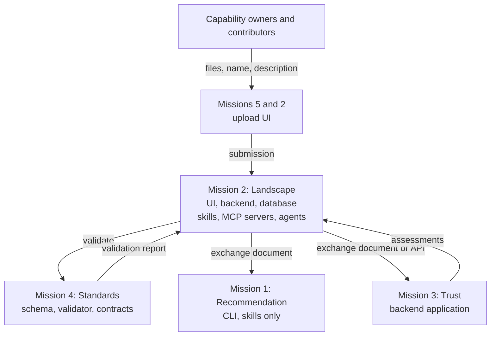

⚠️ Only the arrows that touch Mission 4 are documented. The arrows **between** the other missions are
my reading of the team's description.

🔗 **Connecting the dots.** This split explains why the rest of this page keeps saying "risk is
absent by design" (Mission 3's), "matching is only a test instrument" (Mission 1's) and "the database
is not ours" (Mission 2's).

---

## 4. What Mission 4 must deliver

### 4.1 The charter in brief

📘 **Objectives.** Define a common manifest and metadata model; set naming, identifier, lifecycle and
versioning conventions; define mandatory, conditional and optional fields; provide machine-readable
validation with actionable errors; let downstream consumers use the manifest without per-capability
field mappings.

📘 **Mission 4 does not own** "the capability inventory, recommendation algorithm, governance
approvals, contribution lifecycle, catalog website, automated indexer, or runtime execution
platform" [Charter §9]. Three of those (catalog website, automated indexer, runtime) are **not
assigned to any mission** in the sources.

📘 **Accepted when**: Manifest v0.1 and field docs exist; field requirements and the identifier,
lifecycle, versioning and compatibility rules are documented; five representative manifests cover at
least four types; invalid manifests fail with actionable feedback; errors, warnings and unverified
checks are distinguishable; unassessed risk cannot be read as low or approved; one downstream
consumer works without per-type mappings and a second path is evaluated; limitations and open
decisions are documented [Charter §10].

### 4.2 Where each deliverable stands

| Deliverable | Where it is | Status |
|---|---|---|
| Manifest v0.1 and field documentation | [schema](../schema/0.1/capability.schema.json), [field dictionary](field-dictionary/0.1.md) | Draft; unpublished. The `$id` is the placeholder `schemas.example.com` |
| Schema and validator (JSON Schema 2020-12, YAML), two stages | [src/](../src/), [bin/](../bin/) | Working; Node.js 22 |
| Identifier, lifecycle, versioning, compatibility rules | [manifest-spec.md](manifest-spec.md); `compat`, `schema-compat` | Documented as proposals; id namespace open |
| Risk semantics | `RISK_UNASSESSED`; the exchange view | Implemented |
| Contracts between teams | [schema/contracts/](../schema/contracts/) | Draft |
| Five representative manifests, four types | [examples/valid](../examples/valid/): 8 manifests, 6 types; plus the Caveman case study | Met in POC terms |
| A downstream consumer, and a second path | [consumers.test.js](../test/consumers.test.js); a Python cross-check | **Tests only. No real consumer has integrated** |
| Spike 1-4 documents | [spikes-1-3-research.md](spikes-1-3-research.md) | Findings for Spikes 1-3; Spike 4 presented as the POC report |

Out of scope for now: "automated metadata extraction, catalog indexing, and broader platform
integrations" are potential future enhancements, not commitments [Charter §11].

🧪 The test suite has 206 tests. On 2026-11-09, 204 passed and 2 failed (duplicate-id reporting and
unquoted-`schemaVersion` reporting). The same 2 fail without the Caveman files. I have not
investigated them.

---

## 5. Phase 0: the research question and how it was tested

### 5.1 Why Phase 0 flipped the order

The first proof of concept designed the card *first* and then wrote fictional examples that fitted it.
That cannot show the card helps anyone. The research flipped the order:

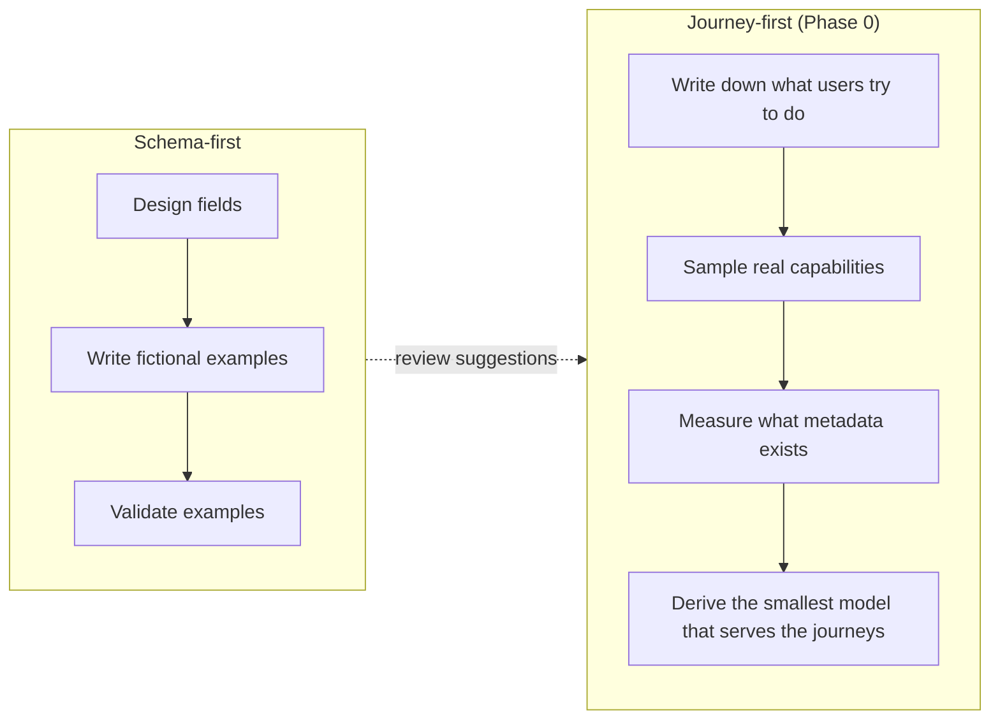

### 5.2 The question and the four journeys

> **Does a common description actually help people find, compare, and reuse AI capabilities? If so,
> what is the smallest description that does it?**

📏 Four journeys were written down before looking at any capability:

| Journey | Who | Goal |
|---|---|---|
| **J1 Find before building** | A developer about to build an integration | Find something that already meets the need |
| **J2 Recognise duplicates** | A developer or curator | Avoid counting one capability twice |
| **J3 Compare and decide** | A team with two or more candidates | Decide to reuse, adapt, or build |
| **J4 Enough information?** | A consumer such as a recommender or reviewer | Know which facts are stated, guessed or missing |

Four concrete needs made J1 testable (N1 let an agent drive a browser; N2 read and update GitHub
issues; N3 live web search with citable URLs; N4 extract text and tables from PDFs). Their relevance
rules were written **before** sampling (pre-registration), so the goalposts could not move.

### 5.3 The method

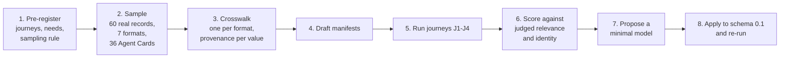

Each extracted value is tagged with how it was obtained: **native** (the record states it),
**linked** (a source it points to states it), **derived by convention** (a documented rule yields it)
or **derived by heuristic** (a guess that must be confirmed).

🔗 **Connecting the dots.** The tags matter later: they let the research count how many records are
usable *without guessing* (§7.5), and they become a field of the model (§11).

---

## 6. Phase 0: the sample and what existing formats say

### 6.1 The sample

📏 **60 capability records** in seven formats, plus **36 A2A Agent Cards** checked separately for
conformance, snapshotted on 2026-10-22.

| Format | Records |
|---|---|
| MCP Registry entry (`server.json`) | 14 |
| npm package | 14 |
| Agent Skill (`SKILL.md`) | 11 |
| Docker MCP catalog entry | 8 |
| Claude Code plugin | 7 |
| PyPI package | 5 |
| GitHub Action | 1 |

Limits the research itself states: one person judged relevance; public capabilities stand in for
internal ones; most records were chosen with the same words J1 searches with; metadata only, nothing
was installed or run; a one-day snapshot.

### 6.2 How often each fact is present

📏 Native means the record states it itself, counted over all 60:

| Fact | Native | Picture |
|---|---|---|
| Name | 60 | `████████████████████` |
| Description | 58 | `███████████████████░` |
| Version | 38 | `█████████████░░░░░░░` |
| Documentation link | 29 | `██████████░░░░░░░░░░` |
| License | 24 | `████████░░░░░░░░░░░░` |
| Lifecycle | 17 | `██████░░░░░░░░░░░░░░` |
| Setup and credentials | 13 | `████░░░░░░░░░░░░░░░░` |
| Limitations | 0 | `░░░░░░░░░░░░░░░░░░░░` |
| Risk assessment | 0 | `░░░░░░░░░░░░░░░░░░░░` (by design: Mission 3) |

### 6.3 Traps: same name, different meanings

| Word | Different meanings observed |
|---|---|
| **skill** | An Agent Skill (a folder); an A2A skill (one ability of an agent); an OASF skill (a taxonomy node) |
| **name** | A machine identifier in most formats; a display label in A2A and GitHub Actions |
| **version** | A release; a metadata republication; a commit; a floating tag such as `latest` |
| **active** | In the MCP Registry, "listed and not deprecated". It does **not** mean maintained |

🔗 **Connecting the dots.** The facts that are almost always present (name, description) help you
*find* a capability. The facts that are almost never present (setup, limitations, license, lifecycle)
are the ones you need to *decide to reuse* it. Section 7 measures that gap journey by journey.

---

## 7. Phase 0: findings, journey by journey

### 7.1 The eleven findings at a glance

| # | Finding |
|---|---|
| 1 | The sources' own search is weak, so discovery depends on how consumers normalise metadata |
| 2 | A shared core exists: name, description, source repository, version, documentation |
| 3 | The facts that decide reuse are the least available: setup, limitations, license, lifecycle |
| 4 | Publications of one capability link reliably from declared links plus repository and path, not from names |
| 5 | Identical name and description do not mean the same capability |
| 6 | Keyword search finds relevant capabilities but with much noise (precision 36-71%) |
| 7 | Passing the schema and being useful are independent |
| 8 | Native formats often do not conform to their own specifications |
| 9 | Lifecycle is rarely machine-readable; deprecations live in prose |
| 10 | Identity breaks in ways the mission anticipated, and in others it had not |
| 11 | An emerging standard (the Linux Foundation's AI Catalog draft) takes the approach the evidence supports |

### 7.2 J1: find a capability for a need

📏 In the official MCP Registry, a search for "github" returns **29,152** results and **GitHub's own
server is at rank 12,080**, because every verified publisher's name starts with `io.github.`. A
simple keyword matcher found nearly everything relevant (N1: 14 of 14), but precision ranged from 36%
(N2) to 71% (N1).
Keeping the **publisher separate from the name** lifted N2's precision from 36% to 62%.

What would have kept the false hits out: publisher kept apart from name; input and output media types
(PDF *viewers* were returned for "extract text from PDFs"); structured abilities with scope ("search
the web" versus "search this site").

### 7.3 J2: recognising the same capability across sources

📏 Microsoft's Playwright server appears four times, under four native names, with three versions
(registry, npm, plugin, Docker). Seven groups of entries were judged to be one capability each, giving
14 true pairs:

| Rule | Correct pairs | False pairs | Missed (of 14) |
|---|---|---|---|
| Declared links only | 11 | 0 | 3 |
| Same repository **and** path | 7 | 0 | 7 |
| **Declared links + same repository and path** | **14** | **0** | **0** |
| Same native name only | 4 | **2** | 10 |

Two different skills are both called `webapp-testing` with identical descriptions, yet differ in
runtime and license. Name matching merged them, which is wrong.

### 7.4 J3: compare candidates and decide

📏 Of 16 relevant capabilities, four had a **blocker** (an archived server still listed; a license
given only as "see LICENSE.txt"; no license; a proprietary skill). **Every** capability had gaps:
limitations were stated for none, setup was missing for 11 of 16, and versions disagreed across
publications for 2.

### 7.5 J4: is there enough information?

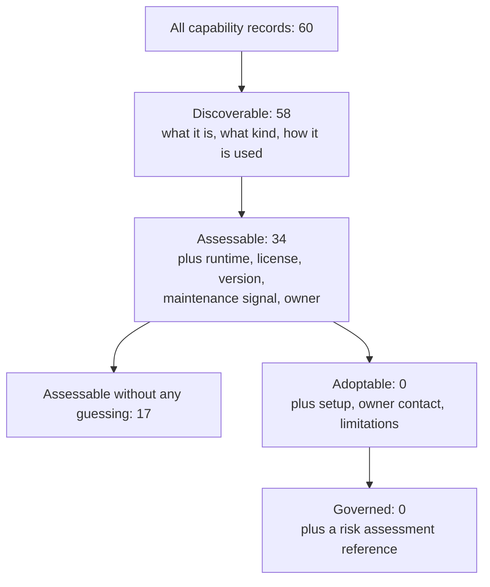

### 7.6 Passing the schema is not the same as being useful

📏 Automatically drafted manifests checked against the schema as it stood on 2026-10-22: only
**12 of 60** were valid. The main cause was a missing `lifecycleStatus` (45 drafts), a field the
schema made mandatory although few sources state it. Meanwhile **29 invalid drafts held enough
information for a reuse assessment**. The list of mandatory fields, not the data, made real
capabilities fail.

### 7.7 A2A Agent Cards

📏 Of 36 public `agent-card.json` files, only **4** validate against A2A v0.3.0. Conformance shows the
shape of a file, not that a working agent stands behind it.

🔗 **Connecting the dots.** Finding works fairly well from existing metadata if publisher and name
are kept apart and publications are grouped. Deciding does not work yet, because the facts it needs
are missing at the source. A rigid mandatory list makes this worse. These three observations drive
the model in §11.

---

## 8. The standards landscape

📘 The manifest is a **description**, not a way to run anything. Mission 4 should define only what no
existing format provides.

| Standard | One line | Proposed stance (💡) |
|---|---|---|
| Agent Skills | A folder format for agent instructions | **Reference** as a native format |
| MCP | Protocol between AI apps and tool servers (runtime) | **Reference**; do not copy |
| MCP Registry `server.json` | Directory entry with verified namespaces | **Reference**; reuse its verification |
| A2A Agent Card | An agent's self-description | **Reference**; reuse its skills and media types |
| AI Catalog (Linux Foundation draft) | A container for listing many kinds of AI artifacts | **Align**: make the manifest convertible |
| JSON Schema 2020-12 | A language for validation rules | **Reuse** |
| SemVer, purl | Version numbers; package addresses | **Reuse** SemVer when it parses; **adopt** purl for package publications |
| OASF | A taxonomy for agent abilities | **Evaluate** with Mission 2 |

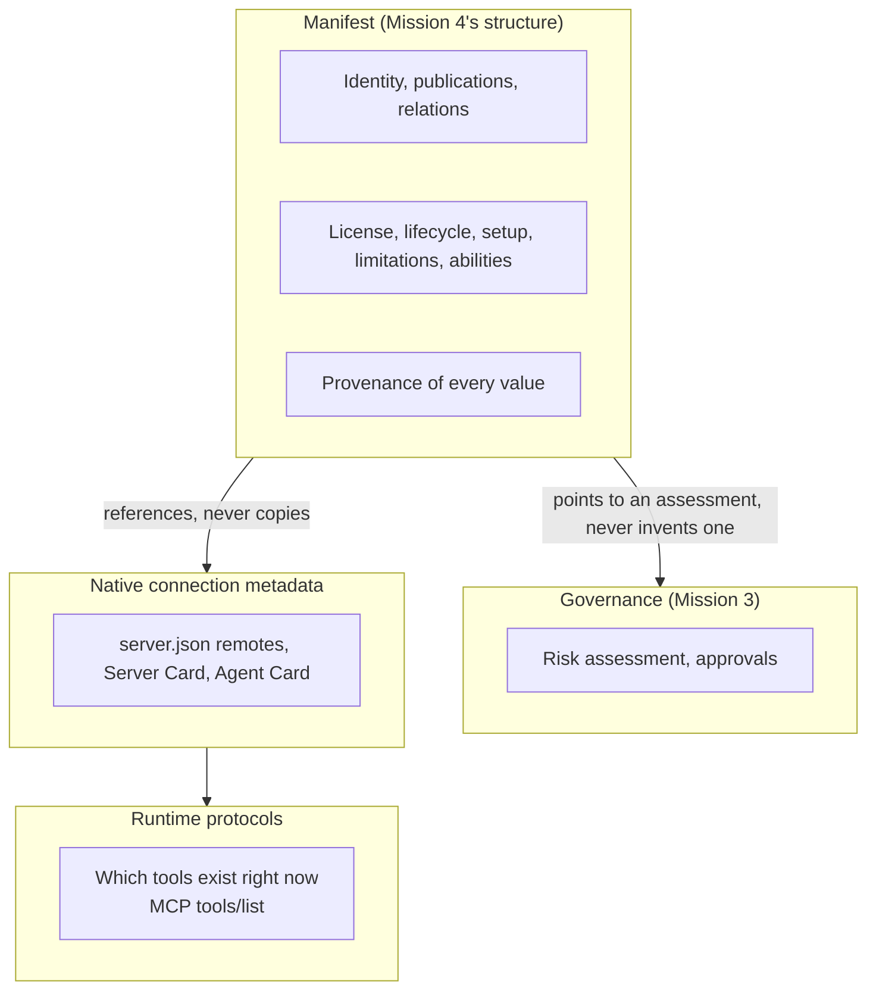

📏 Tools stay out of the manifest because they "can vary by authenticated user, session,
configuration", so a static file cannot list them reliably.

The gaps only a common manifest fills: one record grouping **all publications** with relations to
forks and wrappers; cross-format reuse facts **with provenance**; explicit value states; completeness
levels; and the link to governance.

---

## 9. What counts as one capability?

📘 A capability is "an independently adoptable AI-related asset, tool, service, or solution that can
be described and managed as a distinct unit". The research turned "independently adoptable" into
three tests:

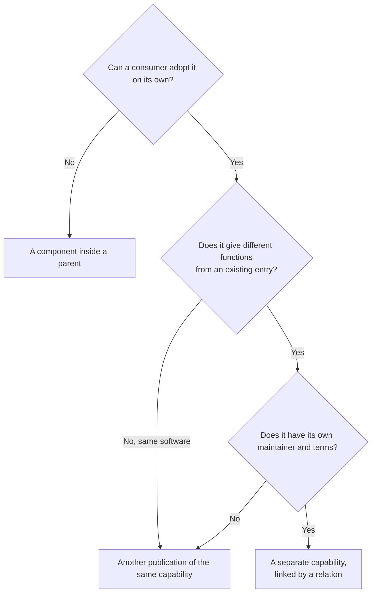

💡 Boundary cases from the sample:

| Case | Proposed treatment |
|---|---|
| A plugin that only configures someone else's server | Same capability; a publication with a `wraps` relation |
| A library that is also an MCP server and a hosted service | One capability, three publications |
| Two skills with the same name and description | Two capabilities |
| A fork republished under another namespace | A separate capability with a `fork_of` relation |
| One repository holding many skills or plugins | Each path is its own capability |
| An A2A agent with several skills | One capability; its A2A skills are *abilities*, not capabilities |

❓ Still open: is a pure wrapper its own inventory entry for Mission 2 (U4)? Where does a bundle end
and its components begin? Section 15 tests this on a real bundle.

📏 Do different types need different metadata? **No.** The core is the same for every type. What
differs is concentrated in four concepts (interface, runtime, setup, dependencies).

---

## 10. Identity, lifecycle, and versioning

### 10.1 Keep three things apart

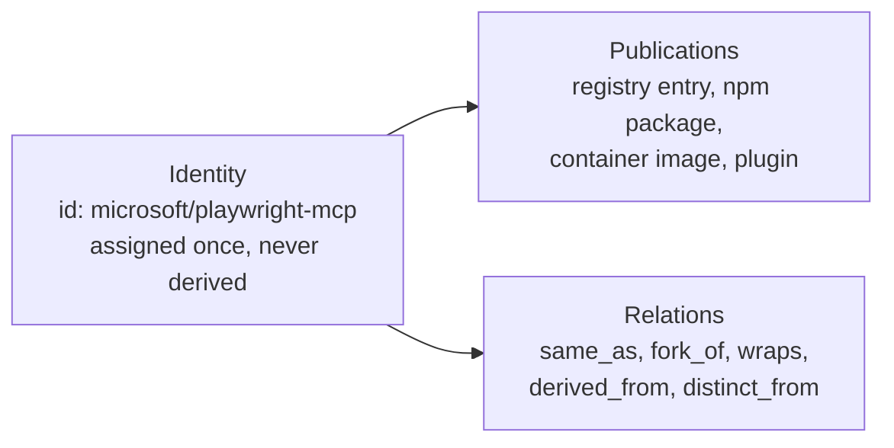

📏 Every attempt to build an id from something that can change failed in a real case: a repository
URL went stale after a rename (GitHub's numeric repository id did not); two publishers ship different
skills both called `pdf`; each channel has its own package name. So the id is **assigned once**, by
the catalog or the contribution workflow. 💡 The readable `namespace/name` form is provisional (U3).

### 10.2 Lifecycle: observed versus declared

📏 Real sources signal lifecycle in many ways; none records a successor in machine-readable form.
💡 The model records **observed signals** per publication, with source and date, and an optional
**owner-declared** `lifecycleStatus` (`experimental`, `active`, `deprecated`, `retired`) that follows
a transition table. 📘 Lifecycle, risk and approval are separate concepts: "active" never means
"approved".

### 10.3 Two kinds of version

| | `schemaVersion` | `capabilityVersion` and publication versions |
|---|---|---|
| Version of what? | The rules | The capability |
| Format | Quoted `"MAJOR.MINOR"`, now `"0.1"` | SemVer for `capabilityVersion`; any native scheme per publication |
| Changed by | Mission 4 | The capability's publishers |

📏 Capability versions in the sample: SemVer 38 records, commit pins 8, and none at all for 13
(including all 11 skills). 💡 Record each native version **with its scheme**; compare only when both
parse; never require SemVer.

---

## 11. The proposed model

### 11.1 Five principles, each from evidence

| Principle | Evidence |
|---|---|
| 1. **Reference** native metadata; restate only what consumers need across formats | Three versions of one capability at once |
| 2. **Separate** identity, publications and relations | Up to four publications per capability; names collide; URLs go stale |
| 3. Every value carries its **provenance** and **state** | Consumers must tell facts from guesses |
| 4. **Require only what every source can supply**; report levels for the rest | One unsupplied mandatory field made 45 of 60 drafts invalid |
| 5. Lifecycle is **observed**; governance is **referenced** | No source supplies risk |

### 11.2 Mandatory fields: from ten candidates to six

| Field | Mandatory now? | Why |
|---|---|---|
| `schemaVersion`, `id`, `name`, `capabilityType`, `source`, `riskTier` | ✅ Yes | Every source can supply them; `riskTier` defaults to `unassessed`, which asserts nothing |
| `description` | Moved to the `discoverable` level | 2 of 60 records have none |
| `owner` | Moved to levels | Often only derivable |
| `lifecycleStatus` | Optional owner declaration | 45 of 60 drafts failed on it |
| `lastUpdated` | Optional | It had two meanings |

### 11.3 Completeness levels: a ladder instead of a wall

The validator **reports how far up the ladder a record gets**, and what the next rung needs. A process
can require a level with `--require-level`.

| Level | Adds | Who usually supplies it |
|---|---|---|
| (valid) | The six mandatory fields | Automatic |
| **Discoverable** | A description and an interface | Automatic, from native metadata |
| **Assessable** | Runtime, license, a version, a lifecycle signal, an owner | Mostly automatic; guesses must be confirmed |
| **Adoptable** | Setup (an empty list means "none"), an owner contact, limitations | The capability owner |
| **Governed** | An assessed risk tier with its assessment reference | Mission 3 and the governance owners |

### 11.4 Value states: saying "I don't know" honestly

| State | How the manifest records it |
|---|---|
| Stated, linked, derived | The value, plus a `provenance[]` entry |
| Declared none | An empty list `[]` |
| Unknown | The field is omitted (`null` is never allowed) |
| Conflicting | Kept per publication; the validator reports it |
| Unverified | A relation with `verified: false` |
| Unassessed risk | `riskTier: unassessed`, **never** read as low |

### 11.5 Before and after

📏 The same 60 records validated three times: **12 of 60** valid under the 2026-10-22 draft; **57** and
then **58** under the revision of 2026-10-23. The revised validator linked all 14 judged
same-capability pairs with no false link, and its completeness levels agreed with the research's own
measurement for 56 of 60.

🔗 **Connecting the dots.** Section 11 is Phase 0's output: the standard itself. Section 12 is how
Mission 4 hands it to everyone else.

---

## 12. Mission 4's tools and the three documents it hands over

### 12.1 The validator

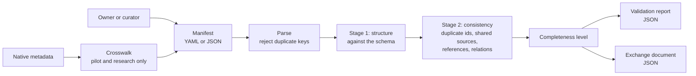

Findings come in three severities: **error** (invalid), **warning** (valid, but probably wrong) and
**unverified** (the check could not be done: *neither passed nor failed*). "Unverified" exists so
that "not checked" is never mistaken for "passed". Duplicate YAML keys are errors, because a common
Python YAML parser reads `riskTier: high` followed by `riskTier: low` as `low`, silently.

| Command | What it does |
|---|---|
| `validate <path...>` | Errors, warnings, unverified checks, completeness level. `--require-level` enforces a level |
| `compat <previous> <next>` | Compares two revisions of one capability and says which version bump the change needs |
| `schema-compat <previous> <next>` | Classifies each schema change as breaking, additive, relaxation or annotation |
| `export <path...>` | Writes an exchange document; no rankings or approvals |
| `docs` | Generates the field dictionary from the schema |

### 12.2 The three documents that cross a mission boundary

| Document | Written by | Read by | Format |
|---|---|---|---|
| **Manifest**: one capability's description | Owners and curators, through the upload workflow | Everyone | YAML or JSON, checked against the schema |
| **Validation report** | `validate --format json` | The contribution workflow (Mission 5) | JSON, [contract](../schema/contracts/validation-report-0.1.schema.json); exit code 0, 1 or 2 |
| **Exchange document**: valid manifests, each unchanged, with its warnings and level | `export` | Missions 1, 2 and 3 | JSON, [contract](../schema/contracts/exchange-document-0.1.schema.json) |

Things also flow back to Mission 4 as agreements, not documents: Mission 3's risk vocabulary and
assessment-reference format, Mission 2's type and maturity definitions, Mission 1's field list and
cost model, Mission 5's required completeness level and id assignment.

### 12.3 What the Node.js code can and cannot do today

🧪 Both findings are from the code:

- **No stable library entry point.** `package.json` is `private: true` and has no `main` or
  `exports`, so another team would import `src/validator.js` by file path. The README says "CLI and
  library", but only the CLI is a declared entry point.
- **Not runnable in a browser.** `src/validator.js` and `src/schema-registry.js` import `node:fs` and
  load the schema from disk. A UI cannot call the validator directly; it needs a server step.

---

## 13. How the missions connect

### 13.1 Data flow

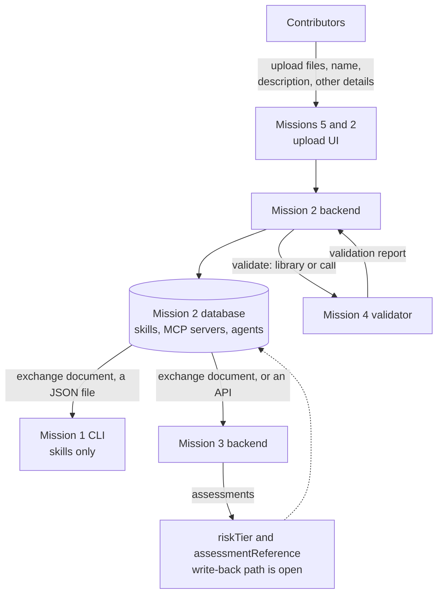

⚠️ Only the arrows that touch Mission 4 are documented. It is also not stated whether Mission 5's
workflow is a separate backend or part of Mission 2's. The model benchmark data (§18) is not drawn,
because its purpose is unknown.

### 13.2 Each interaction

| # | From -> to | What moves | Mission 4's part | Defined? |
|---|---|---|---|---|
| 1 | Contributor -> upload UI | Files, name, description, other details | Field dictionary, authoring guide | **Format open** (§17) |
| 2 | Upload UI / backend -> validator | A manifest, or the data to build one | `validate`, report contract, exit codes, `--require-level` | Offered to Mission 5; adoption unconfirmed |
| 3 | Backend -> database | Accepted manifests | Nothing | **No** ❓ |
| 4 | Mission 2 -> Mission 1 | Exchange document | `export`, contract | Suggested for the MVP; fit with ingestion unverified |
| 5 | Mission 2 -> Mission 3 | Exchange document, or an API | `export`, contract | Mechanism undefined |
| 6 | Mission 3 -> manifest | A tier and an assessment reference | The two fields; an assessed tier must cite its assessment | Fields yes; **write-back path no** ❓ |
| 7 | Mission 2 <-> Mission 4 | Type, maturity and ability vocabularies | The fields | Agreement pending (§18) |

---

## 14. HTTP or events?

### 14.1 What the sources say

Nothing. The charter, the boundaries and the POC report do not mention HTTP services, events or
messaging between missions. What exists, as listed in [mission-understanding §8.9](mission-understanding.md):

| Integration path | Status |
|---|---|
| Exchange document (a file under a contract schema) | POC. Simple and language-neutral; a snapshot, not live data |
| Library API (`validateFiles`, `validateManifests`, `validateManifestText`) | POC. Direct, but tied to Node.js |
| Validation report and exit codes, for CI or the workflow | POC. Fits automation; does not deliver content |
| A live service or catalogue API | Not built. It "would fall under catalogue infrastructure, which Mission 4 does not own" |

### 14.2 What each stack implies

Inference from §3.2, not from any source.

| Mission | Form 🗣️ | What fits | What gets in the way |
|---|---|---|---|
| 1 | CLI, skills | Read an exchange file, print a result. Needs no protocol | Reading only `skill` loses the parent's constraints (§16) |
| 2 | UI, backend, database | The backend holds the content, can enforce unique ids, and is the natural owner of a live API. It embeds or calls the validator | The validator is Node.js only. If Mission 2's backend is another language it needs a call or a conformance suite |
| 5 | UI with Mission 2 | Server-side validation; show each finding's path, line and hint | A hosted validator that checks "is the source reachable" would fetch URLs written by untrusted submitters (SSRF risk). An upload has no URL to check anyway |
| 3 | Backend | Service-to-service JSON | No defined write-back path |

A backend for Mission 3 also makes possible what the sources call unverified: an
`assessmentReference` that can be **resolved** to a record, not only quoted. 💡 Ask Mission 3 for a
reference format that its backend can serve.

### 14.3 The three options

| Option | How it works | Fits | Costs |
|---|---|---|---|
| **A. Files, library, CLI** (today) | Documents are written to files or passed in-process | Mission 1's CLI; CI jobs; any Node.js service | Non-Node backends and UIs have no good way in |
| **B. Request/response over HTTP** | A service answers a question now: a validate call, a read of the inventory | The UIs; a backend in any language | Someone must host it. For **inventory content** that is Mission 2's backend. For **validation only**, Mission 4 could wrap its validator, which the charter does not exclude, but hosting is infrastructure |
| **C. Events** | Messages such as "manifest submitted" or "assessment completed" go through a broker | Many consumers that must react when a capability changes | A broker that no mission owns. Mission 4 would only define the payload shape |

HTTP answers a question now ("is this manifest valid?"). Events announce that something happened ("a
capability changed") to whoever listens. Option A is neither: it hands over a snapshot.

### 14.4 Recommendation

💡

1. **Define the documents, not the transport.** The manifest, report and exchange document are plain
   JSON. The same document can be a file, an HTTP body or an event payload without change.
2. **The live inventory API belongs to Mission 2.** It has the backend and the database. Mission 4
   should not build a catalogue API, a broker or a database.
3. **Make the validator easy for Mission 2's and Mission 5's backends to use** (§19, items 1-4). Ask
   first which language they use.
4. **Build a stateless validate-and-export endpoint only if** their backend cannot embed a library.
   Nothing stored, source checks off. Ask the programme who hosts it before writing it.
5. **Define event payloads only if the programme chooses events.** The minimum is an envelope (event
   name, time, capability id, schema version) around the existing documents. Illustrative names:
   `manifest.submitted`, `manifest.validated`, `capability.updated`, `assessment.completed`.
6. Mission 1's CLI needs none of this: it reads the exchange file that Mission 2 produces.

### 14.5 Questions for the programme, not for Mission 4 alone

| Question | Why it matters |
|---|---|
| Is there an agreed integration style across missions? | Decides whether Mission 4 follows a rule or proposes one |
| What language are the Mission 2, 3 and 5 backends written in? | Decides library, endpoint or conformance suite |
| Who hosts shared services? | An endpoint has no home without an answer |
| Do manifests live in Mission 2's database? Who assigns ids? | Global id uniqueness needs "a registry or inventory" |
| How does an assessment get into the manifest, and who edits it? | Interaction 6 has no path |
| Who owns the catalog website, the indexer and the runtime? | Unassigned in the sources; Mission 2's UI may be the catalog website, which I cannot confirm |

---

## 15. Case study: a skill with sub-skills (Caveman)

This section answers where the first questions of this project ended up: how skills with sub-skills
are mapped, how a user starts one, and why "agent" looked A2A-only. The subject is the real Caveman
plugin for Claude Code, v4.1.0, installed as `caveman@caveman`. 🧪 I read the repository at commit
`3dc497a` on 2026-11-09 as data and ran nothing from it.

### 15.1 What the plugin contains

| Group | Count | Members | How they start |
|---|---|---|---|
| Voice skills | 3 | `caveman`, `ultracave`, `megacave` | `/caveman`; `/ultracave` or `/caveman ultra`; `/megacave` or `/caveman wenyan`. The last two are user-only |
| One-shot skills | 2 | `caveman-commit`, `caveman-review` | Slash command or description match |
| Helpers | 3 | `caveman-compress`, `caveman-help`, `caveman-stats` | Slash command |
| Delegation | 1 + 3 | Skill `cavecrew`; subagents `cavecrew-investigator`, `-builder`, `-reviewer` | The model delegates |
| Cloud and CLI drivers | 7 | `caveman-setup`, `-discover`, `-manage`, `-optimize`, `-evidence-review`, `-learn`, `-explore` | Description match |
| Work patterns | 6 | `investigate-first`, `lean-build`, `surgical-patch`, `safe-refactor`, `migration`, `verify-and-stop` | Description match |
| Command and hooks | 1 + 4 | `caveman-init`; hooks `SessionStart`, `SubagentStart`, `UserPromptSubmit`, `SessionEnd` | `/caveman-init`; events |

That is **22 skills, 3 subagents, 1 command and 4 hooks**. The modes (`off`, `caveman`, `ultracave`,
`megacave`, `commit`, `review`, `compress`) are not settings of one skill: each is a **skill that sets a
state**. My first version of this analysis, built from a README summary, got this wrong; the real
files corrected it.

### 15.2 How a user starts a skill

📘 These are Claude Code's semantics; other hosts differ. The manifest records none of this: it
describes the capability, and the host starts it.

| Trigger | Who decides | Mechanism |
|---|---|---|
| Natural language | The host's model | Descriptions of installed skills are always in context; the model loads a skill when the request matches its `description` |
| Slash command | The user | Types `/skill-name`; plugin skills are also `/plugin:skill` |
| Hook (automatic) | The plugin | A `UserPromptSubmit` hook parses `/caveman`; a `SessionStart` hook resolves the default mode |
| Programmatic | Another component | A skill forked into a subagent, or one skill telling the model to follow another |
| Organization step | A person or process, before any session | The skill is found, assessed and installed. **This is the manifest's moment** |

Two flags restrict the first two rows: `disable-model-invocation: true` (only the user can start it;
Caveman sets it on `ultracave` and `megacave` only) and `user-invocable: false`.

**Worked example.** 🗣️ The sentence "I have shared the ticket details, analyze the ticket and make a
plan to implement these changes" is, at the organization layer, a **need** (journey J1): Mission 1
would match it against manifests. At the host layer the request arrives and the host matches it
against skill descriptions. If one says something like "use when the user shares a ticket and wants
an implementation plan", it loads; if none does, the base model answers alone. A ticket ID or URL
needs a connector such as an issue-tracker MCP server. **Caveman would not trigger on that request**:
it compresses replies and does not plan work.

### 15.3 How the plugin is modelled

A part gets its own manifest when the repository itself calls it independent or self-contained
(the adoption test of §9, answered by the owner). Everything else stays inline.

| Result | Parts | Why |
|---|---|---|
| Own manifest, linked with `parent` and `components` (5) | `caveman`, `ultracave`, `megacave`, `caveman-commit`, `caveman-review` | The repository says so, or ships the part alone |
| Inline in `embeddedComponents` (25) | 17 skills, 3 subagents, 1 command, 4 hooks | Not stated to be independent, or tied to hooks, the CLI or Cloud |

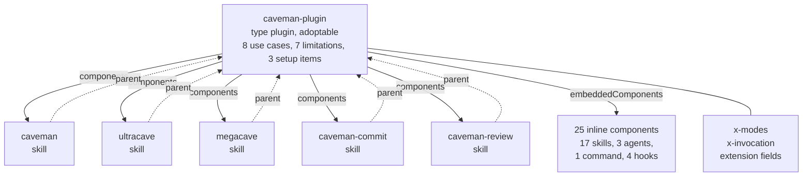

The manifests are in [`case-studies/production-set/manifests/caveman/`](../case-studies/production-set/manifests/caveman/) (the test scripts stay in [`case-studies/caveman/`](../case-studies/caveman/)): one plugin and five skills. The
split is a **judgment**, and the validator reports `/components` as unconfirmed until the owner or a
curator confirms it.

### 15.4 What was tested

🧪

| Check | Result |
|---|---|
| Schema validation | 6 of 6 valid, 0 errors, 0 warnings |
| Source reachability | 6 of 6 reachable |
| Python cross-check (independent validator) | Agrees with the Node.js validator |
| Exchange export | 6 exported, 0 rejected; matches the contract |
| Fact check against the repository and GitHub API | 44 of 44 |
| Deliberate-error mutations | 22 of 22 caught |
| Existing test suite | 204 of 206 pass; the same 2 fail without these files |

Schema validity says a manifest is well formed, not that its values are true; the fact check covers
that. It found a real portability bug: the mode id `off` unquoted is read by YAML 1.1 parsers as
`false`.

### 15.5 Gaps the real bundle exposed

| # | Gap | Effect |
|---|---|---|
| G1 | `embeddedComponents[].type` allows only `prompt, command, hook, resource, tool, other`; `skill` and `agent` are rejected | 20 of the 25 inline components are typed `other`, with the kind carried in the name  **Resolved 2026-11-13:** `skill` and `agent` were added to the schema ([phase-1-changes-explained.md](phase-1-changes-explained.md), C2). |
| G2 | The crosswalk ignores invocation and permission keys (`disable-model-invocation`, `tools`, `model`) | A catalog cannot tell a user-only skill from an auto-loaded one |
| G4 | No home for "how to start it" | Recorded in an `x-invocation` extension that core consumers ignore |
| G5 | The 300-character cap on embedded descriptions bit once (`cavecrew-builder` is 301) | The value was left out, never shortened |
| G6 | Modes have no structured home | `x-modes` carries them |
| G7 | Data egress and credentials exist only as prose | Mission 3 cannot query them |
| G8 | One capability ships in several host packagings (Claude Code, Codex, Cursor, Gemini) | Scoped to Claude Code; the others are open (U18) |
| G9 | `dependencies` can only name capabilities that have manifests | The Caveman CLI and Cloud are described in text |

### 15.6 Why "agent" looked A2A-only

The premise needs one correction: `agent` **is** a capability type. What is missing is agent-specific
**content**; the only agent-specific description is the A2A card. I found no document that records
"agents are A2A-only" as a decision. The reasons the documents support (inferred):

1. **Reference, don't restate**: A2A's Agent Card is the one standard agent contract in the sample.
2. **No evidence about other agents**: none of the seven sampled formats defines an agent. Caveman adds
   three subagent files, but from one publisher.
3. **One common core**: per-type profiles are not supported by the evidence.
4. **Agent risk belongs to Mission 3**: model risks, access controls and data handling are a deliberate gap.
5. **The abilities vocabulary is open** (U5).
6. **Coverage is not promised**: "support for every platform or capability type is not assumed".

Agent facets with no field today: the model used (`model: haiku` on two Caveman subagents), tools and
permissions, autonomy, and state. 💡 Add `skill` and `agent` to `embeddedComponents[].type` first
(cheap, affects 20 of 25 components); collect about 10 agent definitions from at least three publishers
before widening A2A; trial the facets as `x-agent` extension fields until Mission 3 says what it
needs. Phase 1 allows no direct schema edits, so each enters as a decision record.
Details: [skills-and-agents-modelling.md](skills-and-agents-modelling.md).

---

## 16. Mission 1: a CLI that starts with skills

🗣️ Mission 1 starts with `capabilityType: skill`, and sub-skills may be added. That is the type with
the most evidence behind it, and Caveman is a good test.

🧪 I exported the six Caveman manifests and filtered to `skill`:

| What a skills-only reader finds | The 5 skill manifests | The 1 plugin manifest (the parent) |
|---|---|---|
| Completeness | `assessable` | `adoptable` |
| `supportedUseCases` | 0 each | 8 |
| `limitations` | 0 each | 7 |
| `setup` | 0 each | 3 |
| AI hosts (`publications[].platformCompatibility` since 2026-11-16) | not provided | `claude-code` |
| `description`, `interfaces`, `runtime`, `license`, `owner`, `parent` | provided | provided |
| Publication (how to install) | A repository path | The marketplace entry `caveman@caveman` |

A CLI that reads only `skill` manifests would see five skills with no use cases, no limitations (such
as "saves nothing on agents billed per request") and no platform. It would also point at a repository
path when the Claude Code install unit is the plugin.

💡 **Options.**

| Option | Cost | Notes |
|---|---|---|
| **A. Mission 1 follows `parent`** to the plugin | A small change in the CLI | `parent` is already in the exchange document |
| B. Repeat the key facts on each child | Authoring effort and duplication | I can trial it on Caveman |
| C. One `skill` manifest with the children inline | Loses independence | Contradicts the repository's own statement that five skills are self-contained |
| D. A rule that children inherit from the parent | A schema decision | Not now: Phase 1 allows no direct schema edits |

💡 Use A now, ask Mission 1 to confirm, and try B on Caveman to see how much duplication it needs.

---

## 17. Missions 5 and 2: the upload gap

🗣️ The upload UI collects files, a name, a description and other details. Nobody knows whether that
arrives as a manifest. Mission 4 cannot make contributors write manifests, so the question is who
turns what they enter into one, and what Mission 4 gives them to do it.

### 17.1 What a form needs to produce

🧪 Tested with the repository's validator:

| Payload | Result |
|---|---|
| Only a name and a description | **Invalid**: 5 required fields missing (`schemaVersion`, `id`, `capabilityType`, `source`, `riskTier`) |
| Plus values the workflow supplies: `schemaVersion: "0.1"`, an assigned `id`, `source: { type: other, description: ... }`, `riskTier: unassessed`, and a `capabilityType` the contributor chooses | **Valid**, completeness `none` (needs an interface) |
| Plus `interfaces: [{ type: agent_skill }]` | `discoverable` |
| Plus owner (name, contact), license, a version, runtime, `setup: []` and `limitations: []` | Still `discoverable`; the validator says `assessable` needs a lifecycle signal |
| Plus `lifecycleStatus: active` | **`adoptable`**; `governed` needs a risk assessment |

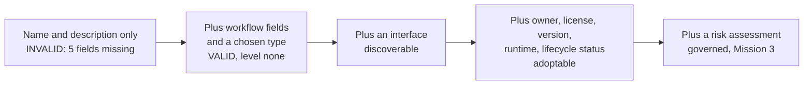

| Supplied by | Fields |
|---|---|
| The workflow, never the contributor | `schemaVersion`; `id` (the schema says it is "assigned once by the catalog or the contribution workflow"); `riskTier: unassessed` (Mission 3 owns tiers); `lastUpdated`; `source` for an uploaded file (type `other`) |
| The contributor chooses | `name`, `description`, `capabilityType` |
| The contributor adds for `discoverable` | The interface kind (for a skill, `agent_skill`) |
| The contributor adds for `assessable` | Owner name, license, a version, the runtime or host, a lifecycle status |
| The contributor adds for `adoptable` | Setup needs, owner contact, limitations (or "none") |

### 17.2 Three ways to get there

| Path | How | What Mission 4 owns | Risk |
|---|---|---|---|
| **A. Form to manifest** | The UI collects fields; the backend assembles the manifest and validates it | The schema and field dictionary the form is built from; the field list above | The form can drift from the schema unless generated from it |
| **B. Native file to draft** | The contributor uploads a `SKILL.md` (or `server.json`); the backend extracts a draft | The crosswalks in [pilot/](../pilot/) and [research/spikes-1-3/](../research/spikes-1-3/) show how, for seven formats | Extraction is a "potential future enhancement" in the charter, and where a crosswalk ends and an indexer begins is ❓. Extracted values need an owner's confirmation (`provenance.confirmedBy`) |
| **C. Manifest upload** | The contributor writes the YAML | Everything | Fits technical contributors only; the validator's messages show path, line and fix |

💡 The manifest should be what the backend produces, not what the contributor types. Mission 4 can
start now, without waiting for anyone, on a **submission profile**: the table above, a sample JSON
payload for each completeness level, and golden valid and invalid cases for the other teams' tests.
Which path Missions 5 and 2 take decides whether Mission 4 also offers path B as a library.

---

## 18. Mission 2's `model_capabilities.csv`

🧪 The file is [model_capabilities.csv](../research/mission-2/model_capabilities.csv) (moved from the repository root on 2026-11-16), not yet tracked by
git. I profiled all of it.

### 18.1 What it is

A **leaderboard of language models by task**, not a list of adoptable assets. Each row is one model's
score on one benchmark.

| Property | Value |
|---|---|
| Size | 4,222 rows, 18 columns, no malformed rows |
| A row | A model, a benchmark, a score and a rank, for example `Gemini 4 Carbon (High)`, `LMArena Text - Coding`, 1569.49, rank 1 |
| `capability` values | 12: general, reasoning_math, coding, code_review, instruction_following, creative_writing, image_understanding, web_development, document_summarization, image_generation, image_editing, search_research |
| Benchmarks | 22, from two sources: LMArena (3,287 rows) and Epoch AI (935) |
| Evidence | `direct` 3,728 rows; `proxy` 494. All 452 `code_review` rows are proxy |
| Snapshot | One fetch for every row: 2026-10-29T06:15:14.880Z |
| Rows about skills, MCP servers, agents, plugins or tools | **0** |

### 18.2 Same word, different meaning

| In the CSV | In the manifest |
|---|---|
| `capability`: a task area where a **model** is scored | A capability is an independently adoptable asset |
| `source`: who published the numbers | `source`: where the capability's code or entry lives |
| `evidence`: `direct` or `proxy` | `provenance`: native, linked, derived or curated, with a basis and a date |
| `model_key` | `id`: stable, permanent, never derived from a name |
| `organization` | `owner` |
| `fetched_at` | `provenance[].observedAt` |
| `score`, `rank`, `ci_low`, `ci_high`, `votes` | No equivalent. The manifest holds no benchmark results |

Mission 2 treats "capability" as a **measured ability of a model**; Mission 4 treats it as a **thing a
team can adopt**. Neither is wrong, but one word carries two meanings across the programme.

### 18.3 Data quality

| Observation | Count |
|---|---|
| Model keys versus display names | 800 keys, 1,273 names; 206 keys cover more than one name. `claude-opus-5-5` appears as five names, including effort variants ("High", "Max", "medium") and raw ids |
| `organization` blank | 331 rows (7.8%) |
| Organization spelled two ways | 12 groups differing only in case or punctuation (google / Google, openai / OpenAI) |
| Several organizations in one cell | Comma-separated, for example `Google DeepMind,Google` |
| `votes` and `source_rank` blank | 935 rows: every Epoch AI row |
| Confidence interval blank | 174 rows |
| `published_or_release_date` | 2,645 rows (62.6%) carry 2026-10-28, all LMArena: for those it is the leaderboard date, not a release date. 5 rows are blank |
| Score units | `elo` 3,287; `fraction` 594; `index` 270; `percent` 71. Scores cannot be compared across benchmarks |
| The same scores under two abilities | All 33 SWE-bench Verified scores appear under `coding` (direct) and again under `code_review` (proxy) |
| Same key, two rows | `GPT-5.3-Codex (Codex Harness)` in `web_development` appears twice with different ranks (96, 112), scores and votes |
| Coverage | No model appears under all 12 abilities; from 488 models (general) to 42 (search_research) |
| Harness variants | 9 model names include "Codex Harness": a model run inside an agent harness, closer to an agent than a model |

The model-identity problem is the one Phase 0 already studied for capabilities: names change and
variants multiply, so identity needs a rule that does not depend on the display name.

### 18.4 Where it could connect to the manifest

❓ Not decided by anyone. Three candidate links:

1. **An ability vocabulary (open question U5).** The Phase 0 research asks "which vocabulary for
   abilities, if any (free text, A2A-style, OASF)", to be settled with Missions 1 and 2. The CSV's 12
   values are the nearest thing to a Mission 2 vocabulary. 🧪 I judged Caveman's 8 use cases against
   them (one judge, me, so indicative only): **2 map cleanly** (reviewing a diff to `code_review`;
   compressing a memory file to `document_summarization`), **3 partly** (terse commit messages,
   delegating lookups and edits, task-shaped work patterns, all near `coding`), and **3 not at all**
   (making replies terse, showing token usage, reducing LLM spend). A list built to rank models does not
   cover style, telemetry or cost.
2. **A reference to a model.** The schema has no field for the model an agent or skill uses. Caveman's
   `caveman-explore` skill and two of its three subagents set `model: haiku`. The CSV has at least
   four Haiku families (`claude-3-haiku`, `claude-3-5-haiku`, `claude-haiku-4-5`, `claude-haiku-5-5`),
   so "haiku" would need an alias table and a date to resolve, and the unstable model key makes that
   harder.
3. **A new capability type, `model`.** The 10 types include none. A hosted model could arguably be a
   `service`. 💡 Do not add a type now: the CSV records measurements, which the manifest does not hold,
   and Phase 1 forbids direct schema edits. Record it as a decision for the next round.

### 18.5 Questions for Mission 2

| Question | Why it matters |
|---|---|
| What is the CSV for: a model-comparison page, or a taxonomy for all capabilities? | Decides whether it feeds U5 or stays separate |
| Does Mission 1 use it, for example to pick which model runs a recommended skill? | It would make a model reference necessary |
| Which id identifies a model, and how are effort variants and harnesses handled? | The same identity problem as capability ids |
| How often is it refreshed? | It is one snapshot, 13 days old on 2026-11-11 |
| Canonical organization names, one organization per row? | Needed for any join with `owner` |

---

## 19. What Mission 4 should build next

### 19.1 Already built

Schema 0.1 and the field dictionary; the validator with completeness levels; the `validate`, `compat`,
`export`, `schema-compat` and `docs` commands; the two contracts; 8 example manifests; the journey
pilot; the Phase 0 research harness on 60 real records; a Python cross-check; the Caveman case study.

### 19.2 Next, in order 💡

| # | Build | Why | Needs a decision from |
|---|---|---|---|
| 1 | A **submission profile**: field list by who supplies it, sample payloads per level, golden valid and invalid cases | The upload UI team can build and test against it now (§17) | Nobody |
| 2 | Publish the schema at a real, immutable URL | The `$id` is a placeholder; any backend or UI can then fetch the schema | Nobody |
| 3 | A stable library entry point, installable by other teams | `package.json` is `private` with no `main` or `exports` | Where internal packages are published |
| 4 | The YAML profile and a conformance suite (golden files) | Lets a non-Node backend reach the same verdicts as the validator | Nobody |
| 5 | Try per-child facts on Caveman (§16, option B), then rerun the checks | Shows whether a skills-only Mission 1 can work without following `parent` | Mission 1 |
| 6 | Integrate one real consumer: Mission 1's CLI reading an exchange file | The charter requires a downstream consumer; only tests exist | Mission 1 |
| 7 | A draft-from-native-file function (§17, path B) | Only if Missions 5 and 2 take that path | Missions 5 and 2 |
| 8 | A pure core split from the Node file access; a stateless HTTP wrapper | Only if a backend or UI cannot embed the library | The languages and hosting questions in §14.5 |
| 9 | Event payload envelope | Only if the programme picks events | The programme |
| 10 | Decision records for the ability vocabulary (U5), a model reference, and the `model` type | The CSV and Caveman's `model: haiku` both need an answer (§18.4) | Missions 1 and 2 |
| 11 | CI, with `schema-compat --corpus` on every schema change | There is no CI in the repository; it would catch the 2 failing tests | Nobody |

Items 1, 2, 4 and 11 need no one else.

### 19.3 Do not build

The inventory or its database, a catalogue website or indexer, any ranking or recommendation, risk
assessments or approvals, the submission workflow or its UI, and anything that runs a capability
[Charter §9]. The manifest "is a metadata and description contract, not a runtime execution
protocol" [Charter §8].

---

## 20. Where things stand

| Item | State on 2026-11-11 |
|---|---|
| **Phase 0** | Produced the draft schema 0.1 and ten open questions, U1 to U10 |
| **Phase 1** | Four tickets, one per teammate: standards (A), metadata model (B), identity and lifecycle (C), evidence and consumers (D). Decision records are due Nov 9 and the plan assumes a review on Wed Nov 11. The repository has no `phase1/` folders, so I cannot say what has been written |
| Spike findings | No spike has produced findings that confirm or reject a POC decision |
| Other missions | Nobody outside Mission 4 has confirmed that the exchange document fits their ingestion |
| Real consumers | None has integrated |
| Real internal capabilities | None yet. Phase 0 used public ones |
| Source reachability | Unverified for all six Caveman manifests (`SOURCE_NOT_CHECKED`); the check is offline by default |
| Files | Everything new is untracked in git, including the CSV. Nothing has been committed |

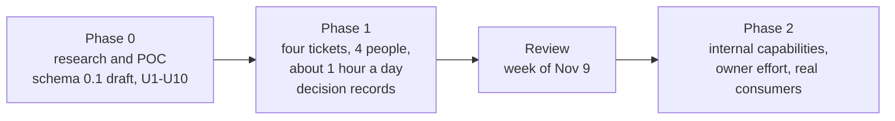

---

## 21. Trade-offs, risks, and what this does not prove

### 21.1 Trade-offs

| Choice | Benefit | Cost |
|---|---|---|
| Reference native metadata instead of copying it | No drift | Consumers must follow references, or a catalog must cache them |
| Several publications per capability | Matches reality; removes duplicates | More complex records |
| Provenance on every value | Honest uncertainty | Larger records; tooling needed |
| Completeness levels | Every capability can enter | Consumers must handle partial records |
| Assigned ids | Stable across renames | Someone must run an allocation process |
| Manifest produced by the backend, not typed by contributors | Contributors never see YAML | The form and backend must stay in step with the schema |
| Documents defined, transport left open | Works for a CLI, a UI and a backend alike | Someone else must choose and run the transport |

### 21.2 Risks

| Risk | Mitigation |
|---|---|
| Public capabilities do not represent internal ones | Iteration with internal capabilities |
| The upload format is not manifest-shaped | A submission profile and golden cases; ask Missions 5 and 2 early |
| A skills-only Mission 1 loses parent constraints | Follow `parent`, or repeat key facts on children |
| "Capability" means two things across the programme | A shared glossary; a decision on the CSV's role |
| Guessed values get trusted as facts | Provenance on every value |
| Owners find the adoptable level too costly | Measure owner effort before requiring it |
| Scope creep into search, ranking, hosting | Keep the harness a test instrument; hosting and ranking belong to others |

### 21.3 What the results do **not** show

- That internal capabilities behave like public ones.
- That the completeness levels suit Missions 1, 2 and 5.
- That owners will supply setup and limitations.
- That drafted guessed values are correct.
- That Caveman is typical: it is one publisher, and I did not install or run it.
- How the other missions really integrate: their arrows in §13 are my reading.

---

## 22. Open questions and decisions

### 22.1 Phase 0 questions

❓ None is decided.

| # | Question | Who decides |
|---|---|---|
| U1 | Adopt completeness levels instead of a fixed mandatory set? (Applied to the draft; to confirm) | Mission 4, with Mission 5 |
| U2 | Fold `source` into `publications[]`? | Identifier and lifecycle research |
| U3 | Readable namespaced id or URN? Who allocates namespaces? | Identifier and lifecycle research, with Missions 5 and 2 |
| U4 | Is a configuration-only wrapper a publication or its own inventory entry? | Metadata-model research, with Mission 2 |
| U5 | Which vocabulary for abilities, if any? | Metadata-model research, with Missions 1 and 2 |
| U6 | How are owner declarations of lifecycle constrained, and by whom? | Identifier and lifecycle research, with Mission 3 |
| U7 | Publish the manifest as an AI Catalog entry type, or only make it convertible? | Standards research |
| U8 | How much curation effort per capability is acceptable? | Mission 4, with Mission 5 |
| U9 | Will Missions 1 and 2 accept partial (levelled) records? | Missions 1 and 2 |
| U10 | Is "declared none" only the owner's word, or verifiable? | Metadata-model research |

### 22.2 Questions added by the case study and the other missions

| # | Question | Who decides |
|---|---|---|
| U11 | Should `embeddedComponents[].type` include `skill` and `agent`? | Ticket 2 |
| U12 | Are modes abilities, a state set by a skill, or an extension? | Ticket 2, with U5 |
| U13 | Is "how to start it" a core field, an `x-` extension, or left in `SKILL.md`? | Ticket 2, with Mission 1 |
| U14 | Should the 300-character cap on embedded descriptions equal the 1,024 cap? | Ticket 4 |
| U15 | Are file-defined, non-A2A agents in scope for 0.1? | Ticket 2, with Missions 1 and 2 |
| U16 | Which agent facets does Mission 3 need? | Mission 3 |
| U17 | Where is the line between `agent` and `workflow`? | Ticket 2 |
| U18 | One capability in several host packagings: publications or separate capabilities? | Tickets 2 and 3 |
| U19 | Does the owner confirm the Caveman component split? | Mission 5's workflow; the owner |
| U20 | Should the Caveman CLI, proxy, engine and MCP server get manifests? | Mission 2 |

### 22.3 Integration decisions

| # | Decision | Who decides | Blocks |
|---|---|---|---|
| D-a | What format do Missions 5 and 2 upload: manifest, form fields, or native files? | Missions 5 and 2 | §17, §19.2 items 1 and 7 |
| D-b | Integration style: files, HTTP or events | The programme | §19.2 items 8 and 9 |
| D-c | Backend languages of Missions 2, 3 and 5; who hosts a validation service | The missions; the programme | §19.2 items 3, 4 and 8 |
| D-d | How an assessment reaches the manifest | Missions 3 and 5 | Interaction 6 |
| D-e | Who assigns ids and namespaces, and when | Missions 5 and 2 with Mission 4 | Permanent ids |
| D-f | Which completeness level a submission needs | Mission 5 (U1, U9) | The validation gate |
| D-g | Who grants acceptance of v0.1, and when | Not stated in the sources | Closing Phase 0 |
| D-h | How a skills-only Mission 1 gets the parent's constraints | Mission 1 | §16 |
| D-i | What the CSV is for, and whether a model is a capability | Mission 2, with Mission 4 | §18.4 |

---

## 23. The whole story on one page

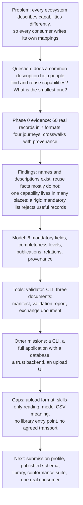

**In six sentences.**
1. AI capabilities arrive in many formats that disagree, so Mission 4 designs one common description
   and the rules around it.
2. Phase 0 tested four real user journeys on 60 real capabilities and found that the facts needed to
   *find* a capability usually exist, the facts needed to *decide* on it usually do not, and one
   capability often lives in several places under different names.
3. The model therefore requires only what every source can supply, reports a completeness level for
   the rest, and records every publication, relation and value source.
4. Mission 4 delivers a standard and its tools, not an application; its three documents are the
   manifest, the validation report and the exchange document.
5. The other missions are building a CLI, a full application with a database, a trust backend and an
   upload UI, and three things do not yet fit: the upload format, a skills-only reader of bundles, and
   a CSV that uses "capability" to mean something else.
6. Nothing written down requires HTTP or events; the live inventory API belongs to Mission 2, and
   Mission 4's best next step is to make its validator and documents easy for those backends to use.

---

## 24. Test yourself

Try to answer each question before reading the answer.

**1. Why is matching capabilities by name a bad way to find duplicates?**
Different capabilities can share a name (two `webapp-testing` skills), and one capability has
different names in different places. Name matching made 2 false pairs and missed 10 of 14 true ones.

**2. What is the difference between "valid" and "assessable"?**
Valid means the manifest follows the schema's rules. Assessable means it holds enough facts to start a
reuse decision. Before the revision, 29 invalid drafts were assessable and 7 valid drafts were not.

**3. A manifest says `riskTier: unassessed`. Can a team treat the capability as low risk?**
No. Unassessed means no assessment is recorded. It is never low risk and never approved. Risk
decisions belong to Mission 3.

**4. Does Mission 4 have to build an HTTP service or an event system?**
No. Nothing in the charter requires either, and a catalogue API or a broker is infrastructure it does
not own. It defines the documents; the live inventory API belongs to Mission 2, whose backend holds
the data.

**5. A form collects only a name and a description. What happens in the validator?**
The manifest is invalid: `schemaVersion`, `id`, `capabilityType`, `source` and `riskTier` are missing.
The workflow can supply four of them; the contributor must choose the type. Even then it only reaches
level `none` until an interface is added.

**6. Why does a skills-only Mission 1 lose information about Caveman?**
The use cases, limitations, setup and platform sit on the parent plugin manifest. The five skill
manifests carry none of them, and the install unit is the plugin.

**7. Where do Caveman's modes live in the manifest?**
In an `x-modes` extension field, because modes are not a concept of the schema. Core consumers ignore
`x-` fields. Each mode is a skill that sets a state, not a setting of one skill.

**8. What does "capability" mean in Mission 2's CSV, and how does it differ from the manifest?**
A task area, such as coding, in which a language model is scored on benchmarks. In the manifest it is
an independently adoptable asset, such as a skill or MCP server. The CSV has no rows about skills, MCP
servers or agents.

**9. Why must the id be assigned instead of derived from a URL or a name?**
Every derived form failed in a real case: URLs went stale after a rename, and two publishers shipped
different skills both called `pdf`. So the catalog or workflow assigns it once.

**10. Which facts must come from people rather than from existing metadata?**
The adoption facts: setup (including "none needed"), limitations and owner contact. That is why no
record reaches `adoptable` without owner input.

---

## 25. Where to read more

| To learn about | Read |
|---|---|
| The Phase 0 research in depth | [research-explained.md](research-explained.md), [spikes-1-3-research.md](spikes-1-3-research.md) |
| The mission in depth | [mission-understanding.md](mission-understanding.md) §1, §3, §4, §11 |
| Scope against Missions 1-5 | [mission-boundaries.md](mission-boundaries.md) |
| Field rules | [manifest-spec.md](manifest-spec.md), [field dictionary](field-dictionary/0.1.md) |
| What was decided and why | [poc-report.md](poc-report.md) §3 |
| Phase 1 | [phase-1-plan.md](phase-1-plan.md), [phase-1-spike-briefs.md](phase-1-spike-briefs.md) |
| Skills, sub-skills and agents in depth | [skills-and-agents-modelling.md](skills-and-agents-modelling.md) |
| The Caveman manifests and their tests | [case-studies/production-set/manifests/caveman/](../case-studies/production-set/manifests/caveman/) (manifests), [case-studies/caveman/](../case-studies/caveman/) (test scripts), [caveman-manifest-test-results.md](caveman-manifest-test-results.md) |
