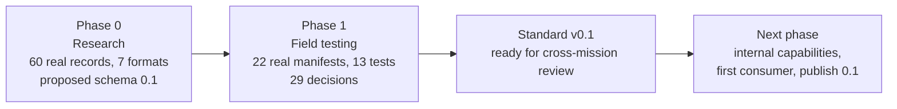
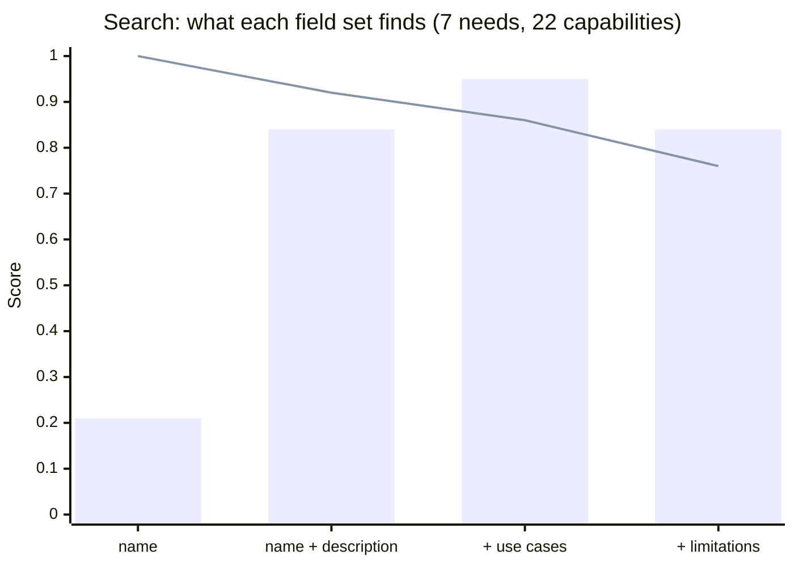
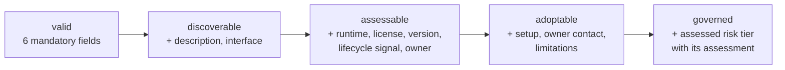
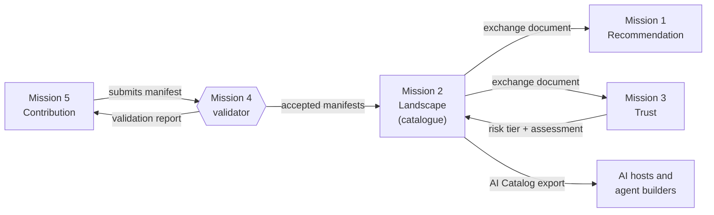

# Mission 4, Phase 1 demo: from research to a tested standard

| | |
|---|---|
| Mission | Mission 4: AI Capability Intelligence & Standards |
| Date | 2026-11-16 |
| Repository | [github.com/Mohanraj237/capability-intelligence](https://github.com/Mohanraj237/capability-intelligence/tree/phase-1) (branch `phase-1`) |
| In one sentence | Phase 0 found out how AI capabilities are described today and proposed a manifest; Phase 1 tested every field of that manifest on 22 real capabilities, decided every open schema question, and produced a standard the other missions can adopt |
| The standard | [AI Capability Manifest Standard v0.1](https://github.com/Mohanraj237/capability-intelligence/blob/phase-1/docs/capability-manifest-standard-v0.1.md) |



## Contents

1. The problem, in one minute
2. Phase 0: what the research found
3. Phase 1: what we set out to do
4. The 22 real manifests
5. How every field was tested
6. Results
7. What we decided
8. Completeness levels in practice
9. How it contributes to the other missions
10. What you can run today
11. Honest limits
12. What's next
13. Where everything is

---

## 1. The problem, in one minute

Teams build and buy AI capabilities: skills, MCP servers, agents, plugins, libraries, CI actions.
Each format describes itself differently (`SKILL.md`, MCP `server.json`, `package.json`, A2A Agent
Cards). So nobody can answer, across all of them: *what exists, is it the same thing as that other
entry, can I use it in my AI host, what do I need to set it up, and has anyone assessed its risk?*

Mission 4's job is **one common description**, the capability manifest, that every other mission can
read, without replacing the native formats.

## 2. Phase 0: what the research found

Full explanation: [research-explained.md](https://github.com/Mohanraj237/capability-intelligence/blob/phase-1/docs/research-explained.md).

**What was studied.** 60 real capability records in 7 packaging formats (MCP Registry, npm, Agent
Skills, Docker MCP catalog, Claude Code plugins, PyPI, GitHub Actions), plus 36 A2A Agent Cards,
against four user journeys: find, recognise the same capability, compare, and judge whether there is
enough information.

**The key findings:**

| # | Finding |
|---|---|
| 1 | A shared core already exists in every format: name, description, source, version, documentation |
| 2 | The facts that decide reuse are the least available: setup, limitations, license, lifecycle |
| 3 | The same capability appears in up to four places with different versions; names cannot link them, declared links plus repository and path can |
| 4 | Identical name and description do not mean the same capability |
| 5 | Keyword search finds the right capabilities but returns a lot of noise (precision 36% to 71%) |
| 6 | Passing a schema and being useful are independent: one unsupplied mandatory field made 45 of 60 drafts invalid |
| 7 | No source states risk; "active" does not mean "approved" |
| 8 | An emerging standard (the Linux Foundation AI Catalog draft) already takes the approach the evidence supports |

**What Phase 0 proposed:**

- **Five principles:** reference native metadata instead of copying it; separate identity, publications, and relations; every value carries its provenance; require only what every source can supply; lifecycle is observed and governance is referenced.
- **Six mandatory fields** (down from ten candidates): `schemaVersion`, `id`, `name`, `capabilityType`, `source`, `riskTier` (`unassessed` by default, never read as low).
- **A completeness ladder** instead of a wall: `discoverable`, `assessable`, `adoptable`, `governed`.
- A **proof-of-concept validator** and **10 open questions** (U1 to U10).

## 3. Phase 1: what we set out to do

Phase 0's evidence came from drafts generated from registry records. Phase 1 asked the harder
question: **does each field earn its place when real capabilities are described properly?**

| Goal | How |
|---|---|
| Describe real, production-grade capabilities by hand, from their own sources | 22 manifests: 16 production capabilities chosen by six criteria (maintained, accountable owner, open license, real adoption, versioned, appropriate), plus the Caveman plugin with its 5 skills |
| Test every field, not just run the unit tests | 13 tests (T1 to T13) against five user journeys and seven search needs |
| Close the open questions with evidence | 16 schema changes (C1 to C16), 10 open questions (U1 to U10), 11 recommendations (R1 to R11), all in one [decision register](https://github.com/Mohanraj237/capability-intelligence/blob/phase-1/docs/decision-register.md) |
| Check against the outside world | AI Catalog (Linux Foundation draft), A2A, MCP, Agent Skills, OASF, and the vendors' own READMEs |
| Produce something shareable | The [standard v0.1](https://github.com/Mohanraj237/capability-intelligence/blob/phase-1/docs/capability-manifest-standard-v0.1.md) and the [Mission 2 guidance](https://github.com/Mohanraj237/capability-intelligence/blob/phase-1/docs/mission-2-standards-guidance-v0.1.md) |

## 4. The 22 real manifests

All 22 are **valid**, all are **`adoptable`**, all sources are reachable, and the validator reports
**0 warnings**. Each one was written from the capability's own repository, registry entries, and
README, and every value says where it came from (`provenance`).

Folder: [case-studies/production-set/manifests](https://github.com/Mohanraj237/capability-intelligence/tree/phase-1/case-studies/production-set/manifests)

### MCP servers (7)

| Capability | Manifest | Published as | AI hosts (per publication) |
|---|---|---|---|
| Playwright MCP (Microsoft) | [playwright-mcp.capability.yaml](https://github.com/Mohanraj237/capability-intelligence/blob/phase-1/case-studies/production-set/manifests/playwright-mcp.capability.yaml) | MCP Registry, npm | 7 hosts on the npm package |
| Chrome DevTools MCP (Google) | [chrome-devtools-mcp.capability.yaml](https://github.com/Mohanraj237/capability-intelligence/blob/phase-1/case-studies/production-set/manifests/chrome-devtools-mcp.capability.yaml) | npm, plugin marketplace | 7 on npm; the plugin only in Claude Code |
| GitHub MCP Server | [github-mcp-server.capability.yaml](https://github.com/Mohanraj237/capability-intelligence/blob/phase-1/case-studies/production-set/manifests/github-mcp-server.capability.yaml) | MCP Registry, container, hosted endpoint | 6 on the container, 6 on the hosted endpoint |
| Exa MCP Server | [exa-mcp-server.capability.yaml](https://github.com/Mohanraj237/capability-intelligence/blob/phase-1/case-studies/production-set/manifests/exa-mcp-server.capability.yaml) | Hosted endpoint, MCP Registry, npm | 6 on the hosted endpoint |
| Tavily MCP Server | [tavily-mcp.capability.yaml](https://github.com/Mohanraj237/capability-intelligence/blob/phase-1/case-studies/production-set/manifests/tavily-mcp.capability.yaml) | npm, MCP Registry, hosted endpoint | Claude Desktop and Cursor on npm; Claude Code and Cursor on the hosted endpoint |
| Brave Search MCP Server | [brave-search-mcp-server.capability.yaml](https://github.com/Mohanraj237/capability-intelligence/blob/phase-1/case-studies/production-set/manifests/brave-search-mcp-server.capability.yaml) | npm, container | Claude Desktop, GitHub Copilot on both |
| MCP Atlassian | [mcp-atlassian.capability.yaml](https://github.com/Mohanraj237/capability-intelligence/blob/phase-1/case-studies/production-set/manifests/mcp-atlassian.capability.yaml) | PyPI, container | 3 on the PyPI package |

### Libraries (5)

| Capability | Manifest | Published as |
|---|---|---|
| Docling | [docling.capability.yaml](https://github.com/Mohanraj237/capability-intelligence/blob/phase-1/case-studies/production-set/manifests/docling.capability.yaml) | PyPI |
| pdfplumber | [pdfplumber.capability.yaml](https://github.com/Mohanraj237/capability-intelligence/blob/phase-1/case-studies/production-set/manifests/pdfplumber.capability.yaml) | PyPI |
| Unstructured | [unstructured.capability.yaml](https://github.com/Mohanraj237/capability-intelligence/blob/phase-1/case-studies/production-set/manifests/unstructured.capability.yaml) | PyPI, container |
| pdf-parse | [pdf-parse.capability.yaml](https://github.com/Mohanraj237/capability-intelligence/blob/phase-1/case-studies/production-set/manifests/pdf-parse.capability.yaml) | npm |
| LangChain Tavily | [langchain-tavily.capability.yaml](https://github.com/Mohanraj237/capability-intelligence/blob/phase-1/case-studies/production-set/manifests/langchain-tavily.capability.yaml) | PyPI |

### Framework, tool, workflow, skill (4)

| Capability | Type | Manifest |
|---|---|---|
| browser-use | framework | [browser-use.capability.yaml](https://github.com/Mohanraj237/capability-intelligence/blob/phase-1/case-studies/production-set/manifests/browser-use.capability.yaml) |
| PR-Agent | tool | [pr-agent.capability.yaml](https://github.com/Mohanraj237/capability-intelligence/blob/phase-1/case-studies/production-set/manifests/pr-agent.capability.yaml) |
| Claude Code Action | workflow (GitHub Action) | [claude-code-action.capability.yaml](https://github.com/Mohanraj237/capability-intelligence/blob/phase-1/case-studies/production-set/manifests/claude-code-action.capability.yaml) |
| Web Application Testing | skill | [webapp-testing.capability.yaml](https://github.com/Mohanraj237/capability-intelligence/blob/phase-1/case-studies/production-set/manifests/webapp-testing.capability.yaml) |

### A bundle: the Caveman plugin and its 5 skills (6)

Caveman shows how a **plugin that contains independently usable skills** is described: one parent
manifest that lists its `components`, and one manifest per skill that points back to its `parent`.
It is also the set we verified hardest: 44 of 44 facts checked against the source repository, and
22 of 22 deliberately planted errors detected ([test results](https://github.com/Mohanraj237/capability-intelligence/blob/phase-1/docs/caveman-manifest-test-results.md)).

| Capability | Type | Manifest |
|---|---|---|
| Caveman (Claude Code plugin) | plugin | [caveman-plugin.capability.yaml](https://github.com/Mohanraj237/capability-intelligence/blob/phase-1/case-studies/production-set/manifests/caveman/caveman-plugin.capability.yaml) |
| Caveman | skill | [caveman.capability.yaml](https://github.com/Mohanraj237/capability-intelligence/blob/phase-1/case-studies/production-set/manifests/caveman/caveman.capability.yaml) |
| Ultracave | skill | [ultracave.capability.yaml](https://github.com/Mohanraj237/capability-intelligence/blob/phase-1/case-studies/production-set/manifests/caveman/ultracave.capability.yaml) |
| Megacave | skill | [megacave.capability.yaml](https://github.com/Mohanraj237/capability-intelligence/blob/phase-1/case-studies/production-set/manifests/caveman/megacave.capability.yaml) |
| Caveman Commit | skill | [caveman-commit.capability.yaml](https://github.com/Mohanraj237/capability-intelligence/blob/phase-1/case-studies/production-set/manifests/caveman/caveman-commit.capability.yaml) |
| Caveman Review | skill | [caveman-review.capability.yaml](https://github.com/Mohanraj237/capability-intelligence/blob/phase-1/case-studies/production-set/manifests/caveman/caveman-review.capability.yaml) |

### What one manifest looks like (Playwright MCP, shortened)

```yaml
schemaVersion: "0.1"
id: microsoft/playwright-mcp
name: Playwright MCP
capabilityType: mcp_server
capabilityVersion: "0.0.85"
description: >-
  MCP server by Microsoft that lets an AI agent automate a browser with Playwright ...
source:                       # where it is maintained (identity anchor)
  type: repository
  url: https://github.com/microsoft/playwright-mcp
  repositoryId: "952688112"   # survives a repository rename
publications:                 # what adopters obtain
  - kind: registry_entry
    locator: io.github.microsoft/playwright-mcp
  - kind: package
    locator: pkg:npm/%40playwright/mcp
    nativeVersion: "0.0.85"
    platformCompatibility: [claude-code, claude-desktop, codex, cursor, gemini-cli, github-copilot, windsurf]
owner: { name: Microsoft Corporation, contact: https://github.com/microsoft/playwright-mcp/issues, affiliation: external }
license: { expression: Apache-2.0, scope: capability }
riskTier: unassessed          # never read as "low"
interfaces: [{ type: mcp, transport: stdio }]
runtime: [{ kind: local_process, detail: Node.js >=18 }]
setup: [...]                  # what the adopter must provide
limitations: [...]            # what can go wrong
provenance: [...]             # where every value came from
```

## 5. How every field was tested

The unit tests check that the validator works. Phase 1 checked whether **the fields themselves**
are worth having, using a protocol fixed before the first run
([protocol.yaml](https://github.com/Mohanraj237/capability-intelligence/blob/phase-1/research/phase-1/field-audit/protocol.yaml)).

| # | Test | The question |
|---|---|---|
| T1 | Field inventory | What does the schema define, and which level needs each field? |
| T2 | Coverage and provenance | How often is each field filled, and where did the value come from? |
| T3 | Removal | Remove a field: what breaks (validity, level, findings, journey answers)? |
| T4 | Journeys | Can each journey question be answered from each manifest? |
| T5 | Search | Which fields find the right capability, and which add noise? |
| T6 | Identity | Is the same capability recognised under another id, and different ones never linked? |
| T7 | Mutation | Put a wrong value in each field: is it rejected at that field? |
| T8 | AI host recipes | Can an AI host install and connect the capability from structured fields alone? |
| T9 | Native counterparts | Which facts do MCP, Skills, A2A, npm, and Python already state? |
| T10 | Independent validator | Does a second implementation (Python) reach the same verdicts? |
| T11 | Exchange | Is every manifest passed to consumers unchanged, with its level? |
| T12 | Governed level | With simulated risk assessments, does the top level and its 12-month expiry work? |
| T13 | AI Catalog | Can the 22 be exported as a valid AI Catalog and imported back without loss? |

Plus four focused analyses: `source` versus `publications` (C9), the abilities vocabulary (U5),
AI Catalog interoperability (U7), and a field overlap review (C14 to C16). Each test has a draft
report in [docs/phase-1-testing/drafts](https://github.com/Mohanraj237/capability-intelligence/tree/phase-1/docs/phase-1-testing/drafts).

## 6. Results

| Test | Result |
|---|---|
| Validity | **22 of 22 valid, all `adoptable`**, 0 warnings, all sources reachable |
| Mandatory fields | Remove any one of the six: all 22 become invalid. Each is needed |
| Completeness levels | Remove any level fact: the level drops exactly as defined |
| Journeys | **440 of 440** required questions answered (100%) |
| Search | Name + description: recall 0.84, precision 0.92. Adding use cases: recall 0.95. With every field including limitations, precision drops to 0.73, so recommenders must not index limitations |
| Identity | **66 of 66** synthetic cases right: re-registrations and repository renames caught, namesakes not linked |
| Wrong values | **102 of 102** testable fields reject a wrong value at that field |
| AI host recipes | **22 of 22** install or connection recipes from structured fields |
| Independent validator | **33 of 33** verdicts agree (Python `jsonschema`) |
| Exchange | **22 of 22** carried unchanged |
| Governed (simulated) | 22 of 22 reach `governed` with a current assessment; 22 warn when it is older than 12 months; 22 are invalid with a tier but no reference |
| AI Catalog | Valid at Level 2; the hybrid export round-trips **22 of 22**; github.com's live catalog confirms our GitHub identity independently |
| Caveman | 44 of 44 source facts, 22 of 22 planted errors detected |
| Unit tests | 225 of 226 pass (1 Windows-only test issue, tracked as R4) |



*Bars: recall. Line: precision.*

## 7. What we decided

Every decision has its evidence, owner, and date in the
[decision register](https://github.com/Mohanraj237/capability-intelligence/blob/phase-1/docs/decision-register.md).
**16 of 16 schema changes and 9 of 10 open questions are decided.**

### Schema changes (C1 to C16)

| Change | Why (evidence) |
|---|---|
| New type `library` (C1) | 5 of 16 production capabilities are libraries; they had to pretend to be tools |
| Bundled `skill` and `agent` components (C2) | Caveman's 17 bundled skills and 3 subagents had no type |
| Interface `ci_action` (C3) | GitHub Actions could only say "other" |
| Cost model `provider_billed` (C4) | 7 of 16 are free software that calls a paid service |
| AI hosts: a controlled list, named by agent (C5) | Of 58 platform values, only 25 were AI hosts; the rest were languages, operating systems, and guesses. New `integrations` field for connected systems (GitLab, Jira, LangChain) |
| `setup[].kind` and `setup[].group` (C7, C13) | Installed software and credentials had no structured place; 5 of 22 need "this token *or* that token" |
| `source` is the origin, `publications` what adopters obtain (C9) | Tested on all 22; a repository counts as a publication only with the ref adopters pin |
| Hosts stated **only per publication** (C12, C14) | A host works through a particular artifact: in 6 of 9 manifests a capability-wide list hid which one to install |
| `intendedAudience` removed (C15) | All 25 values restated other fields or said only "developers" |
| Runtime details state requirements only (C16) | 24 of 32 repeated a package, image, or host |
| Assessment date required, valid 12 months; evidence older than 180 days flagged (risk vocabulary, C11) | So that a risk tier cannot go stale silently |

### Questions answered (U1 to U10)

| Question | Answer |
|---|---|
| Keep the completeness levels? (U1) | Yes, and **listing requires `adoptable` or `governed`** (U9) |
| Who assigns ids? (U3) | Mission 5 at submission, from namespaces Mission 2 registers |
| A configuration-only wrapper? (U4) | Its own record, linked by `relations: wraps` |
| A vocabulary for abilities? (U5) | No new field in 0.1; a functional classification in 0.2, cross-walked to OASF |
| Lifecycle transitions? (U6) | Owner-declared, as proposed |
| AI Catalog? (U7) | Exported as a hybrid AI Catalog: native artifacts plus the full manifest, lossless |
| Who confirms values? (U10) | The owner or a Mission 5 curator, through `provenance[].confirmedBy` |
| Still open | **U8**: how long a manifest takes an owner (needs real owners) |

## 8. Completeness levels in practice

The validator never just says "valid"; it says **how far up the ladder** a manifest gets and what
the next rung needs.



| Level | Who fills it | Phase 1 result |
|---|---|---|
| discoverable | Automatic, from native metadata | 22 of 22 |
| assessable | Mostly automatic | 22 of 22 |
| adoptable | The owner or a curator | **22 of 22** (the 5 Caveman skills were completed from their own sources) |
| governed | Mission 3 | 0 of 22 real (no assessment exists yet); 22 of 22 with simulated assessments |

The bar for listing a capability in the catalogue is **`adoptable`**: a team can adopt it without
asking anyone, because setup, owner contact, and limitations are stated.

## 9. How it contributes to the other missions



| Mission | What it gets from Mission 4 | Fields it reads | Shown in Phase 1 |
|---|---|---|---|
| **Mission 1** Recommendation | Matching, filtering, and ranking data | `name`, `description`, `supportedUseCases` (match); `capabilityType`, hosts per publication, `integrations`, cost (filter); `riskTier`, `limitations`, `setup` (judge) | Search test: which fields to index and which not to; recommend only `adoptable` and `governed` |
| **Mission 2** Landscape | One record per capability across all sources, and the catalogue rules | `id`, `source`, `publications`, `relations`, `owner`, `maturity`, `capabilityType` | Identity 66 of 66; one capability on npm, Docker, and the MCP Registry is one record; [guidance for Mission 2](https://github.com/Mohanraj237/capability-intelligence/blob/phase-1/docs/mission-2-standards-guidance-v0.1.md) |
| **Mission 3** Trust | A queue of unassessed capabilities, and where the assessment is recorded | `riskTier`, `assessmentReference`, `limitations`, `license`, `owner` | `unassessed` is never read as low; 12-month expiry tested; trust fields planned for 0.2 |
| **Mission 5** Contribution | A validator with fix hints, and a gate | The validation report; the completeness level and its missing facts | Every error says what to fix; `--require-level adoptable` as the listing gate |
| **AI hosts and teams** | How to install, connect, and when to use a capability | `interfaces`, `publications`, hosts, `setup`, `embeddedComponents` | 22 of 22 recipes from structured fields |

The end-to-end flow is walked through on two real capabilities (MCP Atlassian and PR-Agent) in
[case-studies/two-use-cases](https://github.com/Mohanraj237/capability-intelligence/blob/phase-1/case-studies/two-use-cases/README.md).

## 10. What you can run today

```bash
npm install
```

```bash
node bin/capability-manifest.js validate case-studies/production-set/manifests
```

```bash
node bin/capability-manifest.js validate case-studies/production-set/manifests --require-level adoptable
```

```bash
node bin/capability-manifest.js export case-studies/production-set/manifests --out exchange-document.json
```

```bash
node bin/capability-manifest.js compat examples/valid/sql-review.capability.yaml examples/compatibility/sql-review.1.4.0-breaking.capability.yaml
```

```bash
node research/phase-1/field-audit/audit.js
```

```bash
npm test
```

| Output | For | Example |
|---|---|---|
| Validation report (JSON) | Mission 5 | [validation-report.json](https://github.com/Mohanraj237/capability-intelligence/blob/phase-1/case-studies/production-set/outputs/validation-report.json) |
| Exchange document (JSON) | Missions 1 and 3 | [exchange-document.json](https://github.com/Mohanraj237/capability-intelligence/blob/phase-1/case-studies/production-set/outputs/exchange-document.json) |
| Field dictionary | Everyone | [field-dictionary/0.1.md](https://github.com/Mohanraj237/capability-intelligence/blob/phase-1/docs/field-dictionary/0.1.md) |
| JSON Schema | Tools | [capability.schema.json](https://github.com/Mohanraj237/capability-intelligence/blob/phase-1/schema/0.1/capability.schema.json) |

## 11. Honest limits

- **All 22 are public, external capabilities.** Internal capabilities, internal owners, maturity, and lifecycle declarations are not yet tested on real data.
- **No real risk assessment exists.** The `governed` level is tested with simulated assessments.
- **One curator** wrote the manifests and judged search relevance; a second judge has not checked them.
- **No owner has timed** writing a manifest yet, so the curation effort (U8) is unknown. On average a manifest has about 13 provenance entries; 65% come from the sources, 29% are curated.
- **The search test is a term matcher**, not Mission 1's recommender; **the AI host recipes are generated, not run**.
- **The AI Catalog is still a draft** (changed 5 times in the two weeks before our test); we tested a dated version.

## 12. What's next

| Item | Why | With |
|---|---|---|
| **Cross-mission review of the standard v0.1**, then publish it | The structure is decided; the other missions confirm their parts (§13 of the standard) | Missions 1, 2, 3, 5 |
| **10 to 20 internal capabilities** (R6) | The biggest remaining unknown: internal ownership, maturity, lifecycle | Missions 1 and 2 |
| **A first real consumer** (R7) | Nobody reads the exchange document yet; Mission 1's recommender or Mission 5's submission step | Mission 1 or 5 |
| **Owner timing** (U8) | How long a manifest really takes, to size the contribution workflow | Mission 5 |
| **Real risk assessments** | Move real capabilities to `governed`, and agree the trust fields for 0.2 (C8) | Mission 3 |
| **Functional classification** (0.2) | Mission 2's category list as a standard field, cross-walked to OASF; a controlled role list if needed | Mission 2 |
| **Consumer rules for the exchange document** (R2, R3) | What consumers do with rejected records; record which checks ran | Missions 1, 2 |
| **CI on more than one platform** (R4) | Fix the Windows test; run the suite automatically | Mission 4 |
| **Link MCP Server Cards** (R10) and an `export --format ai-catalog` command | Interoperability with AI Catalog clients | Mission 4, Mission 2 |

## 13. Where everything is

| What | Link |
|---|---|
| The standard v0.1 (shareable) | [docs/capability-manifest-standard-v0.1.md](https://github.com/Mohanraj237/capability-intelligence/blob/phase-1/docs/capability-manifest-standard-v0.1.md) |
| Decision register | [docs/decision-register.md](https://github.com/Mohanraj237/capability-intelligence/blob/phase-1/docs/decision-register.md) |
| Phase 1 testing summary | [docs/phase-1-testing/README.md](https://github.com/Mohanraj237/capability-intelligence/blob/phase-1/docs/phase-1-testing/README.md) |
| Field-by-field verdicts | [docs/phase-1-testing/field-by-field-review.md](https://github.com/Mohanraj237/capability-intelligence/blob/phase-1/docs/phase-1-testing/field-by-field-review.md) |
| Field overlap review (C14 to C16) | [docs/phase-1-testing/field-overlap-review.md](https://github.com/Mohanraj237/capability-intelligence/blob/phase-1/docs/phase-1-testing/field-overlap-review.md) |
| `source` versus `publications` (C9) | [docs/phase-1-testing/c9-source-and-publications.md](https://github.com/Mohanraj237/capability-intelligence/blob/phase-1/docs/phase-1-testing/c9-source-and-publications.md) |
| AI Catalog interoperability (U7) | [docs/phase-1-testing/ai-catalog-interoperability.md](https://github.com/Mohanraj237/capability-intelligence/blob/phase-1/docs/phase-1-testing/ai-catalog-interoperability.md) |
| Abilities vocabulary (U5) | [docs/phase-1-testing/abilities-vocabulary-analysis.md](https://github.com/Mohanraj237/capability-intelligence/blob/phase-1/docs/phase-1-testing/abilities-vocabulary-analysis.md) |
| Guidance for Mission 2 | [docs/mission-2-standards-guidance-v0.1.md](https://github.com/Mohanraj237/capability-intelligence/blob/phase-1/docs/mission-2-standards-guidance-v0.1.md) |
| The 22 manifests | [case-studies/production-set](https://github.com/Mohanraj237/capability-intelligence/blob/phase-1/case-studies/production-set/README.md) |
| End-to-end walkthrough | [case-studies/two-use-cases](https://github.com/Mohanraj237/capability-intelligence/blob/phase-1/case-studies/two-use-cases/README.md) |
| Phase 0 research, explained | [docs/research-explained.md](https://github.com/Mohanraj237/capability-intelligence/blob/phase-1/docs/research-explained.md) |
| Review guide (reading order) | [docs/review-guide.md](https://github.com/Mohanraj237/capability-intelligence/blob/phase-1/docs/review-guide.md) |
