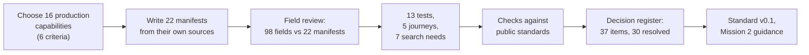
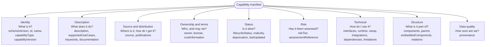
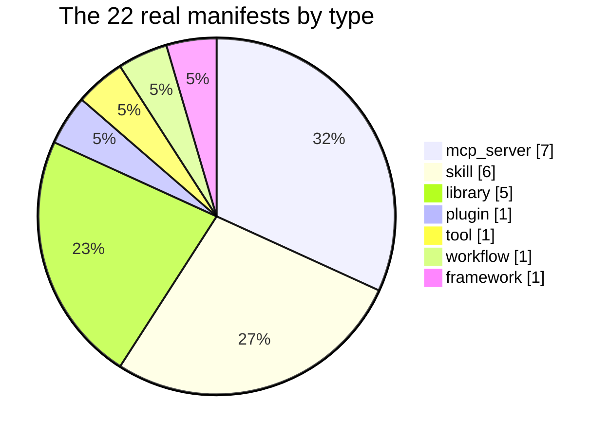
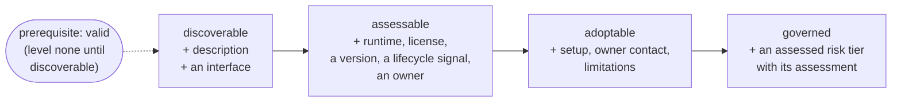
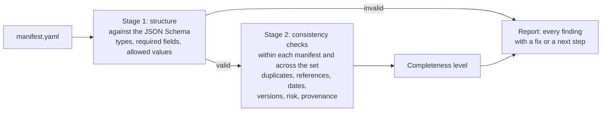
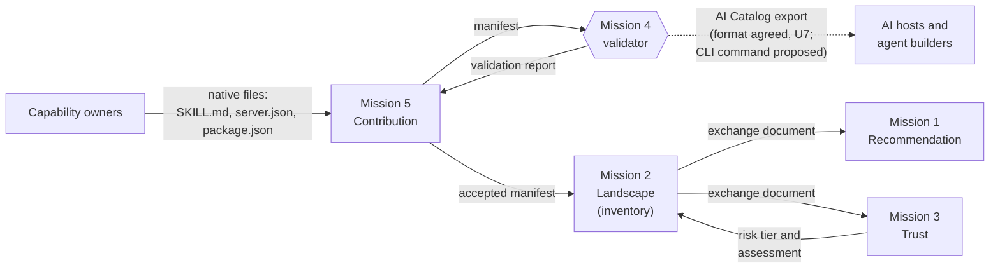
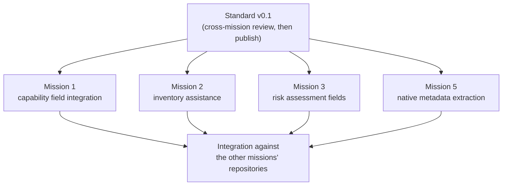

# Mission 4 Explained for the Phase 1 Demo: The Capability Manifest, How We Built It, and What Comes Next

| | |
|---|---|
| **What this is** | A guided walk through Mission 4 for readers who are new to it: what the mission is for, what Phase 0 and Phase 1 did, the manifest field by field, worked examples for every capability type (public, internal, and illustrative), how validation works, and what Phase 3 will do with the other missions |
| **Written** | 2026-11-16, for the Phase 1 demo |
| **Builds on** | [research-explained.md](https://github.com/Mohanraj237/capability-intelligence/blob/phase-1/docs/research-explained.md) (Phase 0, in depth) and [mission-4-context-and-architecture.md](https://github.com/Mohanraj237/capability-intelligence/blob/phase-1/docs/mission-4-context-and-architecture.md) (how the missions connect) |
| **The standard itself** | [capability-manifest-standard-v0.1.md](https://github.com/Mohanraj237/capability-intelligence/blob/phase-1/docs/capability-manifest-standard-v0.1.md): the compact reference to share with other teams. This page explains it; the standard defines it |
| **Status** | Schema 0.1 is agreed inside Mission 4 and ready for cross-mission review. It is not yet published, and no other mission's system consumes it yet |
| **In one line** | Phase 1 delivered a **tested v0.1 manifest standard, a validator, and draft exchange contracts**. It did not deliver an integrated capability catalogue: no other mission consumes the documents yet |
| **Phase naming** | ❓ This page calls the next stage "Phase 3", as the Mission 4 team asked. The [Phase 1 plan](https://github.com/Mohanraj237/capability-intelligence/blob/phase-1/docs/phase-1-plan.md) calls the next phase "Phase 2". The official name is to be confirmed |
| **Reviewed** | 2026-11-16: every number re-checked against the repository's artefacts (the decision register, `results.json` of the field audit, the validation outputs, the test suite). Items that could not be verified are marked ❓ |

> **How to read the labels.** Key claims are tagged to show their evidence and status.
>
> - 📘 **Mission rule**: stated in the charter or the published team boundaries.
> - 📏 **Measured**: counted on real data, reproducible with the repository's tools.
> - ✅ **Decided**: recorded in the [decision register](https://github.com/Mohanraj237/capability-intelligence/blob/phase-1/docs/decision-register.md) by the Mission 4 team on 2026-11-16.
> - 💡 **Proposal**: suggested, not decided.
> - ❓ **Open**: nobody has answered this yet.
> - 🔗 **Connecting the dots**: a short note that links one section to the next.
> - 🗣️ **Reported**: told to Mission 4 by another mission's team; not in any document. Please confirm.

Where it matters, this page also says how far a piece of work has got:

| Status | Meaning |
|---|---|
| **Implemented** | Exists in the codebase |
| **Tested** | Covered by an identifiable test or verification |
| **Agreed** | Accepted as a project decision (recorded in the decision register) |
| **Proposed** | Suggested, not yet agreed |
| **Planned** | Intended for a future phase |
| **Unverified** | Evidence is not sufficient yet |

> ⚠️ **Read this first: what "valid" does and does not mean.** A manifest that passes the validator
> is **well formed and internally consistent**. It is **not** thereby safe, approved, fully verified,
> production-ready, or `governed`. All 22 real manifests in this page are `riskTier: unassessed`:
> no one has assessed their risk, and that must never be read as low risk. No other mission's system
> consumes these documents yet; every integration shown here is exercised only by Mission 4's own
> tests (§13.2). The full list of limits is in §15.

---

## Contents

1. The problem in plain words
2. Words you need first
3. Mission 4: in scope, out of scope, deliverables
4. Phase 0: the research, in ten minutes
5. Phase 1: what we did
6. The manifest at a glance
7. Every field: what it says, why it is there, when it matters
8. Capability types, with samples
9. Example manifests for each kind of capability
10. Completeness levels: a ladder, not a wall
11. How the manifest was tested, and the results
12. Validation and the documents Mission 4 hands over
13. How it serves the other missions
14. Phase 3: what's ahead
15. Honest limits
16. Where everything is

---

## 1. The problem in plain words

### 1.1 An analogy: a library without a common catalogue card

Imagine a library where every publisher prints its own catalogue card, in its own layout. One card
puts the author at the top, another hides it in a footnote, a third leaves it out. Some books appear
three times under three titles because three publishers printed them. A missing "approved for lab
use" stamp could mean "not checked" or "checked and fine", and nobody can tell which.

Four departments need that catalogue: a **recommendation desk**, a **records office**, a **safety
office**, and a **donations counter**. Without one common card, each department writes its own
translation rules for every publisher, and they make different mistakes.

**AI capabilities have exactly this problem.** A skill describes itself in a `SKILL.md` file, an MCP
server in a `server.json`, a library in `package.json` or `pyproject.toml`, an agent in an A2A Agent
Card. They use different names for the same facts, the same names for different facts, and most
leave out what a team needs to decide whether to adopt.

### 1.2 What Mission 4 is for

📘 The charter's goal: *"establish a common, machine-readable standard to describe, identify,
version, and validate AI capabilities so multiple consumers can use them consistently without
custom mappings."*

In library terms, **Mission 4 designs the catalogue card and its rules**. It does not run the
library (Mission 2), recommend books (Mission 1), stamp them safe (Mission 3), or take donations
(Mission 5).

🔗 **Connecting the dots.** The "card" is the **capability manifest**: one YAML file per capability.
The rest of this page is about what goes on it and how we know each line is worth having.

---

## 2. Words you need first

| Term | Plain meaning | Example |
|---|---|---|
| **AI capability** | Something a team can adopt and reuse on its own | Microsoft's Playwright MCP server |
| **Skill** | A folder of instructions (a `SKILL.md`) that an AI agent loads when a task matches | Anthropic's `webapp-testing` skill |
| **MCP server** | A program that gives AI agents tools through the Model Context Protocol | GitHub MCP Server |
| **Agent** | An AI program that plans and acts on a task, often reached through the A2A protocol | An incident triage agent |
| **Plugin** | A package that bundles skills, commands, and hooks for an AI host | The Caveman plugin for Claude Code |
| **AI host** | The AI agent or assistant that loads a capability | Claude Code, GitHub Copilot, Cursor |
| **Metadata** | Data that describes something, rather than the thing itself | Name, version, license |
| **Native metadata** | What a format already records about its own items | The header of a `SKILL.md` |
| **Manifest** | One file that describes one capability in the common format | `playwright-mcp.capability.yaml` |
| **Schema** | The machine-readable rules a manifest must follow (JSON Schema) | `schema/0.1/capability.schema.json` |
| **Validator** | The program that checks a manifest and explains every problem | `capability-manifest validate` |
| **Publication** | One place a capability is distributed | An npm package, a container image, a registry entry |
| **Provenance** | Where a value came from | "License: stated by PyPI" |
| **Journey** | A real task a person tries to do, written as the questions they must answer | "Find something that already does X" |
| **Completeness level** | How much a manifest says: `discoverable`, `assessable`, `adoptable`, `governed` | §10 |
| **Recall** | Of the right answers, how many a search found | 0.95 = it found 95% of them |
| **Precision** | Of what a search returned, how much was right | 0.86 = 86% of the results were relevant |
| **Exchange document** | A JSON bundle of valid manifests, handed to other missions | Output of `capability-manifest export` |
| **Validation report** | The validator's verdict in JSON, for automated workflows | Output of `validate --format json` |

---

## 3. Mission 4: in scope, out of scope, deliverables

### 3.1 In scope

📘 From the charter, Mission 4 owns **the structure and the rules**:

| Area | What it means in practice |
|---|---|
| A common manifest and metadata model | One format for skills, MCP servers, agents, plugins, tools, libraries, workflows, frameworks, applications, services, and platforms |
| Mandatory, conditional, and optional fields | Which facts every record must have, which depend on others, and which are recommended |
| Naming, identifiers, lifecycle, versioning | How a capability keeps one identity when it moves, how its status changes, how versions are compared |
| Machine-readable validation with actionable errors | Every problem comes with the field, the line, and how to fix it |
| Contracts between missions | The validation report and the exchange document, each with its own schema |
| Consumers without custom mappings | Missions 1, 2, 3, and 5 can read every capability type the same way (the goal; no consumer has integrated yet) |

### 3.2 Out of scope

📘 *"The capability inventory, recommendation algorithm, governance approvals, contribution
lifecycle, catalog website, automated indexer, or runtime execution platform"* are not Mission 4's.

| Not ours | Whose |
|---|---|
| The inventory's content (which capabilities exist, which are duplicates) | Mission 2 |
| Ranking and recommending | Mission 1 |
| Risk assessment and approval | Mission 3 and the governance owners |
| The submission process and contributor engagement | Mission 5 |
| A catalogue website, an automated indexer, running capabilities | Not assigned to any mission |

The rule that keeps the boundary clear: *"The Landscape team owns the inventory's content; this
team owns the structure and rules used to represent that content."* So the manifest has a field for
risk, but **Mission 3 fills it**; it has a field for maturity, but **Mission 2 rates it**.

### 3.3 Deliverables and where they stand

| Deliverable (charter) | Where | Status |
|---|---|---|
| Manifest v0.1 and field documentation | [schema](https://github.com/Mohanraj237/capability-intelligence/blob/phase-1/schema/0.1/capability.schema.json), [field dictionary](https://github.com/Mohanraj237/capability-intelligence/blob/phase-1/docs/field-dictionary/0.1.md), [standard](https://github.com/Mohanraj237/capability-intelligence/blob/phase-1/docs/capability-manifest-standard-v0.1.md) | **Agreed** in Mission 4; cross-mission review and publication still to come |
| Field requirements, identifier, lifecycle, versioning, compatibility rules | [standard §5 to §8](https://github.com/Mohanraj237/capability-intelligence/blob/phase-1/docs/capability-manifest-standard-v0.1.md), [decision register](https://github.com/Mohanraj237/capability-intelligence/blob/phase-1/docs/decision-register.md) | **Agreed** |
| Schema validator with actionable feedback | `bin/capability-manifest.js`, `src/` | **Implemented and tested**: two stages, three kinds of finding |
| Errors, warnings, and unverified checks distinguishable | The validator's three severities | **Implemented and tested** |
| Unassessed risk can never be read as low or approved | `riskTier: unassessed` and the `RISK_UNASSESSED` notice on every unassessed record | **Implemented and tested** |
| Five representative manifests covering four types | [22 real, public manifests](https://github.com/Mohanraj237/capability-intelligence/blob/phase-1/case-studies/production-set/README.md) covering 7 types, plus 8 example manifests | **Done**, beyond the charter's minimum |
| Contracts between teams | [validation report and exchange document schemas](https://github.com/Mohanraj237/capability-intelligence/tree/phase-1/schema/contracts) | **Implemented and tested** as draft contracts (0.1) |
| A downstream consumer, and a second path | Consumer tests in Mission 4's repository; an independent Python validator | ⚠️ **Tested only inside Mission 4.** No other mission's system consumes the documents yet (Planned, Phase 3) |
| Limitations and open decisions documented | [decision register](https://github.com/Mohanraj237/capability-intelligence/blob/phase-1/docs/decision-register.md), §15 below | **Done** |

---

## 4. Phase 0: the research, in ten minutes

The full story is in [research-explained.md](https://github.com/Mohanraj237/capability-intelligence/blob/phase-1/docs/research-explained.md). The short version:

### 4.1 The question

*What must a common description contain so that people can find, compare, and adopt AI
capabilities, whatever format they come from?* Phase 0 answered it with evidence, not opinion.

### 4.2 What was studied

📏 **60 real capability records in 7 formats**, plus 36 A2A Agent Cards:

| Format | Records |
|---|---|
| MCP Registry entries | 14 |
| npm packages | 14 |
| Agent Skills (`SKILL.md`) | 11 |
| Docker MCP catalog | 8 |
| Claude Code plugins | 7 |
| PyPI packages | 5 |
| GitHub Actions | 1 |

The **60 capability records** were tested against **four journeys**: find a capability for a need
(J1), recognise the same capability in different places (J2), compare and decide (J3), and judge
whether there is enough information (J4). The **36 A2A Agent Cards** are a separate sample, used
only to check how well real cards conform to the A2A specification (4 of 36 validated against the A2A v0.3.0 schema).

### 4.3 What it found

| # | Finding, in plain words |
|---|---|
| 1 | Every format already shares a core: name, description, source, version, documentation |
| 2 | The facts that decide adoption (setup, limitations, license, lifecycle) are the ones most often missing |
| 3 | One capability appears in up to four places with different versions; names can't link them, declared links and repository paths can |
| 4 | Two capabilities with the same name and description can still be different things |
| 5 | Keyword search finds the right capabilities but returns a lot of noise (precision 36% to 71%) |
| 6 | Being valid and being useful are different: one mandatory field nobody supplies made 45 of 60 drafts invalid |
| 7 | No format states risk, and "active" does not mean "approved" |
| 8 | An emerging Linux Foundation standard (the AI Catalog) already takes the approach the evidence supports |

### 4.4 What it proposed

- **Five principles:** reference native metadata instead of copying it; keep identity, publications, and relations separate; record where each value came from; require only what every source can supply; observe lifecycle and reference governance.
- **Six mandatory fields**, down from ten candidates.
- **Completeness levels**: report how complete a record is, instead of rejecting it.
- **A proof-of-concept validator** and **10 open questions** (U1 to U10) for Phase 1.

🔗 **Connecting the dots.** Phase 0 tested drafts generated automatically from registry records.
Phase 1 asked the harder question: when real capabilities are described *properly*, by hand, does
every field earn its place?

---

## 5. Phase 1: what we did

### 5.1 The activities



| Step | What we did | Output |
|---|---|---|
| 1. Pick real capabilities | 16 production capabilities that pass six criteria: maintained, accountable owner, clear open license, real adoption, versioned releases, appropriate for the organisation. Plus Caveman, a plugin with 5 skills, as the bundle case | [sample review](https://github.com/Mohanraj237/capability-intelligence/blob/phase-1/docs/reviews/phase-1-sample-review.md) |
| 2. Write the manifests | 22 manifests, each from the capability's own repository, registry entries, and README, with every value's source recorded | [22 manifests](https://github.com/Mohanraj237/capability-intelligence/blob/phase-1/case-studies/production-set/README.md) |
| 3. Review every field | Each field against the 22: who fills it, which values, what breaks. This first review (2026-11-13) counted **98 fields**, to the second level of nesting, in the schema of that date | [field review](https://github.com/Mohanraj237/capability-intelligence/blob/phase-1/docs/reviews/field-review-production-set.md) |
| 4. Test every field | 13 tests (§11), on a protocol written before the first run. The test inventory (T1) counts **106 field paths** at every depth in the final schema; the two counts differ in method (depth) and in schema date (fields were added and removed in between) | [testing summary](https://github.com/Mohanraj237/capability-intelligence/blob/phase-1/docs/phase-1-testing/README.md) |
| 5. Check against the outside world | AI Catalog, A2A, MCP, Agent Skills, OASF, and the vendors' READMEs | [AI Catalog](https://github.com/Mohanraj237/capability-intelligence/blob/phase-1/docs/phase-1-testing/ai-catalog-interoperability.md), [abilities](https://github.com/Mohanraj237/capability-intelligence/blob/phase-1/docs/phase-1-testing/abilities-vocabulary-analysis.md) |
| 6. Decide | The register tracks 37 items in three categories, each with evidence, owner, and status (§5.3) | [decision register](https://github.com/Mohanraj237/capability-intelligence/blob/phase-1/docs/decision-register.md) |
| 7. Make it shareable | The standard, guidance for Mission 2, a review guide, this page | [standard](https://github.com/Mohanraj237/capability-intelligence/blob/phase-1/docs/capability-manifest-standard-v0.1.md), [Mission 2 guidance](https://github.com/Mohanraj237/capability-intelligence/blob/phase-1/docs/mission-2-standards-guidance-v0.1.md) |

### 5.2 The headline

📏 **All 22 real manifests are structurally valid and consistent with each other, and all reach
`adoptable`**: the facts a team needs before adopting (setup, owner contact, limitations) are stated.
None is `governed`, because no risk assessment exists yet. Every required journey question, except
the one only Mission 3 can answer, is answered for every manifest: 440 of 440 raw checks, of which
416 are clearly applicable and 24 are answered with an applicability caveat (§11.3). Of the 106 field paths, 102 were
mutation-tested structurally and all 102 reject a wrong value at the right place; 4 could not be
tested because no manifest or example states them (§11.3). For each of the 22, a generator produced a structured install, load, or
connection step from the fields alone; the steps were **generated, not executed** (§11.3).

### 5.3 The decision register, counted

The [decision register](https://github.com/Mohanraj237/capability-intelligence/blob/phase-1/docs/decision-register.md) has three separate, numbered categories:

| Category | Items | Resolved | Still open |
|---|---|---|---|
| **C** Schema changes | C1 to C16: 16 | 16 (Agreed; C8, the trust fields, was agreed as *deferred to 0.2*) | 0 |
| **U** Open questions from Phase 0 | U1 to U10: 10 | 9 (Agreed) | 1: U8, owner effort |
| **R** Recommendations | R1 to R11: 11 | 5 (3 done: R1, R5, R11; 2 agreed: R8, R9) | 6 Proposed: R2, R3, R4, R6, R7, R10 |
| **Total** | **37** | **30** | **7** |

Two pairs were settled by one decision each (C9 with U2, C10 with U10), and the decision log also
records three decisions that have no number (the risk vocabulary, the maturity levels and type
list, and the schema `$id`). The log therefore has 21 entries, not 30 or 37. Earlier drafts of this
page said "29 decisions"; that figure could not be traced to the register and is withdrawn.

---

## 6. The manifest at a glance

A manifest is one YAML file. The fields fall into nine groups, each answering a question someone
actually asks:



📏 Schema 0.1 has **31 top-level fields and 106 field paths** in all (counted by the field audit,
T1, at every depth; the first field review's "98 fields" counted two levels of an earlier schema). **6 are universally mandatory**:
`schemaVersion`, `id`, `name`, `capabilityType`, `source`, `riskTier`. Others become **required
only when another field has a certain value** (conditional rules, all Implemented and tested):

| # | When | Then also required |
|---|---|---|
| 1 | `riskTier` is `low`, `medium`, or `high` | `assessmentReference` (which itself always requires `id` and `assessedOn`) |
| 2 | `lifecycleStatus` is `deprecated` or `retired` | `deprecation` (which itself always requires `reason`) |
| 3 | `capabilityType` is `mcp_server` | `interfaces`, containing at least one entry with `type: mcp` |
| 4 | `interfaces[].type` is `a2a` or `openapi` | `interfaces[].contractRef` of that entry |
| 5 | `source.type` is `repository` | `source.url` |
| 6 | `source.type` is `registry` | `source.registry` and `source.identifier` |
| 7 | `source.type` is `provider` | `source.url` |
| 8 | `source.type` is `other` | `source.description` |
| 9 | `license` has no `expression` | `license.text` |
| 10 | `costInformation.model` is `other` | `costInformation.details` |
| 11 | a `relations[]` entry has no `id` | `relations[].locator` of that entry |
| 12 | `provenance[].method` is `derived` | `provenance[].basis` of that entry |

The smallest valid manifest is therefore eight lines:

```yaml
schemaVersion: "0.1"
id: ai-platform/sql-review
name: SQL Review
capabilityType: skill
source:
  type: repository
  url: https://github.com/example-org/ai-capabilities
riskTier: unassessed
```

It is **valid**, and its completeness level is **`none`**: valid, but not yet `discoverable`
(it has no description or interface). It can be stored, not listed. Validity and completeness are
two different results: validity is a pass or fail check and the prerequisite; completeness is
reported only for valid manifests, and its ladder starts at `discoverable` (§10). Beyond the
mandatory and conditional fields, everything is optional in the schema; the completeness levels say
which optional facts matter, and when.

---

## 7. Every field: what it says, why it is there, when it matters

For each field: **what** it says, **why** it exists (the evidence), **when** it matters (the
scenario and who reads it), and an **example**. "Used by" counts how many of the 22 real manifests
state it (📏).

### 7.1 Identity: "what is it?"

| Field | What it says | Why it is there | When it matters | Example | Used by |
|---|---|---|---|---|---|
| `schemaVersion` **(M)** | Which version of the standard the file follows | The validator picks its rules from it; old and new records can live side by side | Every validation; Mission 5's submission step | `"0.1"` | 22 |
| `id` **(M)** | A permanent identifier: assigned once, never changed or reused | Names collide and URLs move (Phase 0 found both). Other records point to this id | Mission 2 deduplicates on it; dependencies and components refer to it | `microsoft/playwright-mcp` | 22 |
| `name` **(M)** | The display name | Every source has one (60 of 60 in Phase 0); people search by it | Search results, catalogue pages | `Playwright MCP` | 22 |
| `capabilityType` **(M)** | The primary kind of capability (§8) | Consumers treat a library differently from an agent; it is always derivable from the format | Mission 1 filters ("only skills"); Mission 2 groups its radar | `mcp_server` | 22 |
| `capabilityVersion` | The owner's own version (Semantic Versioning) | Channels often disagree (Exa: 3.5.1, 3.4.1, and 3.4.3 at once); this is the canonical one, and the compatibility check compares it | Upgrading; deciding whether a change is breaking | `"0.0.85"` | 15 |

### 7.2 Description: "what does it do, and is it for me?"

| Field | What it says | Why it is there | When it matters | Example | Used by |
|---|---|---|---|---|---|
| `description` | What it does and the problem it solves | The best single field for search: with the name, it finds 84% of the right capabilities at 92% precision | Mission 1 matching; an AI host deciding when to use a capability | "MCP server that lets an agent automate a browser..." | 22 |
| `supportedUseCases[]` | The jobs it is meant for, each with a title | The only field that improves search after the description (recall 0.84 to 0.95) | "Is it meant for my use case?"; "who is it for?" | `Review pull requests automatically` | 22 |
| `keywords[]` | Tags as the sources state them | Native tags are kept, not lost; but they add nothing to matching | Display only (decided: R9) | `[playwright, testing, mcp]` | 17 |
| `documentation` | Link to the documentation | The only answer to "where are the docs?" | Evaluating; onboarding | `https://playwright.dev` | 22 |

### 7.3 Source and distribution: "where is it, and how do I get it?"

| Field | What it says | Why it is there | When it matters | Example | Used by |
|---|---|---|---|---|---|
| `source` **(M)** | Where it is **maintained**: repository URL, path inside it, the forge's repository id, and its status and last change | The identity anchor. `repositoryId` was the only signal that caught all 22 simulated repository renames; `path` tells apart 5 skills in one repository | Mission 2 recognising the same capability; "is it still maintained?" | `url: https://github.com/microsoft/playwright-mcp`, `repositoryId: "952688112"` | 22 |
| `publications[]` | Every channel adopters **obtain** it from: kind, locator, native version, status | One capability is often on npm, Docker, and the MCP Registry at once, with different versions; this keeps them as **one** record | Installing; Mission 2 linking duplicates; version checks | `kind: package`, `locator: pkg:npm/%40playwright/mcp` | 22 |
| `publications[].platformCompatibility[]` | The **AI hosts** that publication works in | A host works through a particular artifact: a plugin may install only into Claude Code while the npm package also works in Cursor. ✅ Stated only here (C14) | "Does it work in my AI host, and what do I install?" | `[claude-code, cursor, github-copilot]` | 13 publications in 9 |

✅ **The rule (C9):** `source` is where it is maintained; `publications` are what adopters get. A
repository counts as a publication only when people use it directly (a skill, a GitHub Action), and
then it states the ref they pin (`main`, `v1`).

### 7.4 Ownership and terms: "who is behind it, and may we use it?"

| Field | What it says | Why it is there | When it matters | Example | Used by |
|---|---|---|---|---|---|
| `owner` | Name, contact (email or URL), internal or external | "Who maintains it?" and "how do I reach them?" are required questions in J3; the contact is needed to reach `adoptable` | Before adopting; when something breaks; Mission 3 queries | `name: Microsoft Corporation`, `affiliation: external` | 22 |
| `license` | SPDX expression and its scope (the capability or the whole repository) | "May we use it?" A repository-wide license is flagged for a person to confirm | Legal and Mission 3 review | `expression: Apache-2.0`, `scope: capability` | 22 |
| `costInformation` | How use is paid for | 7 of 16 production capabilities are "free software, billed service" (`provider_billed`) | Mission 1 ranking; budgeting | `model: provider_billed` | 22 |

### 7.5 Status: "is it alive, and how proven is it?"

| Field | What it says | Why it is there | When it matters | Example | Used by |
|---|---|---|---|---|---|
| `lifecycleStatus` | The **owner's declaration**: `experimental`, `active`, `deprecated`, `retired` | "Active" observed in a registry is not the owner's promise; this is | Internal capabilities; planning migrations | `active` | 0 (public owners don't declare it) |
| `maturity` | How proven it is: `prototype`, `pilot`, `production` | Mission 2 tracks maturity separately from availability | Mission 2's radar; Mission 1 ranking | `pilot` | 0 (Mission 2 rates it) |
| `deprecation` | Why it is deprecated, the replacement, the sunset date. **Required** when deprecated or retired | Phase 0 found deprecations only in prose | Migrating away | `replacedBy: sre/runbook-search` | 0 |
| `lastUpdated` | When this record was last edited | Phase 0 found one date field used for two meanings; this one is the record's | Spotting stale records | `"2026-11-16"` | 22 |

📏 The three fields stated by 0 of 22 are **dormant by design**: they record the outcome of a
process (an owner's declaration, Mission 2's rating, a deprecation) that hasn't happened yet for
these public capabilities. Examples and unit tests exercise them.

**Declared versus observed lifecycle.** `lifecycleStatus` is what the **owner declares**. It is a
different fact from what a source or channel **reports**: `source.status` (for example a repository
that the forge reports as `archived`), `source.updatedAt` (the last change at the source), and each
publication's `status` and `updatedAt`. The schema keeps them apart on purpose: an "active"
repository is not an owner's commitment. §10 explains how the `assessable` level uses them.

### 7.6 Risk: "has anyone assessed it?"

| Field | What it says | Why it is there | When it matters | Example | Used by |
|---|---|---|---|---|---|
| `riskTier` **(M)** | `unassessed`, `low`, `medium`, or `high` | No source states risk. Making it mandatory, with `unassessed` as the honest default, means missing risk is **never read as low** | Mission 3's queue; Mission 1 must never rank `unassessed` as safe | `unassessed` | 22 |
| `assessmentReference` | The assessment record: `id` and `assessedOn` required, `url` optional. **Required** for any assessed tier | A tier can't be self-asserted. A 12-month validity is **agreed**, and the validator **implements and tests** it: an older assessment raises `ASSESSMENT_EXPIRED` | Mission 3 records it; auditors follow the link | `id: RA-2026-0142`, `assessedOn: "2026-08-14"` | 0 (no real assessment yet) |

**What schema 0.1 does and does not hold about risk and trust.**

| | In schema 0.1 | Status |
|---|---|---|
| `riskTier` (`unassessed`, `low`, `medium`, `high`) | Yes, mandatory | Implemented and tested |
| `assessmentReference` (`id`, `assessedOn`, `url`) | Yes, required for an assessed tier | Implemented and tested |
| 12-month validity, `ASSESSMENT_EXPIRED` | A validator rule | Agreed, implemented, tested (unit tests and T12, with simulated assessments) |
| Data leaving the organisation, write access, telemetry, credential handling | **No**: stated only as free text in `limitations` | Agreed to defer to 0.2 (C8); Planned with Mission 3 (§14.3) |
| The assessment itself (criteria, approval) | **No**: owned by Mission 3 and the governance owners | Out of Mission 4's scope |

An unassessed capability must never be read as low risk, safe, or approved; the validator says so on
every unassessed record.

### 7.7 Technical: "how do I use it, and what do I need?"

| Field | What it says | Why it is there | When it matters | Example | Used by |
|---|---|---|---|---|---|
| `interfaces[]` | How it is used, one of nine types: `mcp`, `a2a`, `openapi`, `agent_skill`, `cli`, `library`, `ci_action`, `ui`, or `other` (any other way, explained in its `description`, for example a Claude Code plugin's `plugin.json`). Where relevant, a `transport` (for MCP and A2A) and a link to the native contract (`contractRef`, required for `a2a` and `openapi`) | The manifest **links** the native contract (SKILL.md, Agent Card, OpenAPI) instead of copying it. An MCP server must declare an `mcp` interface | An AI host choosing the protocol; Mission 1 filtering | `type: mcp`, `transport: stdio` | 22 |
| `runtime[]` | Where it runs (local process, container, hosted, inside an agent host, CI runner) and what that needs | "Where does it run?" is required in J3; needed for `assessable` | Feasibility: "we can't run containers" | `kind: local_process`, `detail: Node.js >=18` | 22 |
| `setup[]` | What the adopter must supply: environment variables, accounts, software, apps. Secrets marked. `group` for alternatives. `[]` means "declared: nothing is needed"; **omitting the field** means "not known" | The most-missing fact in Phase 0; 5 of 22 need "this token **or** that token" | Installing; an AI host asking the user for exactly the right secrets | `name: GITHUB_TOKEN`, `secret: true` | 22 |
| `integrations[]` | Systems and frameworks it connects to | Kept apart from AI hosts so neither list gets polluted | "Does it work with our GitLab / Jira Data Center?" | `[gitlab, jira-data-center]` | 6 |
| `dependencies[]` | Other **registered** capabilities it needs, by id | An agent that uses an MCP server must say so; software and keys go in `setup` | Adoption planning; impact of a deprecation | `- id: sre/runbook-search` | 16 (all `[]`) |
| `limitations[]` | Known constraints. `[]` means "declared: none known"; omitting it means "not stated" | Where write access, data sent to providers, and telemetry are stated today, as free text; needed for `adoptable` | "What can go wrong?"; Mission 3's first read | "Sends the pull request's code to the model provider" | 22 |

### 7.8 Structure: "what is it part of, and what is inside?"

| Field | What it says | Why it is there | When it matters | Example | Used by |
|---|---|---|---|---|---|
| `components[]` | Independently adoptable parts, each with its own manifest | A plugin can contain skills people use on their own | Browsing a bundle; adopting one part | `- id: juliusbrussee/caveman-commit` | 1 |
| `parent` | The bundle this one belongs to | Someone who finds a sub-skill in search must see its bundle | "Is it part of a larger package?" | `id: juliusbrussee/caveman-plugin` | 5 |
| `embeddedComponents[]` | Parts that can't be used alone: tools, commands, hooks, bundled skills and subagents | Answers "which tools does it expose?" without a manifest for each | An AI host listing tools; reviewing a plugin | `name: /review`, `type: command` | 8 |
| `relations[]` | Links to other entries: forks, wrappers, derivatives, look-alikes | Same name does not mean same capability (Phase 0) | Mission 2 deduplicating; avoiding look-alikes | `type: distinct_from` | 5 |

### 7.9 Data quality: "how sure are we?"

| Field | What it says | Why it is there | When it matters | Example | Used by |
|---|---|---|---|---|---|
| `provenance[]` | Per field (not to be confused with the `owner` field: the provenance **method** `owner` means "declared by the owner", and 0 of the 280 entries use it, although all 22 manifests name an owner): stated by the source (`native`), read from a source it declares (`linked`), inferred (`derived`), declared by the owner (`owner`), or written by a curator (`curated`); when it was read; who confirmed it | Consumers must tell a stated fact from a guess. A guessed value is flagged until confirmed; evidence older than 180 days is flagged | Auditing; Mission 5 asking owners to confirm | `field: /license`, `method: native`, `source: npm package.json` | 22 |
| `x-...` | Organisation-specific extensions | Lets teams add what they need without breaking the standard | Pilots, local data | `x-costCenter: CC-4410` | 6 (the Caveman set) |

**Provenance freshness (the 180-day rule).** Agreed (C11), implemented, and tested
(`test/consistency.test.js`):

- The age is counted from each entry's `provenance[].observedAt`: the date the value was read or
  declared. Entries without `observedAt` are not checked.
- When any entry is more than 180 days older than the validation date, the validator raises one
  `EVIDENCE_STALE` **warning** for the manifest, saying how many entries are stale and the oldest date.
- It does **not** make the manifest invalid and does not lower its completeness level.
- The expected action, stated in the warning: re-read those values from their sources, correct any
  that changed, and update `observedAt`. Recording `confirmedBy` alone does not clear it.
- In the 22, every entry was read between 2026-10-22 and 2026-11-16, so none is stale yet.
- ❓ Who re-reads stale values in operation (the owner, a Mission 5 curator, or an automated job) is
  not yet agreed.

### 7.10 Fields we removed, and why

✅ A fact should be stated **once**. Two fields repeated other fields
([field overlap review](https://github.com/Mohanraj237/capability-intelligence/blob/phase-1/docs/phase-1-testing/field-overlap-review.md)):

| Removed | Why | Where the fact lives now |
|---|---|---|
| A capability-wide `platformCompatibility` | It was by rule the union of the publications' lists, so the same fact was stored twice; in 6 of 9 manifests it hid which publication to install | `publications[].platformCompatibility` |
| `intendedAudience` | All 25 values restated the description, use cases, runtime, or integrations, or said only "developers" | `supportedUseCases` and `description` |

🔗 **Connecting the dots.** Fields answer questions. The next section shows the kinds of capability
those questions are asked about.

---

## 8. Capability types, with samples

✅ The type says **how a capability is primarily adopted**. A capability with several interfaces
still gets one type; `interfaces` lists all the ways to use it.

| Type | Plain meaning | Samples among the 22 real, public manifests |
|---|---|---|
| `skill` | Instructions an agent loads when a task matches | Web Application Testing; Caveman, Ultracave, Megacave, Caveman Commit, Caveman Review (6) |
| `mcp_server` | Gives agents tools through MCP | Playwright, Chrome DevTools, GitHub, Exa, Tavily, Brave Search, MCP Atlassian (7) |
| `plugin` | Bundles skills, commands, hooks for an AI host | Caveman plugin (1) |
| `library` | A package that code calls | Docling, pdfplumber, Unstructured, pdf-parse, LangChain Tavily (5) |
| `tool` | Something a person or agent runs | PR-Agent (1) |
| `workflow` | A multi-step automation, for example a CI step | Claude Code Action (1) |
| `framework` | A foundation for building agents or applications | browser-use (1) |
| `agent` | An AI program that plans and acts; often reached through A2A | None. Internal example only: [incident triage agent](https://github.com/Mohanraj237/capability-intelligence/blob/phase-1/examples/valid/incident-triage-agent.capability.yaml) |
| `application` | A complete product people use | None. Illustrative example in §9.9 |
| `service` | A hosted API other systems call | None. Illustrative example in §9.9 |
| `platform` | A shared base that many capabilities run on | None. Illustrative example in §9.9 |



---

## 9. Example manifests for each kind of capability

Worked examples covering **all 11 supported capability types**, using public, internal, and
illustrative examples where appropriate. Every example below is valid as shown, with 0 errors and 0 warnings; unverified findings remain (§9.10).

| § | Example | Type | Nature |
|---|---|---|---|
| 9.1 | Web Application Testing | `skill` | **Public**, real; shortened from the Phase 1 manifest |
| 9.2 | Caveman plugin and Caveman Commit | `plugin`, `skill` | **Public**, real; shortened |
| 9.3 | Playwright MCP | `mcp_server` | **Public**, real; shortened |
| 9.4 | Incident Triage Agent | `agent` | **Internal example** (a fictional organisation, `example-org`), adapted from [examples/valid](https://github.com/Mohanraj237/capability-intelligence/blob/phase-1/examples/valid/incident-triage-agent.capability.yaml): a license, a maturity, and a setup item were added and its dependencies cut to one, so that it shows a complete record. Not a real capability |
| 9.5 | Docling | `library` | **Public**, real; shortened |
| 9.6 | PR-Agent | `tool` | **Public**, real; shortened |
| 9.7 | Claude Code Action | `workflow` | **Public**, real; shortened |
| 9.8 | browser-use | `framework` | **Public**, real; shortened |
| 9.9 | Support Copilot, Document Summarizer API, LLM Gateway | `application`, `service`, `platform` | **Illustrative**: invented for this page. They show the shape only; their values (including the risk assessment) are not real |

**What "shortened" means.** The real manifests are longer: they record provenance for every value,
and some lists are longer. In the shortened examples, provenance is left out and some lists
(`setup`, `limitations`, `supportedUseCases`, `embeddedComponents`) keep only their first items. An
empty list `[]` appears only where the real manifest itself declares one; a shortened list is never
turned into `[]`. Links go to the full files.

### 9.1 A skill (Anthropic's Web Application Testing)

The simplest real case: a folder with a `SKILL.md` that an agent host loads. The manifest links
`SKILL.md` instead of copying it, says which host supports it, and states the one thing the adopter
must install. [Full manifest](https://github.com/Mohanraj237/capability-intelligence/blob/phase-1/case-studies/production-set/manifests/webapp-testing.capability.yaml)

```yaml
# example: skill
schemaVersion: "0.1"
id: anthropics/webapp-testing
name: Web Application Testing (skill)
description: >-
  Agent Skill that teaches an agent to test local web applications with Playwright: verify
  frontend behaviour, debug the UI, capture screenshots, and read browser logs.
capabilityType: skill
source:
  type: repository
  url: https://github.com/anthropics/skills
  path: skills/webapp-testing
  repositoryId: "1061953414"
  status: active
publications:
  - kind: repository
    locator: https://github.com/anthropics/skills/tree/main/skills/webapp-testing
    nativeVersion: main
    versionScheme: floating
    platformCompatibility: [claude-code]
owner:
  name: Anthropic
  contact: https://github.com/anthropics/skills/issues
  affiliation: external
license:
  expression: Apache-2.0
  scope: capability
riskTier: unassessed
supportedUseCases:
  - title: Test a local web application
  - title: Debug a web UI
interfaces:
  - type: agent_skill
    contractRef: https://github.com/anthropics/skills/blob/main/skills/webapp-testing/SKILL.md
runtime:
  - kind: agent_host
    detail: Agent hosts that load Agent Skills.
setup:
  - name: Python Playwright
    kind: software
    secret: false
    required: true
limitations:
  - No version of its own; it changes with the repository's main branch. Pin a commit for production.
```

### 9.2 A skill with sub-skills (the Caveman plugin and Caveman Commit)

A plugin that contains skills people use on their own. The **parent** lists its independently
adoptable skills in `components`, and lists the parts that can't be used alone in
`embeddedComponents`. Each **child** has its own manifest and points back with `parent`. The
validator checks that both ends agree. [Parent](https://github.com/Mohanraj237/capability-intelligence/blob/phase-1/case-studies/production-set/manifests/caveman/caveman-plugin.capability.yaml),
[child](https://github.com/Mohanraj237/capability-intelligence/blob/phase-1/case-studies/production-set/manifests/caveman/caveman-commit.capability.yaml)

```yaml
# example: plugin-parent
schemaVersion: "0.1"
id: juliusbrussee/caveman-plugin
name: Caveman (Claude Code plugin)
description: >-
  Ultra-compressed communication mode. Shortens prose while preserving technical terms, code,
  commands, and exact errors.
capabilityType: plugin
capabilityVersion: "4.1.0"
source:
  type: repository
  url: https://github.com/JuliusBrussee/caveman
  repositoryId: "1201173969"
  status: active
publications:
  - kind: marketplace_entry
    locator: caveman@caveman
    nativeVersion: "4.1.0"
    versionScheme: semver
    platformCompatibility: [claude-code]
owner:
  name: Julius Brussee
  contact: https://github.com/JuliusBrussee/caveman/issues
  affiliation: external
license:
  expression: Apache-2.0
  scope: repository
riskTier: unassessed
interfaces:
  - type: other
    contractRef: https://github.com/JuliusBrussee/caveman/blob/main/.claude-plugin/plugin.json
    description: Claude Code plugin with hooks, skills, agents, and commands.
runtime:
  - kind: agent_host
    detail: Loaded as a plugin; the plugin root is the repository root.
setup:                          # all three are optional settings
  - { name: CAVEMAN_DEFAULT_MODE, kind: env_var, secret: false, required: false }
  - { name: CAVEMAN_REINFORCE, kind: env_var, secret: false, required: false }
  - { name: CAVE_API_KEY, kind: env_var, secret: true, required: false }
limitations:
  - Saves nothing on agents billed per request; the rules add input tokens.
components:                     # independently adoptable: each has its own manifest
  - id: juliusbrussee/caveman-commit
embeddedComponents:             # bundled, not adopted on their own
  - name: caveman-help
    type: skill
    description: Quick-reference card for the caveman skills and their commands.
```

```yaml
# example: plugin-child
schemaVersion: "0.1"
id: juliusbrussee/caveman-commit
name: Caveman Commit
description: >-
  Write a Conventional Commits message compressed to intent only. Use for "write a commit",
  "commit message", /commit or /caveman-commit.
capabilityType: skill
source:
  type: repository
  url: https://github.com/JuliusBrussee/caveman
  path: skills/caveman-commit
  repositoryId: "1201173969"
  status: active
publications:
  - kind: repository
    locator: https://github.com/JuliusBrussee/caveman/tree/main/skills/caveman-commit
    nativeVersion: main
    versionScheme: floating
owner:
  name: Julius Brussee
  contact: https://github.com/JuliusBrussee/caveman/issues
license:
  expression: Apache-2.0
  scope: repository
riskTier: unassessed
supportedUseCases:
  - title: Write a Conventional Commits message
interfaces:
  - type: agent_skill
    contractRef: https://github.com/JuliusBrussee/caveman/blob/main/skills/caveman-commit/SKILL.md
runtime:
  - kind: agent_host
    detail: Coding agents that load Agent Skills.
setup: []
limitations:
  - "Only writes the message: it does not stage files, commit, or amend."
parent:
  id: juliusbrussee/caveman-plugin
```

### 9.3 An MCP server (Microsoft's Playwright MCP)

One capability, two channels (the MCP Registry and npm), each listed once. The AI hosts are stated
on the npm package, the publication they actually configure. [Full manifest](https://github.com/Mohanraj237/capability-intelligence/blob/phase-1/case-studies/production-set/manifests/playwright-mcp.capability.yaml)

```yaml
# example: mcp_server
schemaVersion: "0.1"
id: microsoft/playwright-mcp
name: Playwright MCP
description: >-
  MCP server by Microsoft that lets an AI agent automate a browser with Playwright, working from
  accessibility snapshots of the page instead of screenshots.
capabilityType: mcp_server
capabilityVersion: "0.0.85"
source:
  type: repository
  url: https://github.com/microsoft/playwright-mcp
  repositoryId: "952688112"
  status: active
publications:
  - kind: registry_entry
    locator: io.github.microsoft/playwright-mcp
    nativeVersion: "0.0.85"
    versionScheme: semver
  - kind: package
    locator: pkg:npm/%40playwright/mcp
    nativeVersion: "0.0.85"
    versionScheme: semver
    platformCompatibility: [claude-code, claude-desktop, codex, cursor, gemini-cli, github-copilot, windsurf]
owner:
  name: Microsoft Corporation
  contact: https://github.com/microsoft/playwright-mcp/issues
  affiliation: external
license:
  expression: Apache-2.0
  scope: capability
riskTier: unassessed
supportedUseCases:
  - title: Let a coding agent click through a web application
interfaces:
  - type: mcp
    transport: stdio
runtime:
  - kind: local_process
    detail: Node.js >=18.
setup:
  - name: PLAYWRIGHT_MCP_HEADLESS
    kind: env_var
    description: Optional. Run the browser headless; headed by default.
    secret: false
    required: false
limitations:
  - By default the browser keeps a persistent profile on disk, so logins survive between sessions.
```

### 9.4 An agent (internal example, adapted)

None of the 22 public capabilities is an agent, so this is an **internal example from the
repository's example set, adapted** (see the table above); it does not describe a real system. An agent is reached
through A2A; the manifest **links its Agent Card** instead of re-describing its skills, and names
the other registered capabilities it depends on. [Full example](https://github.com/Mohanraj237/capability-intelligence/blob/phase-1/examples/valid/incident-triage-agent.capability.yaml)

```yaml
# example: agent
schemaVersion: "0.1"
id: ai-platform/incident-triage-agent
name: Incident Triage Agent
description: >-
  Triages production alerts: correlates the alert with recent deployments, logs, and metrics,
  retrieves the relevant runbook, and proposes a severity and a first-response plan.
capabilityType: agent
capabilityVersion: "0.4.0"
source:
  type: repository
  url: https://github.com/example-org/incident-triage-agent
owner:
  name: AI Platform Engineering
  contact: ai-platform@example.com
  affiliation: internal
license:
  expression: LicenseRef-Example-Internal
  scope: capability
lifecycleStatus: experimental
maturity: pilot
riskTier: unassessed
interfaces:
  - type: a2a
    contractRef: https://agents.example.com/incident-triage/.well-known/agent-card.json
runtime:
  - kind: hosted_service
    detail: Hosted by AI Platform Engineering.
setup:
  - name: On-call roster access
    kind: account
    secret: false
    required: true
dependencies:
  - id: sre/runbook-search
limitations:
  - Proposes actions only; it never executes remediation steps.
```

### 9.5 A library (Docling)

A package that code calls. No AI host, so no host list. Its inputs and outputs are stated as media
types, which helps a recommender match "PDF to Markdown". [Full manifest](https://github.com/Mohanraj237/capability-intelligence/blob/phase-1/case-studies/production-set/manifests/docling.capability.yaml)

```yaml
# example: library
schemaVersion: "0.1"
id: docling-project/docling
name: Docling
description: >-
  Converts PDF, DOCX, PPTX, HTML, images, and more into one document representation that exports
  to Markdown, HTML, or lossless JSON, with layout, reading order, and table structure.
capabilityType: library
capabilityVersion: "2.150.0"
source:
  type: repository
  url: https://github.com/docling-project/docling
  repositoryId: "826168160"
  status: active
publications:
  - kind: package
    locator: pkg:pypi/docling
    nativeVersion: "2.150.0"
    versionScheme: pep440
owner:
  name: Docling Project (LF AI & Data Foundation)
  contact: https://github.com/docling-project/docling/issues
license:
  expression: MIT
  scope: capability
riskTier: unassessed
interfaces:
  - type: library
    inputs:
      - name: document
        mediaType: application/pdf
    outputs:
      - name: markdown
        mediaType: text/markdown
runtime:
  - kind: local_process
    detail: Python >=3.10,<4.0.
setup: []
integrations: [langchain, llamaindex]
limitations:
  - Releases are very frequent; pin a version for production.
costInformation:
  model: free
```

### 9.6 A tool (PR-Agent)

Run by people or by CI, on several platforms. The connected systems go in `integrations`, the two
secrets in `setup`, and the pay-per-call model in `costInformation`. [Full manifest](https://github.com/Mohanraj237/capability-intelligence/blob/phase-1/case-studies/production-set/manifests/pr-agent.capability.yaml)

```yaml
# example: tool
schemaVersion: "0.1"
id: the-pr-agent/pr-agent
name: PR-Agent
description: >-
  Open-source AI code review agent for pull requests: reviews changes, suggests improvements,
  writes descriptions, and answers questions about the change.
capabilityType: tool
capabilityVersion: "0.50.0"
source:
  type: repository
  url: https://github.com/The-PR-Agent/pr-agent
  repositoryId: "662766482"
  status: active
publications:
  - kind: package
    locator: pkg:pypi/pr-agent
    nativeVersion: "0.50.0"
    versionScheme: pep440
  - kind: repository              # the GitHub Action is used straight from the repository
    locator: https://github.com/The-PR-Agent/pr-agent
    nativeVersion: main
    versionScheme: floating
owner:
  name: The PR Agent
  contact: https://github.com/the-pr-agent/pr-agent/issues
license:
  expression: MIT
  scope: capability
riskTier: unassessed
interfaces:
  - type: cli
  - type: ci_action
runtime:
  - kind: local_process
    detail: Python >=3.12.
setup:
  - name: OPENAI_KEY
    kind: env_var
    secret: true
    required: true
  - name: GITHUB_TOKEN
    kind: env_var
    secret: true
    required: true
integrations: [github, gitlab, bitbucket, azure-devops, gitea]
limitations:
  - The pull request's code is sent to the configured model provider.
costInformation:
  model: provider_billed
  details: The software is free; each command is a model API call billed by the provider.
```

### 9.7 A workflow with alternative credentials (Claude Code Action)

A CI step. It needs **one of three** ways to authenticate, which `setup[].group` expresses: an
adopter supplies one complete group. [Full manifest](https://github.com/Mohanraj237/capability-intelligence/blob/phase-1/case-studies/production-set/manifests/claude-code-action.capability.yaml)

```yaml
# example: workflow
schemaVersion: "0.1"
id: anthropics/claude-code-action
name: Claude Code Action
description: >-
  GitHub Action that runs Claude Code on pull requests and issues: answers questions, reviews
  changes, and implements fixes, replying through GitHub comments and reviews.
capabilityType: workflow
source:
  type: repository
  url: https://github.com/anthropics/claude-code-action
  repositoryId: "986421638"
  status: active
publications:
  - kind: repository
    locator: https://github.com/anthropics/claude-code-action
    nativeVersion: v1
    versionScheme: tag
owner:
  name: Anthropic
  contact: https://github.com/anthropics/claude-code-action/issues
license:
  expression: MIT
  scope: capability
riskTier: unassessed
interfaces:
  - type: ci_action
    contractRef: https://github.com/anthropics/claude-code-action/blob/main/action.yml
runtime:
  - kind: ci_runner
    detail: Your own GitHub Actions runner.
setup:
  - { name: anthropic_api_key, kind: input, group: anthropic-api, secret: true, required: true }
  - { name: claude_code_oauth_token, kind: input, group: claude-oauth, secret: true, required: true }
  - { name: Cloud provider OIDC, kind: account, group: cloud-provider, secret: false, required: true }
integrations: [github-actions]
limitations:
  - Can push code and comment on pull requests and issues with the permissions it is given.
costInformation:
  model: provider_billed
```

### 9.8 A framework (browser-use)

A foundation for building browser agents. Note the two publications with **different versions**
(PyPI 1.0.3, MCP Registry 0.13.11): the validator reports that difference instead of hiding it.
[Full manifest](https://github.com/Mohanraj237/capability-intelligence/blob/phase-1/case-studies/production-set/manifests/browser-use.capability.yaml)

```yaml
# example: framework
schemaVersion: "0.1"
id: browser-use/browser-use
name: browser-use
description: >-
  Open-source Python library for AI browser agents: an agent is given a task in natural language
  and controls a real Chrome or Chromium browser to complete it.
capabilityType: framework
capabilityVersion: "1.0.3"
source:
  type: repository
  url: https://github.com/browser-use/browser-use
  repositoryId: "881458615"
  status: active
publications:
  - kind: package
    locator: pkg:pypi/browser-use
    nativeVersion: "1.0.3"
    versionScheme: pep440
  - kind: registry_entry
    locator: com.browser-use/browser-use
    nativeVersion: "0.13.11"
    versionScheme: semver
owner:
  name: Browser Use
  contact: https://github.com/browser-use/browser-use/issues
license:
  expression: MIT
  scope: capability
riskTier: unassessed
interfaces:
  - type: library
runtime:
  - kind: local_process
    detail: Python >=3.11,<4.0.
setup:
  - { name: Model provider API key, kind: account, secret: true, required: true }
  - { name: Chrome or Chromium, kind: software, secret: false, required: true }
limitations:
  - Releases move fast and can break code; pin the exact version.
```

### 9.9 An application, a service, and a platform (illustrative)

The public 22 contain none of these three types; internal inventories are expected to (Phase 3).
These **invented** examples show the shape only, including what an assessed risk tier looks like
when it reaches `governed`. The assessment `RA-2026-0201` is fictional: no real assessment exists.

```yaml
# example: application
schemaVersion: "0.1"
id: ai-platform/support-copilot
name: Support Copilot
description: >-
  Web application for support agents that drafts replies to customer tickets from the knowledge
  base and the ticket history, for the agent to edit and send.
capabilityType: application
capabilityVersion: "2.3.0"
source:
  type: provider
  url: https://support-copilot.example.com/docs
owner:
  name: Customer Support Engineering
  contact: support-eng@example.com
  affiliation: internal
license:
  expression: LicenseRef-Example-Internal
  scope: capability
lifecycleStatus: active
maturity: production
riskTier: medium
assessmentReference:
  id: RA-2026-0201
  assessedOn: "2026-09-30"
interfaces:
  - type: ui
runtime:
  - kind: hosted_service
    detail: Hosted by Customer Support Engineering.
setup:
  - { name: Support Copilot access, kind: account, secret: false, required: true }
limitations:
  - Drafts only; a person reviews and sends every reply.
```

```yaml
# example: service
schemaVersion: "0.1"
id: ai-platform/document-summarizer-api
name: Document Summarizer API
description: >-
  Internal HTTP API that summarizes long documents into a short abstract and key points, for other
  applications to call.
capabilityType: service
capabilityVersion: "1.1.0"
source:
  type: repository
  url: https://github.com/example-org/document-summarizer
owner:
  name: AI Platform Engineering
  contact: ai-platform@example.com
  affiliation: internal
license:
  expression: LicenseRef-Example-Internal
  scope: capability
lifecycleStatus: active
riskTier: unassessed
interfaces:
  - type: openapi
    contractRef: https://api.example.com/summarizer/openapi.json
runtime:
  - kind: hosted_service
    detail: Hosted by AI Platform Engineering.
setup:
  - { name: SUMMARIZER_API_KEY, kind: header, secret: true, required: true }
limitations:
  - Documents up to 200 pages; longer ones are truncated.
```

```yaml
# example: platform
schemaVersion: "0.1"
id: ai-platform/llm-gateway
name: LLM Gateway
description: >-
  Shared gateway that gives internal applications one API for several model providers, with
  usage limits, logging, and cost reporting per team.
capabilityType: platform
capabilityVersion: "3.0.0"
source:
  type: repository
  url: https://github.com/example-org/llm-gateway
owner:
  name: AI Platform Engineering
  contact: ai-platform@example.com
  affiliation: internal
license:
  expression: LicenseRef-Example-Internal
  scope: capability
lifecycleStatus: active
maturity: production
riskTier: unassessed
interfaces:
  - type: openapi
    contractRef: https://api.example.com/llm-gateway/openapi.json
runtime:
  - kind: hosted_service
    detail: Hosted by AI Platform Engineering.
setup:
  - { name: Team API key, kind: account, secret: true, required: true }
limitations:
  - Each team has a monthly token quota.
costInformation:
  model: chargeback
  details: Model usage is charged back to the calling team.
```

### 9.10 Do the examples validate?

📏 Validated together, offline (the default:
`node bin/capability-manifest.js validate <folder>`), the 12 examples above are all valid, with
**0 errors and 0 warnings; 27 unverified findings remain**. 11 reach `adoptable`, and the
illustrative application, with its fictional assessment, reaches `governed`. The unverified findings
are: risk not assessed (11), sources not checked offline (12), Caveman's license covering the whole
repository (2), browser-use's two publications stating different versions (1), and the agent's
dependency having no manifest in this set (1). In words: risk not assessed, sources not checked offline, Caveman's
license covering the whole repository, browser-use's two publications stating different versions,
and the agent's dependency having no manifest in this set.

---

## 10. Completeness levels: a ladder, not a wall

Rejecting every record that lacks some facts would block most real capabilities (Phase 0: 45 of 60).
Instead, the validator **reports how far up the ladder a record gets**, and what the next rung
needs. Validity is **not** a rung: it is the pass or fail check that comes first. A valid manifest
that does not reach `discoverable` has the level `none`; an invalid one has no level at all
(`"completeness": null` in the validation report).



| Level | Means | Who usually supplies it | The 22 real manifests 📏 |
|---|---|---|---|
| discoverable | It can be found and recognised | Automatic, from native metadata | 22 of 22 |
| assessable | A reuse assessment can start | Mostly automatic | 22 of 22 (the lifecycle signal is observed, not declared: see below) |
| **adoptable** | The facts a team needs before adopting are stated: setup, an owner contact, limitations. Not an approval | The owner or a curator | **22 of 22** |
| governed | Mission 3 has assessed its risk | Mission 3 | 0 real (no assessment exists yet); 22 of 22 with simulated assessments |

**What counts as a "lifecycle signal".** The `assessable` level needs **any one** of five fields:
the owner's `lifecycleStatus` (declared), or `source.status`, `source.updatedAt`,
`publications[].status`, or `publications[].updatedAt` (observed). 📏 None of the 22 has an owner
declaration (`lifecycleStatus` 0 of 22); all 22 meet the fact through observed signals:
`source.status` in 22 (every one `active`), publication dates in 15, `source.updatedAt` in 6,
publication statuses in 5. So yes, a capability can be `assessable` without an owner-declared
lifecycle status. The level says that an assessment can **start**, not that the capability's future
is known: an assessor must read an observed `active` as "the repository is not archived", never as
the owner's commitment to maintain it.

✅ **Decided (U9):** a capability is **listed** in the catalogue only at `adoptable` or `governed`.

**Two honest details:**
- An empty list is a real answer. `setup: []` means "nothing needed", and `limitations: []` means "none known". Leaving the field out means "nobody has said".
- `riskTier: unassessed` reaches every level except `governed`, and the validator always repeats that it **must not be read as low risk**.

Example of what the validator tells an owner:

```text
completeness: assessable (adoptable needs: setup, limitations)
```

---

## 11. How the manifest was tested, and the results

### 11.1 The five journeys

A journey is a real task, written as the questions a person must answer. A field earns its place
when it answers one.

| Journey | Who | Sample questions |
|---|---|---|
| **J1** Find a capability for a need | A developer, Mission 1 | What does it do? Is it meant for my use case? Does it work in my AI host? |
| **J2** Recognise the same capability elsewhere | Mission 2 | Is this the same as another entry? Is it a fork? Is it part of a package? |
| **J3** Compare and decide | A team deciding whether to adopt | Where do I get it? Which version is current? May we use it? What does it need? What are its limitations? |
| **J4** Is there enough information? | Mission 3, Mission 5 | Where does each fact come from? Has it been risk-assessed? |
| **J5** Load and use it from an AI host | An AI host or agent builder | Which protocol? How is it installed? Which secrets must be supplied? What can go wrong? |

### 11.2 The 13 tests

| # | Test | In plain words |
|---|---|---|
| T1 | Inventory | List every field and which level needs it |
| T2 | Coverage | Count how often each field is filled, and where each value came from |
| T3 | Removal | Delete a field from all 22: what breaks? |
| T4 | Journeys | Answer every journey question from every manifest |
| T5 | Search | Search the 22 for seven real needs: which fields find the right ones? |
| T6 | Identity | Re-register, rename, and fake 66 capabilities: are they recognised, and never confused? |
| T7 | Mutation | Put one wrong value in each field path that a manifest or example states (102 of 106): is it rejected at that path by the structural stage? |
| T8 | AI host | Can install, load, or connection steps be **generated** from the fields alone? (Not executed) |
| T9 | Native formats | Which facts do MCP, Skills, A2A, npm, and Python already state? |
| T10 | Second opinion | Does an independent Python validator agree? |
| T11 | Exchange | Does every manifest reach consumers unchanged? |
| T12 | Governed | With simulated assessments, does the top level and its 12-month expiry work? |
| T13 | AI Catalog | Can the 22 be exported to the Linux Foundation AI Catalog and back without loss? |

### 11.3 Results

| Test | Result 📏 | What it shows, and what it does not |
|---|---|---|
| Validity | **Structural validity** (against the JSON Schema) and **consistency checks**: 22 of 22 valid, 0 errors, 0 warnings. **Completeness**: all 22 `adoptable`, 0 `governed`. In the **online** run that produced [validation-report.json](https://github.com/Mohanraj237/capability-intelligence/blob/phase-1/case-studies/production-set/outputs/validation-report.json) (`node bin/capability-manifest.js validate case-studies/production-set/manifests --check-sources --format json`, 2026-11-16), the validator reports **35 unverified checks**: 22 `RISK_UNASSESSED`, 7 `LICENSE_NEEDS_REVIEW` (a repository-wide license), 3 `PUBLICATION_VERSIONS_DIFFER`, 3 `DERIVED_VALUE_UNCONFIRMED` | Well formed and consistent. Not safe, approved, or production-ready (see the box at the top) |
| Source reachability | Run with `--check-sources` on 2026-11-16: the `source.url` of all 22 answered with an HTTP status below 400 (a `HEAD` request, then `GET`) | The URL responded **at that moment**. It does not prove who owns the repository, and publication locators are not checked. Without the flag (the default, used for the examples in this page) every record reports `SOURCE_NOT_CHECKED` |
| Mandatory fields | Remove any one of the six: all 22 become invalid | All six are needed |
| Levels | Remove any level fact: the level drops exactly as defined | The levels behave as specified |
| Journeys | The protocol ([protocol.yaml](https://github.com/Mohanraj237/capability-intelligence/blob/phase-1/research/phase-1/field-audit/protocol.yaml)) has 37 questions: 21 required, 16 helpful. The one required **governance** question ("has it been risk-assessed?") is excluded, because only Mission 3 can answer it. **20 required questions × 22 manifests = 440 raw checks; 440 answered**: 416 clearly applicable, plus 24 answered with an applicability caveat (see below). Helpful: 206 of 352 | Every question is asked of every manifest, whatever its type. "Answered" means at least one of the fields that answer it is stated (a declared empty list counts). It shows the fact is **present**, not that the value is **correct** |
| Identity | **66 of 66** synthetic cases right: 22 re-registrations and 22 renames caught, 22 look-alikes not linked; no false links among the 22 | Built from the 22 by the test harness, not observed in the wild |
| Mutation | **102 of the 106 field paths** were tested: one wrong value each (wrong type, a value outside the list, a broken pattern, a non-https link, a wrong constant), in a manifest that states the path, or in an example manifest when no real one does. **All 102 were rejected at that path.** The other 4 (`source.description`, `publications[].statusMessage`, `deprecation.replacedBy`, `provenance[].confirmedBy`) appear in no manifest or example and were not mutated | Tests the **structural** stage only. The cross-manifest checks are covered by the unit tests (`test/consistency.test.js`), not by this test |
| AI host recipes | For each of the 22, the generator produced at least one structured step: `npx`, `uvx`, `docker run`, a remote URL, or a registry entry for the 7 MCP servers; "load `SKILL.md`" for the 6 skills; `/plugin install` for the plugin; `pip` or `npm install` for the 5 libraries and the framework; `uses: <repo>@<pin>` for the workflow and the tool | **Generated, not executed**: nothing was installed or started. It proves the needed facts are structured, not that the steps work. The generator has no recipe for `a2a`, `openapi`, or `ui` interfaces, so agents, services, applications, and platforms (none in the 22) are not covered: they are adopted by connecting to a running service or requesting access, not installed |
| Second opinion | **33 of 33** verdicts agree with an independent Python `jsonschema` validator: 22 manifests valid, 11 deliberately broken probes rejected | Structural stage only |
| Exchange | **22 of 22** carried unchanged, with their level, and the document conforms to its contract | It proves the export **preserves the data**. It does not prove that Mission 1, 2, or 3 can consume the document in their systems: no consumer has integrated yet (§13.2) |
| Governed | With **simulated** assessments: 22 of 22 reach `governed`, all 22 raise `ASSESSMENT_EXPIRED` when the assessment is older than 12 months, and all 22 are invalid with a tier but no reference | The rule works; no real assessment exists |
| Provenance | 280 entries in the 22 (about 13 each): `native` 108 (38.6%), `linked` 73 (26.1%), `derived` 19 (6.8%), `curated` 80 (28.6%), `owner` 0. Rounded: 65% from the sources (native + linked), 7% derived, 29% curated. None confirmed by an owner yet | The denominator is **provenance entries**, one per field or sub-field, not individual values; a value with no entry is unattributed |
| AI Catalog | All three export variants are valid at the AI Catalog's own conformance **Level 2** (a valid catalog that names its `host`; unrelated to the manifest's completeness levels). In the hybrid export, 11 of the 88 field paths the 22 manifests use map onto the AI Catalog's own members, 6 partly, and 71 do not; those survive only because the **whole manifest is carried in an `extensions` member**, so the import of 22 of 22 is identical to the original. github.com's live catalog independently confirms our GitHub identity (the same repository id) | Validated by **Mission 4's own** checker of the 2026-11-08 draft, not by an independent AI Catalog implementation. A client that ignores extensions, as the draft allows, sees only the 11 mapped fields and the native artifacts. Details: [ai-catalog-interoperability.md](https://github.com/Mohanraj237/capability-intelligence/blob/phase-1/docs/phase-1-testing/ai-catalog-interoperability.md) |
| Caveman | 44 of 44 facts match the source repository (with `--online`); 22 of 22 planted errors detected | One bundle only |
| Unit tests | `npm test`: 226 tests, 225 pass on Windows. The failure is a path-separator issue inside one test (R4), not a validator defect | |

**Do all 20 required questions apply to all 22 capabilities?** The protocol has only two outcomes,
answered or missing; it has no "not applicable". The 20 required questions are:

| Journey | Required questions | Applicable to all 22? |
|---|---|---|
| J1 | What is it called? What does it do? Is it meant for my use case? What kind is it? | Yes: every capability has a name, a purpose, and a type |
| J2 | Is it the same capability as another entry? | Yes: identity applies to every record |
| J3 | Where do I get it? How does my system use it? Where does it run? Which version is current? Is it still maintained? May we use it? Who maintains it? How do I reach them? What configuration or credentials does it need? What are its limitations? | Yes: these are the adoption questions for any type; "nothing needed" is a valid, declared answer (`setup: []`) |
| J4 | Where does each fact come from? | Yes |
| J5 | When should the agent use it? Which protocol does the host speak to it? How is it installed or started? Which secrets and settings must be supplied? | ⚠️ **Not for every type.** J5 is about loading a capability into an AI host. For the 5 libraries and the framework, which code imports rather than an AI host loads, the fields answer the questions for a developer, so counting them as "answered" says the facts are present, not that the question fits |

| Checks | Count | Applicability |
|---|---|---|
| J1 to J4: 16 questions × 22 capabilities | 352 | Clearly applicable to all 22 |
| J5: 4 questions × 16 capabilities that an AI host loads or runs | 64 | Clearly applicable |
| J5: 4 questions × 6 code-level capabilities (5 libraries, 1 framework) | 24 | Answered from developer-oriented fields; applicability doubtful |
| **Total** | **440** answered | **416 clearly applicable** + 24 with a caveat |

💡 Proposed for the next run: add a "not applicable" outcome per capability type and report the
applicable denominator. The results above are not changed retroactively.

### 11.4 Search precision, explained

📏 Seven real needs ("let a coding agent drive a browser", "extract tables from PDFs", "review pull
requests"...) were searched across the 22, using different fields:

| Fields searched | Recall: found the right ones | Precision: results that were right | In words |
|---|---|---|---|
| Name only | 0.21 | 1.00 | Precise, but misses 4 in 5 |
| Name + description | 0.84 | 0.92 | The best single choice |
| + use cases | **0.95** | 0.86 | Finds almost everything |
| + limitations | 0.84 | 0.76 | Worse: limitations mention other products ("needs Chrome", "Jira Server") |
| Every field | 0.95 | 0.73 | Noise creeps in |

**How the numbers are calculated.** The evaluation unit is a **capability-need pair**. Across the
seven needs there are **19 relevant capability-need pairs** (between 1 and 4 per need) and **8 partly
relevant pairs**, which are not counted as errors when returned. In this set no capability is
relevant to more than one need, so the 19 pairs are also 19 distinct capabilities; the 8 partly
relevant pairs cover 7 distinct capabilities (Caveman Review is partly relevant to two needs).
Relevance was judged by one curator and fixed in the protocol before the first run. The scores are
**pooled across the 7 needs** (micro-averaged): recall = relevant pairs found ÷ 19; precision = acceptable
results ÷ all results returned. For example, with every field searched: 33 results were returned,
24 of them relevant or partly relevant (precision 0.73), and 18 of the 19 relevant pairs were found
(recall 0.95; the miss is Ultracave for "reduce output tokens"). With name and description: 16 of
the 19 found.

⚠️ This is an **exploratory result on a small, hand-picked set** of 22 capabilities and 7 needs,
using a whole-word term matcher. It shows which fields carry the matching words. It is **not** a
production search benchmark, and it does not predict what Mission 1's recommender will reach on
hundreds or thousands of capabilities.

✅ **Decided (R9):** Mission 1 matches on **name, description, and use cases**. Keywords are for
display. Limitations are for judging, never for matching.

### 11.5 What the tests changed

Testing was not a formality. Of the 16 schema change items (C1 to C16), 15 changed the schema,
its definitions, or the validator, and one (C8, the trust fields) was deferred to 0.2. For example:

| Finding | Change |
|---|---|
| 5 of 16 production capabilities are libraries, but there was no `library` type | Added `library` |
| GitHub Actions could only say `other` | Added the `ci_action` interface |
| 7 of 16 are free software that calls a paid service | Added the `provider_billed` cost model |
| Of 58 "platform" values, only 25 were AI hosts; the rest were languages and guesses | AI hosts became a controlled list; connected systems moved to `integrations` |
| 5 of 22 need "this token or that token" | Added `setup[].group` |
| Hosts depend on the publication | Hosts are stated only per publication |
| Two fields repeated others | Removed `intendedAudience` and the capability-wide host list |

---

## 12. Validation and the documents Mission 4 hands over

### 12.1 How the validator works



It reports three kinds of finding, so nobody confuses a broken record with an unchecked one:

| Kind | Means | Example | Effect |
|---|---|---|---|
| **Error** | The record is wrong | `capabilityType: mcp-server` (should be `mcp_server`) | Invalid; exit code 1 |
| **Warning** | Valid, but probably a mistake | Two records claim the same npm package | Still valid |
| **Unverified** | A check could not be made, or a value needs a person | `riskTier` is unassessed; a license covers the whole repository | Still valid; shown to consumers |

Exit codes for automation: **0** no errors, **1** validation errors, **2** usage or file problems.

### 12.2 What a contributor sees (a real first draft)

A first draft of the MCP Atlassian manifest with three typical mistakes:

```text
INVALID  first-draft/mcp-atlassian.capability.yaml
         ERROR  MISSING_REQUIRED_FIELD  /riskTier (line 5, col 1)
           Missing mandatory field 'riskTier'.
           fix: Use 'unassessed' when no risk assessment has been completed; an assessed tier
                (low, medium, high) also requires assessmentReference.
         ERROR  INVALID_TYPE  /schemaVersion (line 5, col 16)
           Field 'schemaVersion' must be a string, but it is a number.
           fix: Use schemaVersion: "0.1" (quoted MAJOR.MINOR).
         ERROR  INVALID_VALUE  /capabilityType (line 9, col 17)
           'mcp-server' is not an allowed value for 'capabilityType'.
           fix: Did you mean 'mcp_server'?
```

Every finding names the field and the line, and carries a hint: a **fix** for errors and warnings, a
**next step** for unverified checks (for example "request a risk assessment"). 📏 Checked on the 95
findings that the validator reports offline for the 22 manifests and the example folders (and on the
35 of the online run): every one has a path, a line, and a hint. A field that was renamed or removed gets the
right answer too: a top-level `platformCompatibility` is told to move into the publication that
supports the host.

### 12.3 The three documents that cross a mission boundary

| Document | What it is | Who reads it | Contract |
|---|---|---|---|
| **The manifest** | One capability, in YAML | Everyone | [capability.schema.json](https://github.com/Mohanraj237/capability-intelligence/blob/phase-1/schema/0.1/capability.schema.json) |
| **The validation report** | The validator's verdict, in JSON | **Mission 5**, at the submission step | [validation-report-0.1.schema.json](https://github.com/Mohanraj237/capability-intelligence/blob/phase-1/schema/contracts/validation-report-0.1.schema.json) |
| **The exchange document** | A bundle of valid manifests, passed through unchanged, each with its level and open caveats | **Missions 1 and 3**, and anyone who needs the inventory | [exchange-document-0.1.schema.json](https://github.com/Mohanraj237/capability-intelligence/blob/phase-1/schema/contracts/exchange-document-0.1.schema.json) |

**The validation report**: the complete, real report for the first draft above, exactly as the
validator wrote it on Windows (hence the backslash in `file`). It conforms to
`validation-report-0.1.schema.json`.

```json
{
  "reportFormatVersion": "0.1",
  "tool": "capability-manifest",
  "toolVersion": "0.1.0",
  "supportedSchemaVersions": [
    "0.1"
  ],
  "summary": {
    "manifests": 1,
    "valid": 0,
    "invalid": 1,
    "errors": 3,
    "warnings": 0,
    "unverified": 0
  },
  "results": [
    {
      "file": "first-draft\\mcp-atlassian.capability.yaml",
      "id": "sooperset/mcp-atlassian",
      "capabilityType": "mcp-server",
      "schemaVersion": 0.1,
      "validatedAgainst": "0.1",
      "valid": false,
      "checks": {
        "structure": "failed",
        "identity": "skipped",
        "references": "skipped",
        "metadata": "skipped",
        "risk": "skipped",
        "source": "skipped"
      },
      "completeness": null,
      "counts": {
        "errors": 3,
        "warnings": 0,
        "unverified": 0
      },
      "findings": [
        {
          "severity": "error",
          "stage": "structural",
          "check": "structure",
          "code": "MISSING_REQUIRED_FIELD",
          "path": "/riskTier",
          "line": 5,
          "column": 1,
          "message": "Missing mandatory field 'riskTier'.",
          "hint": "Use 'unassessed' when no risk assessment has been completed; an assessed tier (low, medium, high) also requires assessmentReference. Allowed values: unassessed, low, medium, high."
        },
        {
          "severity": "error",
          "stage": "structural",
          "check": "structure",
          "code": "INVALID_TYPE",
          "path": "/schemaVersion",
          "line": 5,
          "column": 16,
          "message": "Field 'schemaVersion' must be a string, but it is a number.",
          "hint": "Use schemaVersion: \"0.1\" (quoted MAJOR.MINOR). Unquoted 0.1 is read by YAML as a number, and patch versions such as \"0.1.0\" are not used."
        },
        {
          "severity": "error",
          "stage": "structural",
          "check": "structure",
          "code": "INVALID_VALUE",
          "path": "/capabilityType",
          "line": 9,
          "column": 17,
          "message": "'mcp-server' is not an allowed value for 'capabilityType'.",
          "hint": "Did you mean 'mcp_server'? Allowed values: skill, agent, mcp_server, plugin, tool, library, application, service, workflow, framework, platform."
        }
      ]
    }
  ],
  "notice": "Structural validity does not establish that a source is reachable, a dependency is available, or a capability is secure or approved for production."
}
```

**The exchange document**: a complete, real export of two inputs, the eight-line manifest from §6 and
the invalid first draft. The valid one is carried unchanged with its level and caveats; the invalid
one is listed under `rejected` with its error codes, never passed on as a capability. It conforms to
`exchange-document-0.1.schema.json`.

```json
{
  "exchangeFormatVersion": "0.1",
  "generator": {
    "name": "capability-manifest",
    "version": "0.1.0"
  },
  "schemaVersions": [
    "0.1"
  ],
  "notice": "Structural validity does not establish that a source is reachable, a dependency is available, or a capability is secure or approved for production.",
  "capabilities": [
    {
      "manifest": {
        "schemaVersion": "0.1",
        "id": "ai-platform/sql-review",
        "name": "SQL Review",
        "capabilityType": "skill",
        "source": {
          "type": "repository",
          "url": "https://github.com/example-org/ai-capabilities"
        },
        "riskTier": "unassessed"
      },
      "validation": {
        "warnings": [],
        "unverified": [
          "SOURCE_NOT_CHECKED",
          "RISK_UNASSESSED"
        ],
        "completeness": "none"
      }
    }
  ],
  "rejected": [
    {
      "file": "mcp-atlassian.capability.yaml",
      "id": "sooperset/mcp-atlassian",
      "errorCount": 3,
      "errorCodes": [
        "MISSING_REQUIRED_FIELD",
        "INVALID_TYPE",
        "INVALID_VALUE"
      ]
    }
  ]
}
```

The caveats travel with the record, so a consumer knows the risk is unassessed (and, for MCP
Atlassian in the real export, that its license needs a look) without re-running anything. What a
consumer should do with `rejected` entries, and how to record which checks ran, are still Proposed
(R2, R3). Full files for the 22:
[validation-report.json](https://github.com/Mohanraj237/capability-intelligence/blob/phase-1/case-studies/production-set/outputs/validation-report.json),
[exchange-document.json](https://github.com/Mohanraj237/capability-intelligence/blob/phase-1/case-studies/production-set/outputs/exchange-document.json).

### 12.4 Two more checks: changes over time

| Check | Question | Example result |
|---|---|---|
| `compat` | Between two versions of one manifest: is the change breaking, and is the version bump right? | Removing an interface and a use case in 1.3.0 → 1.4.0: *"INTERFACE_REMOVED, USE_CASE_REMOVED require a MAJOR version bump, but capabilityVersion changed from 1.3.0 to 1.4.0 (minor)."* Fix: *"Set capabilityVersion to 2.0.0 or later, or restore what was removed."* |
| `schema-compat` | Between two versions of the **schema**: which existing records would break? | Implemented. Agreed rule (R8): after publication, additive changes make a MINOR version (0.2, 0.3); a change that can invalidate records needs a MAJOR version; a published version is never edited |

### 12.5 Try it

```bash
npm install
```

```bash
node bin/capability-manifest.js validate case-studies/production-set/manifests
```

```bash
node bin/capability-manifest.js validate case-studies/two-use-cases/first-draft --format json
```

```bash
node bin/capability-manifest.js export case-studies/production-set/manifests --out exchange-document.json
```

```bash
node bin/capability-manifest.js compat examples/valid/sql-review.capability.yaml examples/compatibility/sql-review.1.4.0-breaking.capability.yaml
```

---

## 13. How it serves the other missions

### 13.1 The flow, and who reads what



| Mission | What it needs | What the manifest gives it | Shown in Phase 1 |
|---|---|---|---|
| **1 Recommendation** | Match a need, judge feasibility, rank, explain | Match on name, description, use cases; filter by type, AI host, integrations, cost, level; judge with setup, limitations, risk | Which fields to index and which not to (§11.4); recommend only `adoptable` and `governed` |
| **2 Landscape** | One record per capability across all sources; a catalogue | Identity (`id`, `source`, `publications`, `relations`); type and maturity vocabularies; the listing rule | Identity 66 of 66; one capability on npm, Docker, and the MCP Registry is one record; [guidance for Mission 2](https://github.com/Mohanraj237/capability-intelligence/blob/phase-1/docs/mission-2-standards-guidance-v0.1.md) |
| **3 Trust** | A queue of unassessed capabilities; where an assessment is recorded | `riskTier` (never read as low), `assessmentReference` with a date, `limitations`, `license`, `owner` | 12-month expiry and the governed level tested; trust fields planned for 0.2 |
| **5 Contribution** | Check submissions, tell contributors what to fix, gate the listing | The validation report with a fix per finding; completeness levels; `--require-level adoptable` | A real first draft walked through ([two use cases](https://github.com/Mohanraj237/capability-intelligence/blob/phase-1/case-studies/two-use-cases/README.md)) |
| **AI hosts and teams** | When to use a capability; how to install and connect it | `description`, `supportedUseCases`, `interfaces`, `publications` with their hosts, `setup` | For all 22, install, load, or connection steps generated from the fields alone (not executed) |

The arrows that touch Mission 4 (validate, the validation report, the exchange document) follow
the documented mission boundaries. The arrows **between** the other missions (Mission 5 handing
accepted manifests to Mission 2, Mission 3 sending assessments back) are Mission 4's reading of what
their teams 🗣️ reported, not agreed interfaces.

**Who owns the AI Catalog export.** ✅ Mission 4 decided the export format (U7: the hybrid
projection) and owns the export tooling. The converter is research code
([`research/phase-1/ai-catalog/`](https://github.com/Mohanraj237/capability-intelligence/tree/phase-1/research/phase-1/ai-catalog)); an `export --format ai-catalog`
command in the validator is Proposed. ❓ Who runs the export and publishes a catalogue (Mission 2,
as the owner of the inventory, or someone else) has not been agreed and needs confirming.

### 13.2 How far integration has got

| Level | Means | Where Mission 4 is |
|---|---|---|
| **Contract compatibility** | The documents conform to their JSON Schemas, and each mission's documented needs can be expressed | **Tested**: the outputs validate against both contracts; `test/consumers.test.js` checks that every documented need of Missions 1, 2, 3, and 5 maps to fields of schema 0.1 |
| **Demonstrated internal workflow** | The documented flow, run end to end with Mission 4's tools | **Done** for two capabilities in [two-use-cases](https://github.com/Mohanraj237/capability-intelligence/blob/phase-1/case-studies/two-use-cases/README.md): submit, validate, fix, export, read |
| **Simulated integration** | Mission 4 plays another mission's part | **Done**: simulated Mission 3 assessments (T12); test code standing in for each consumer |
| **Actual downstream integration** | Another mission's system reads the documents | **None yet**: Planned for Phase 3 |

### 13.3 Operational ownership still to agree

Mission 4 defines the rules. Who **operates** each step is partly decided and partly open:

| Topic | What is recorded | Status | To confirm with |
|---|---|---|---|
| Assigning the permanent capability id | U3: Mission 4 has proposed that Mission 5 assigns the permanent id, when a submission is accepted, using namespaces maintained by Mission 2. Mission 4 defines the identity rules | **Recorded by Mission 4, awaiting confirmation**: the Mission 4 team recorded it in the register on behalf of Missions 5 and 2; neither mission has confirmed it | Missions 5 and 2 |
| Onboarding 10 to 20 internal capabilities | R6 | **Proposed** | Mission 2 (and Mission 1) |
| Running the AI Catalog export and publishing a catalogue | Mission 4 owns the format (U7) and the tooling; the CLI command is Proposed | ❓ **Open**: who runs and publishes | Mission 2 |
| Producing the exchange document | Today Mission 4's `export` command produces it from manifest files. Mission 2 producing it from its inventory is a proposal | **Proposed** | Mission 2 |
| Updating `assessmentReference`; triggering reassessment | The schema says risk tiers are set by the governance owners (Mission 3), never inferred; the validator raises `ASSESSMENT_EXPIRED` after 12 months | Rule **Agreed and implemented**; who updates the record and what process follows the warning: ❓ **Open** | Mission 3 |
| Turning several native files into one manifest, and resolving conflicting values | Crosswalks are Mission 4's interoperability work (research code exists). The charter lists automated metadata extraction as a possible future enhancement, not a commitment. Conflicting channel values are kept per publication and reported (for example `PUBLICATION_VERSIONS_DIFFER`) | Who builds and runs the extraction: ❓ **Open**; how owner input overrides native values: ❓ **Open** | Missions 5 and 2 |

🔗 **Connecting the dots.** Turning the last row of §13.2 from "none" into "done", and closing the
open rows above, is the job of Phase 3.

---

## 14. Phase 3: what's ahead

Phase 3 moves from **a tested standard** to **a standard in use**: Mission 4 starts integrating
against the other missions' repositories. Everything in this section is **Planned** or
**Proposed** unless it says otherwise, and the ownership questions of §13.3 come first.



### 14.1 Mission 1: capability field integration

🗣️ Mission 1 is building a command-line recommender, starting with skills (reported by its team).

| Work | Outcome |
|---|---|
| Map Mission 1's data model to the manifest fields: match on name, description, use cases; filter by type, AI host, integrations, cost | Mission 1 can read every capability type the same way, without custom mappings |
| Feed it the exchange document, and show the caveats (`unassessed`, `LICENSE_NEEDS_REVIEW`) in its explanations | Recommendations never present unassessed risk as low |
| Start with skills, including skills with sub-skills (`components`, `parent`) | The Caveman case works end to end in Mission 1's tool |
| Contract tests in Mission 1's repository against the exchange document schema | A schema change can't silently break the recommender |

### 14.2 Mission 2: inventory assistance

Mission 2 owns the inventory. 🗣️ It is building a UI, a backend, and a database for skills, MCP servers, and agents (reported by its team).

| Work | Outcome |
|---|---|
| Proposed (R6, not yet accepted by Mission 2): help load the inventory as manifests, starting with **10 to 20 internal capabilities** | Internal ownership, maturity, and lifecycle tested on real data, the biggest remaining unknown |
| Apply the identity rules for duplicates: one record per capability, publications per channel, `relations` for look-alikes and wrappers | No double counting in the radar |
| Agree the registered namespace list (with the domain for each namespace) and the maturity definitions | Ids assigned once, by Mission 5, from Mission 2's namespaces, if both missions confirm the proposed approach (§13.3) |
| Agree the **functional classification** (Mission 2's categories, cross-walked to OASF) for schema 0.2 | Consistent filtering by category; a controlled role list if needed |
| Database mapping: which manifest fields Mission 2 stores, and how it would export the exchange document | Proposed: Mission 2 becomes the source of the exchange document. Not yet agreed with Mission 2 |

### 14.3 Mission 3: risk assessment field updates

🗣️ Mission 3 is building a backend for trust (reported by its team).

| Work | Outcome |
|---|---|
| Define the **trust fields for 0.2** (C8): data leaving the organisation, write access, telemetry, credential handling; MCP's `readOnlyHint` and `destructiveHint` | What is now free text in `limitations` becomes structured |
| Link `assessmentReference` to Mission 3's backend records (id, link, assessment date) | Auditors can follow every tier to its assessment |
| First **real assessments** on the 22 or on internal capabilities | The first manifests reach `governed` |
| Operationalise the agreed 12-month validity: Mission 3's process acts on `ASSESSMENT_EXPIRED` | The rule is agreed, implemented, and tested in the validator; the reassessment workflow around it does not exist yet |

### 14.4 Mission 5: extraction of native metadata into the manifest

🗣️ Mission 5 is building the upload screen with Mission 2 (reported by its team). Today an owner
would write a manifest by hand; Phase 3 plans to turn native files into a draft manifest
automatically.

| Work | Outcome |
|---|---|
| Extract from `SKILL.md`, MCP `server.json` and Server Cards, `package.json`, `pyproject.toml`, A2A Agent Cards, `action.yml`, `plugin.json` | A draft manifest from the files an owner already has |
| Record provenance automatically: `native` for read values, `derived` for inferred ones, flagged until confirmed | Expected, not yet shown: in the 22, 65% of provenance entries were `native` or `linked`, so most entries could come from the sources and owners would confirm instead of retyping. No owner has confirmed a value yet |
| Run the validator at submission and show its fixes in the form; gate listing at `adoptable` | Contributors know exactly what to add |
| Measure how long an owner takes to complete a manifest (U8) | The effort is known before scaling up |

📏 The crosswalks exist in research form ([pilot/crosswalk.js](https://github.com/Mohanraj237/capability-intelligence/blob/phase-1/pilot/crosswalk.js) for the MCP
Registry, npm, and Agent Skills, and the Phase 0 harness for seven formats). Phase 3 turns them into a
supported tool.

### 14.5 Integrating against the other missions' repositories

| Work | Outcome |
|---|---|
| Publish schema 0.1 at its permanent `$id` after the cross-mission review | Other repositories can pin it |
| Contract tests for the manifest, the validation report, and the exchange document in each consuming repository | Breaking changes are caught where they would hurt |
| Package the validator so other repositories can call it (CLI and library), and run it in their CI | One validator, used everywhere |
| Decide HTTP service or files for the first integrations (files fit Mission 1's CLI today) | The lightest path that works |

### 14.6 Also on the list

| Item | Why |
|---|---|
| Consumer rules for the exchange document: what to do with rejected records, and which checks ran (R2, R3) | So a consumer never mistakes "not checked" for "checked" |
| Continuous integration on more than one platform, and the Windows test fix (R4) | 225 of 226 tests pass today; one path-separator issue on Windows |
| Link MCP Server Cards where vendors publish them (R10, Proposed), and an `export --format ai-catalog` command (Proposed; Mission 4 tooling) | AI Catalog clients get native artifacts. Who publishes the catalogue is still to be agreed (§13) |
| A second curator to review the 22 and the search judgments | One person judged them in Phase 1 |
| Re-test against the AI Catalog when it reaches 1.0 | The draft changed 5 times in two weeks |

---

### 14.7 Questions to expect at the demo

| Question | Short answer | Where |
|---|---|---|
| Why is `riskTier` mandatory if nothing is assessed? | So that "not assessed" is stated, never inferred: `unassessed` is the honest default and can never be read as low risk | §7.6 |
| Why is a valid manifest not automatically discoverable? | Validity checks the six mandatory facts; discovery also needs a description and an interface. Valid but not discoverable is level `none` | §6, §10 |
| Why both `source` and `publications`? | `source` is where it is maintained (identity); publications are where adopters get it. One capability, many channels | §7.3 |
| How are duplicates across npm, GitHub, Docker, and the MCP Registry prevented? | Shared publication locators and the forge's repository id; names are never used. 66 of 66 synthetic cases | §7.3, §11.3 |
| Who assigns the permanent id? | Mission 4 has proposed that Mission 5 assigns it, using namespaces maintained by Mission 2 (U3). The approach is recorded by Mission 4 but awaits confirmation from both missions | §13.3 |
| Why are `setup` and `limitations` optional but needed for `adoptable`? | A record can be stored before the owner supplies them; it is listed only when they are stated (`[]` counts as stated) | §10 |
| How does Mission 1 know a capability works in Claude Code, Cursor, or Copilot? | From `publications[].platformCompatibility`: the publication that lists the host is the one to install. Not listed means unknown, not incompatible | §7.3 |
| Does the validator install or run capabilities? | No. It checks the record; the host recipes are generated, not executed | §11.3 |
| What if a repository disappears or a version changes? | `--check-sources` reports an unreachable source; observed statuses (`archived`, `deprecated`) and differing versions are reported. Nothing re-checks automatically yet | §11.3, §15 |
| Who updates `assessmentReference` when an assessment expires? | The validator warns; who acts is open | §13.3 |
| How does extraction avoid contradictory values? | Values are kept per publication with their provenance, and disagreements are reported; how owner input overrides native values is open | §13.3 |
| What if native metadata and the owner disagree? | Both are kept apart today (`native` versus `owner` provenance); the precedence rule is not decided | ❓ §13.3 |

## 15. Honest limits

- **All 22 are public, external capabilities.** Internal ones are the biggest unknown (Phase 3, Mission 2).
- **No real risk assessment exists**, so `governed` is tested only with simulated assessments.
- **One person** wrote the manifests and judged search relevance.
- **No owner has timed** writing a manifest (U8). On average a manifest has 13 provenance entries; 65% are native or linked, 7% derived, 29% curated (rounded), and none is owner-confirmed.
- **The search test is a word matcher**, not Mission 1's recommender, and **the AI host recipes are generated, not run**.
- **The mutation test is structural, one wrong value per field path**, and 4 of the 106 paths were not mutated.
- **A journey "answer" means the field is stated**, not that its value was checked for correctness.
- **Source reachability is a point-in-time HTTP check** of `source.url` only, on 2026-11-16.
- **Trust facts are free text** in `limitations` until the 0.2 trust fields (C8).
- **The illustrative examples (§9.9) and the internal agent example (§9.4) are not real capabilities.**
- **What the other missions are building is reported (🗣️), not documented.**
- **No other mission's system consumes the documents yet.** Every integration is tested only with Mission 4's own code (§13.2).

---

## 16. Where everything is

| What | Link |
|---|---|
| The standard v0.1 (to share) | [capability-manifest-standard-v0.1.md](https://github.com/Mohanraj237/capability-intelligence/blob/phase-1/docs/capability-manifest-standard-v0.1.md) |
| Field dictionary (generated from the schema) | [field-dictionary/0.1.md](https://github.com/Mohanraj237/capability-intelligence/blob/phase-1/docs/field-dictionary/0.1.md) |
| Decision register | [decision-register.md](https://github.com/Mohanraj237/capability-intelligence/blob/phase-1/docs/decision-register.md) |
| Phase 0, explained | [research-explained.md](https://github.com/Mohanraj237/capability-intelligence/blob/phase-1/docs/research-explained.md) |
| How the missions connect | [mission-4-context-and-architecture.md](https://github.com/Mohanraj237/capability-intelligence/blob/phase-1/docs/mission-4-context-and-architecture.md) |
| Phase 1 testing summary | [phase-1-testing/README.md](https://github.com/Mohanraj237/capability-intelligence/blob/phase-1/docs/phase-1-testing/README.md) |
| Field-by-field verdicts | [phase-1-testing/field-by-field-review.md](https://github.com/Mohanraj237/capability-intelligence/blob/phase-1/docs/phase-1-testing/field-by-field-review.md) |
| `source` versus `publications` | [phase-1-testing/c9-source-and-publications.md](https://github.com/Mohanraj237/capability-intelligence/blob/phase-1/docs/phase-1-testing/c9-source-and-publications.md) |
| Field overlap review | [phase-1-testing/field-overlap-review.md](https://github.com/Mohanraj237/capability-intelligence/blob/phase-1/docs/phase-1-testing/field-overlap-review.md) |
| AI Catalog interoperability | [phase-1-testing/ai-catalog-interoperability.md](https://github.com/Mohanraj237/capability-intelligence/blob/phase-1/docs/phase-1-testing/ai-catalog-interoperability.md) |
| Abilities vocabulary | [phase-1-testing/abilities-vocabulary-analysis.md](https://github.com/Mohanraj237/capability-intelligence/blob/phase-1/docs/phase-1-testing/abilities-vocabulary-analysis.md) |
| Guidance for Mission 2 | [mission-2-standards-guidance-v0.1.md](https://github.com/Mohanraj237/capability-intelligence/blob/phase-1/docs/mission-2-standards-guidance-v0.1.md) |
| The 22 manifests (on GitHub) | [case-studies/production-set/manifests](https://github.com/Mohanraj237/capability-intelligence/tree/phase-1/case-studies/production-set/manifests) |
| End-to-end walkthrough | [case-studies/two-use-cases](https://github.com/Mohanraj237/capability-intelligence/blob/phase-1/case-studies/two-use-cases/README.md) |
| Caveman, a skill with sub-skills | [caveman-manifest-test-results.md](https://github.com/Mohanraj237/capability-intelligence/blob/phase-1/docs/caveman-manifest-test-results.md) |
| Review guide (reading order) | [review-guide.md](https://github.com/Mohanraj237/capability-intelligence/blob/phase-1/docs/review-guide.md) |
