# Describing AI Capabilities So They Can Be Found and Reused: Mission 4 Research, Explained

| | |
|---|---|
| **What this is** | A guided explanation of Mission 4's research into how AI capabilities should be described, written for readers who are new to the topic |
| **Status** | Nothing here is a final decision. The research produced findings and proposals. Its proposals were tried out in the draft schema 0.1, but the research workstreams that own each topic still have to confirm them |

> **How to read the labels.** Every claim in this page has a tag that tells you how firm it is.
>
> - 📘 **Mission rule**: a goal, definition, or rule that Mission 4 set out before this research began.
> - 📏 **Measured**: counted by the research on real data. The counts are reproducible.
> - 💡 **Proposal**: a suggestion from the research or the proof of concept. **Not decided.**
> - ❓ **Open**: nobody has answered this yet.
> - 🔗 **Connecting the dots**: a short note that links this section to the ones before and after it.

---

## Contents

1. The problem in plain words
2. Words you need first
3. Who does what: the five missions
4. The research question and how it was tested
5. The real capabilities that were sampled
6. What existing formats already say
7. Findings, journey by journey
8. The standards landscape
9. What counts as one capability?
10. Identity, lifecycle, and versioning
11. The proposed model
12. How the proof-of-concept validator works
13. Before and after: what the revision changed
14. Trade-offs, risks, and what this does not prove
15. Open questions
16. Next steps and experiments
17. The whole story on one page
18. Test yourself
19. Where to read more

---

## 1. The problem in plain words

### 1.1 An analogy: a library without a common catalogue

Imagine a university library where every publisher writes its own catalogue card, in its own
layout. One card puts the author at the top, another hides it in a footnote, and a third leaves it
out. One gives the year, another gives an edition number, and a third says "latest". Some books
appear three times under three titles, because three publishers printed them.

Now imagine that four departments all need the catalogue:
- the **front desk** wants to know what exists;
- a **recommendation service** suggests books to students;
- a **safety office** checks which books are approved for lab use;
- a **donations office** accepts new books.

Without a common card format, each department writes its own translation rules for every publisher.
They make mistakes. The worst mistake is reading a missing safety stamp as "safe".

**AI capabilities have exactly this problem.** An *AI capability* is something a team can adopt and
reuse, such as a skill, an agent, an MCP server, a tool, a plugin, or a workflow (📘 this list of types
is the mission's own). Each of them arrives with metadata in its own ecosystem's format, and those formats disagree.

### 1.2 What Mission 4 is for

📘 Mission 4 states its goal as: "establish a common, machine-readable standard to describe,
identify, version, and validate AI capabilities so multiple consumers can use them consistently
without custom mappings."

In library terms, Mission 4 designs **the catalogue card and its rules**. It does not run the
library, recommend books, or stamp them as safe.

### 1.3 Why this research was needed

The first proof of concept (POC) designed the card *first* and then wrote fictional examples
that fit it shown the card **actually helps people find and reuse capabilities**.

So this research flipped the order:

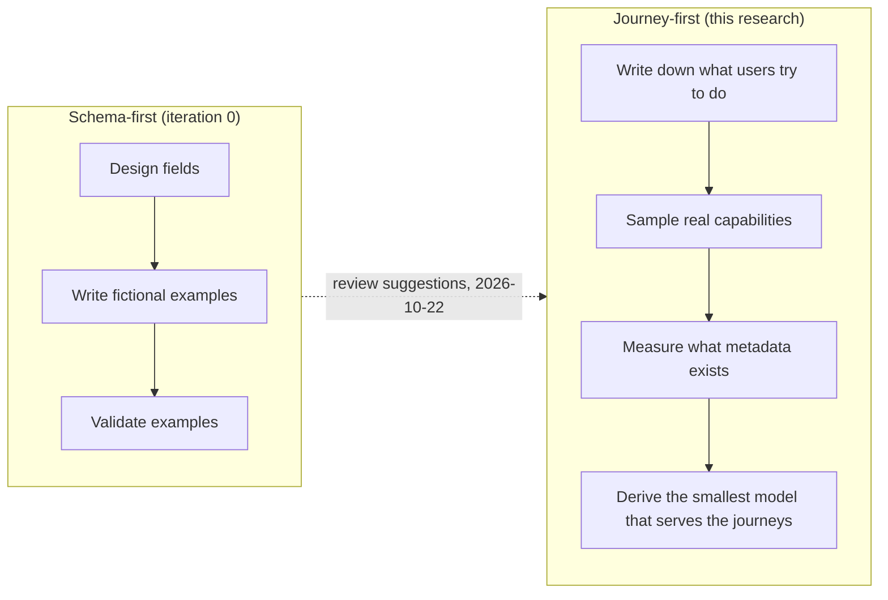

🔗 **Connecting the dots.** Everything after this point follows from the flip: the journeys
define success, the sample supplies evidence, and the model is built from what the
evidence shows.

---

## 2. Words you need first


| Term | Plain meaning | Example |
|---|---|---|
| **AI capability** | A reusable AI-related thing that a team can adopt on its own | Microsoft's Playwright MCP server, which lets an AI agent drive a web browser |
| **Metadata** | Data that describes something, rather than the thing itself | A capability's name, description, version, and license |
| **Native metadata** | The metadata an ecosystem already keeps about its own items, in its own format | A `package.json` file for an npm package |
| **Manifest** | One file that describes one capability in the common format | `playwright-mcp.capability.yaml` |
| **Schema** | The machine-readable rules for what a valid manifest looks like | The capability schema, written in JSON Schema |
| **Validator** | A program that checks a manifest against the schema and other rules | `capability-manifest validate` |
| **Crosswalk** | A translation table from one native format to the common format | "npm's `keywords` → manifest `keywords`; npm's `author` → manifest `owner.name`" |
| **Registry / catalog / marketplace** | A directory where publishers list their items | The official MCP Registry; the Docker MCP catalog |
| **Publication** | One place where a capability is distributed | The same server appears as an npm package, a Docker image, and a registry entry |
| **Provenance** | Where a value came from, and how sure we are | "License: stated by npm" versus "Owner: guessed from the repository owner" |
| **Research workstream** | One of the short, focused research tasks Mission 4 set up to settle its open design questions. Three matter here: **standards research** (which existing formats to reuse), **metadata-model research** (what counts as a capability and which fields describe it), and **identifier and lifecycle research** (ids, status changes, and versions) | "The identifier and lifecycle research decides the id format" |
| **Proof of concept (POC)** | A small working version built to test ideas, not a finished product. Its choices are proposals until the research workstreams confirm them | The validator in §12 |
| **Journey** | A real task a user tries to do, written as the questions they must answer | "Find something that already does X before I build it" |
| **Forge** | A code-hosting site | GitHub |
| **MCP** (Model Context Protocol) | A standard way for an AI application to connect to a tool server. Think of it as a USB port for AI tools | An MCP server that exposes "click", "type", and "screenshot" tools |
| **A2A** (Agent2Agent) and **Agent Card** | A protocol for agents to talk to each other. An Agent Card is the JSON "business card" an agent publishes about itself | `/.well-known/agent-card.json` |
| **Agent Skill** | A folder of instructions (a `SKILL.md` file) and optional scripts that an AI agent can load | A "pdf" skill that tells an agent how to extract text from PDFs |
| **npm / PyPI** | Package stores for JavaScript and Python code | `@playwright/mcp` on npm; `docling` on PyPI |
| **SemVer** | Semantic Versioning: versions written as MAJOR.MINOR.PATCH, where MAJOR changes mean "this may break you" | `2.0.3` |
| **purl** (Package URL) | A standard way to write a package's address across ecosystems | `pkg:npm/%40playwright/mcp` |
| **Precision** | Of the results a search returned, the share that were useful | 8 useful out of 22 returned is 36% |
| **Recall** | Of the useful items that exist, the share the search found | Found 4 of the 4 relevant items: 100% |

🔗 **Connecting the dots.** Three ideas carry the whole document: **native metadata** (what exists
already), **publications** (one capability, many places), and **provenance** (how much to trust each
value). Watch for them.

---

## 3. Who does what: the five missions

Mission 4 is one of five missions. Its job is the **structure and rules**. Content, ranking, risk
decisions, and submissions belong to the others (📘 this split was agreed when the missions were set up).

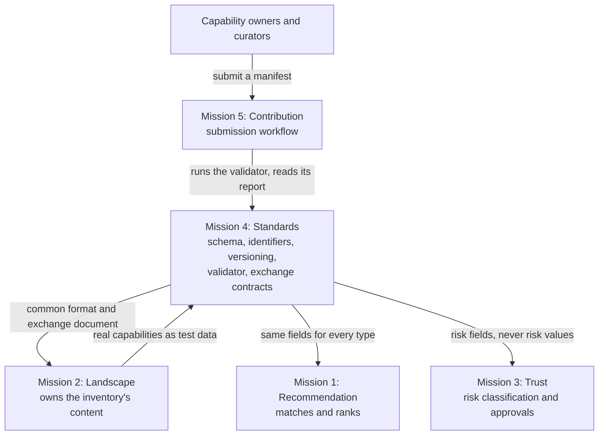

| Mission | Owns | What it needs from Mission 4 |
|---|---|---|
| 1 Recommendation | Matching, ranking, and explaining recommendations | Fields to judge fit and constraints, read the same way for every capability type |
| 2 Landscape | The inventory and its content | A format that every source maps into; a way to spot one capability listed twice |
| 3 Trust | Risk classifications, assessments, approvals | Fields that record an assessment, and a rule that "unassessed" is never read as "low risk" |
| **4 Standards** | **The schema, identifiers, versioning rules, validator, and exchange contracts** | (this is the mission) |
| 5 Contribution | Contributor engagement and the submission workflow | A validator with a machine-readable report and exit codes |

A useful rule of thumb from the published team boundaries: *"The Landscape team owns the inventory's
content; this team owns the structure and rules used to represent that content."*

🔗 **Connecting the dots.** This division explains why later sections keep saying things like
"risk is absent by design" (it is Mission 3's) and "the term matcher is only a test instrument"
(ranking is Mission 1's).

---

## 4. The research question and how it was tested

### 4.1 The question

> **Does a common description actually help people find, compare, and reuse AI capabilities? If so,
> what is the smallest description that does it?**

### 4.2 The four journeys

📏 The research wrote down four journeys before looking at any capability. Each journey is a user,
a goal, and the questions they must answer.

| Journey | Who | Goal | What success looks like |
|---|---|---|---|
| **J1 Find before building** | A developer about to build an integration | Find something that already meets the need | Every relevant capability found, few irrelevant ones, each shown once |
| **J2 Recognise duplicates** | The developer, or a curator of an approved list | Avoid counting one capability twice; spot forks and wrappers | Correct pairs found; no false merges |
| **J3 Compare and decide** | A team with two or more candidates | Decide to reuse, adapt, or build | Each decision question answered with its source, or marked unknown |
| **J4 Enough information?** | A consumer such as a recommender or a reviewer | Know which facts are stated, guessed, or missing, and what to ask | A clear list of what to ask, per capability |

### 4.3 The four concrete needs

To make J1 testable, the research fixed four realistic needs, each with a written rule for what
counts as "relevant". The rules were written **before** sampling. This is called
**pre-registration**: it stops the researcher from moving the goalposts after seeing the results.

| Need | What a developer wants | Counts as relevant when it... |
|---|---|---|
| N1 | Let a coding agent drive a real browser: click, fill forms, take screenshots | lets an agent drive a real browser interactively |
| N2 | Let an agent read and update GitHub issues and pull requests | gives read and write access to issues and pull requests |
| N3 | Give an agent live web search with citable URLs | searches the web and returns URLs |
| N4 | Extract text and tables from PDFs inside an agent workflow | reads PDFs and returns their text (and tables) |

### 4.4 The method, step by step

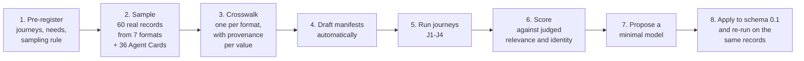

📏 Each value that the crosswalk extracts is tagged with how it was obtained:

| Provenance | Meaning | Example |
|---|---|---|
| **native** | The record itself states it | npm `license: Apache-2.0` |
| **linked** | A source that the record points to states it | The license that GitHub detects for the repository a registry entry links to |
| **derived (convention)** | A documented rule of the source yields it | "A `SKILL.md` file is a skill" |
| **derived (heuristic)** | A guess from wording or context; must be confirmed | "The keywords mention MCP, so it is probably an MCP server" |

🔗 **Connecting the dots.** The provenance tags are not decoration. In §7.6 they let the research
count how many records are usable *without guessing*, and in §11 they become a field of the
model.

---

## 5. The real capabilities that were sampled

### 5.1 Where the sample came from

📏 The sample has **60 distinct capability records** in seven packaging formats, plus **36 A2A Agent
Cards** checked separately for conformance.

| Format | What it is | Records |
|---|---|---|
| MCP Registry entry (`server.json`) | The official directory of MCP servers | 14 |
| npm package (`package.json`) | JavaScript packages | 14 |
| Agent Skill (`SKILL.md`) | Instruction folders for agents, from three publishers | 11 |
| Claude Code plugin | Plugins from the official marketplace | 7 |
| Docker MCP catalog entry (`server.yaml`) | MCP servers packaged as containers | 8 |
| PyPI package | Python packages | 5 |
| GitHub Action (`action.yml`) | A workflow step | 1 |
| **Total capability records** | | **60** |
| A2A Agent Card (`agent-card.json`) | Agents' self-descriptions, sampled from public repositories | 36 (separate) |

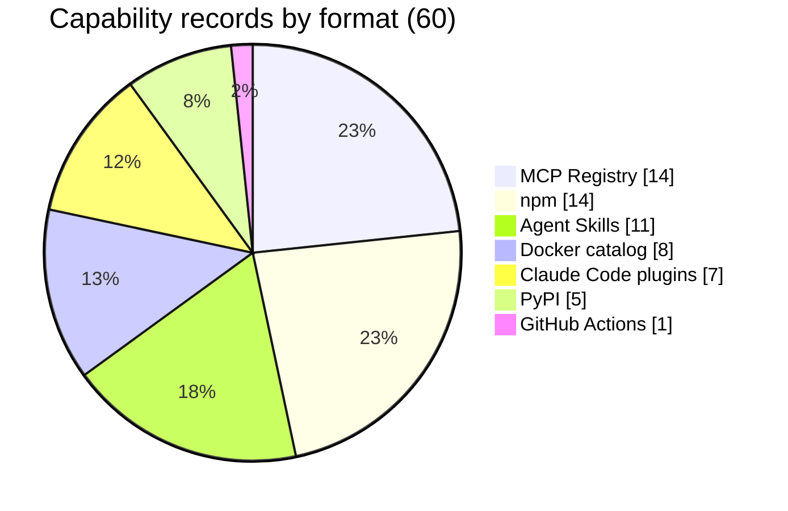

### 5.2 How records were chosen

📏 The sampling rule was fixed in advance:
1. From searchable registries (MCP Registry, npm): the first page of results for each need's query.
2. From listings without search (skills, plugins, Docker): entries whose name or description
   contains the need's terms.
3. At most two entries per source per need: the vendor's own publication first (for example,
   Microsoft's Playwright server for N1), then random draws with a fixed seed.
4. A few purposive additions named in advance, for formats with no searchable source (three PyPI
   packages and one GitHub Action).
5. When a selected record declares another publication of itself, that publication was added too.
6. Background: the 12 randomly drawn capabilities from the earlier pilot (11 distinct records).

### 5.3 Honest limits of the sample

📏 The research itself lists these limits. Keep them in mind when reading any number below.

| Limit | Why it matters |
|---|---|
| One person judged relevance and identity | A second judge might disagree on borderline cases |
| Public capabilities stand in for internal ones | Internal catalogues may look different |
| Most records were selected by the same words that J1 searches with | Recall near 100% is partly built in; the informative results are the misses and the false positives |
| Metadata only: nothing was installed or run | Runtime behaviour (for example, which tools a server really exposes) was not tested |
| A one-day snapshot (2026-10-22) | Registries change by the hour |

🔗 **Connecting the dots.** The sample is small but varied on purpose: seven formats is what makes
the "same capability in several places" problem (J2) visible at all.

---

## 6. What existing formats already say

### 6.1 The comparison matrix, simplified

📏 For each concept, this table shows whether each format has a field for it. ✅ = a field exists;
🟡 = only partly, indirectly, or in prose; ❌ = nothing.

| Concept | MCP Registry | npm | Agent Skill | Plugin | Docker | PyPI | Action | A2A Card |
|---|---|---|---|---|---|---|---|---|
| Name | ✅ | ✅ | ✅ | ✅ | ✅ | ✅ | ✅ | 🟡 display name only |
| Description | ✅ | ✅ | ✅ | ✅ | 🟡 optional | ✅ | ✅ | ✅ |
| Version | ✅ | ✅ | ❌ | 🟡 not checked | 🟡 commit pin | ✅ | 🟡 git tags | 🟡 free text |
| License | 🟡 via repository | ✅ | 🟡 text or file | 🟡 | 🟡 via repository | ✅ | 🟡 via repository | ❌ |
| Lifecycle (active, deprecated...) | ✅ | 🟡 message | ❌ | ❌ | 🟡 "(Archived)" in title | 🟡 classifier | ❌ | ❌ |
| Setup and credentials | ✅ | ❌ | ❌ | 🟡 | ✅ | ❌ | ✅ inputs | 🟡 |
| Other publications of itself | ✅ | 🟡 `mcpName` | ❌ | 🟡 | ✅ image | 🟡 marker | ❌ | ❌ |
| Structured abilities | ❌ runtime only | ❌ | ❌ prose | ❌ | 🟡 generated | ❌ | ❌ | ✅ `skills[]` |
| Limitations | ❌ | ❌ | ❌ | ❌ | ❌ | ❌ | ❌ | ❌ |
| Risk assessment | ❌ | ❌ | ❌ | ❌ | ❌ | ❌ | ❌ | ❌ |

### 6.2 How often each fact is actually present

📏 Counted across all 60 records. "Native" means the record states it itself.

| Fact | Native | Plus linked or derived | Picture (native, of 60) |
|---|---|---|---|
| Name | 60 | | `████████████████████` 60 |
| Description | 58 | | `███████████████████░` 58 |
| Documentation link | 29 | 27 derived | `██████████░░░░░░░░░░` 29 |
| Version | 38 | 9 linked or derived | `█████████████░░░░░░░` 38 |
| License | 24 | 26 via the repository | `████████░░░░░░░░░░░░` 24 |
| Lifecycle | 17 | 2 | `██████░░░░░░░░░░░░░░` 17 |
| Setup and credentials | 13 | | `████░░░░░░░░░░░░░░░░` 13 |
| Limitations | 0 | | `░░░░░░░░░░░░░░░░░░░░` 0 |
| Risk assessment | 0 | | `░░░░░░░░░░░░░░░░░░░░` 0 (by design: Mission 3) |

### 6.3 Same meaning, different names

| Concept | Field names seen in the wild |
|---|---|
| Description | `description`, `Summary`, `about.description` |
| Discovery terms | `keywords`, `tags`, `category`, `meta.tags`, `skills[].tags` |
| Setup | `environmentVariables`, `headers`, `config.secrets`, `oauth`, `inputs`, `userConfig`, `securitySchemes` |
| Lifecycle | `status`, `deprecated`, a Development Status classifier, `archived`, "(Archived)" in a title |

### 6.4 Same name, different meanings (the traps)

| Word | Different meanings observed | Why it is a trap |
|---|---|---|
| **skill** | An Agent Skill (a folder); an A2A skill (one ability of an agent); an OASF skill (a taxonomy node) | Mapping "skills" between formats mixes up whole capabilities with single abilities |
| **name** | A machine identifier in most formats; a display label in A2A and GitHub Actions | Matching by name merges different capabilities (§7.3) |
| **version** | A software release; a metadata republication; a commit; a floating tag such as `v1` or `latest` | "Which version is current?" gets different answers in different places |
| **active** | In the MCP Registry: "listed and not deprecated" | It does **not** mean "maintained" |
| **tables / search / browser** | PDF tables vs database tables; web search vs site search; "drives a browser" vs "runs in a browser" | These cause most false search hits (§7.2) |

🔗 **Connecting the dots.** §6.2 is the most important table so far. The facts that are almost always
present (name, description) help you *find* a capability. The facts that are almost never present
(setup, limitations, license, lifecycle) are the ones you need to *decide to reuse* it. Hold on to
that gap; §7 measures it journey by journey.

---

## 7. Findings, journey by journey

### 7.0 The eleven key findings at a glance

| # | Finding in one line |
|---|---|
| 1 | Sources' own search is weak, so good discovery depends on how consumers normalise metadata |
| 2 | A shared core already exists: name, description, source repository, version, documentation |
| 3 | The facts that decide reuse are the least available: setup, limitations, license, lifecycle |
| 4 | Publications of one capability can be linked reliably from declared links plus repository and path, but not from names |
| 5 | Identical name and description do not mean the same capability |
| 6 | Keyword search finds relevant capabilities but returns a lot of noise (precision 36-71%) |
| 7 | Passing the schema and being useful are independent |
| 8 | Native formats are often not conformant to their own specifications, and conformance proves little |
| 9 | Lifecycle is rarely machine-readable; deprecations live in prose |
| 10 | Identity breaks in the ways the mission had anticipated, and in others it had not |
| 11 | An emerging standard (the Linux Foundation's AI Catalog draft) already takes the approach the evidence supports |

### 7.1 Before the journeys: how the sources' own search behaves

📏 The striking example: in the official MCP Registry, a search for "github" returns **29,152**
results, and **GitHub's own server is at rank 12,080**. Why? The registry matches name substrings,
and every GitHub-verified publisher's name starts with `io.github.` So every entry matches.

| Source | How its search works | What happened |
|---|---|---|
| MCP Registry | Case-insensitive substring match on names, sorted alphabetically (the registry calls it "intentionally simple") | "github": GitHub's server at rank 12,080 of 29,152. "web search": no results at all |
| npm | Relevance-ranked text search | "playwright mcp": vendor package at rank 2, mixed with a fork, a wrapper, and near-identical copies |
| Skills, plugins, Docker | No search, just a list to browse | 523, 315, and 328 entries |

🔗 **Connecting the dots.** Mission 4 does not build search (that is Missions 1 and 2). What it can
control is whether the metadata it hands them lets them do *better* than this. J1 tests exactly that.

### 7.2 J1: find a capability for a need

**Method.** 📏 A simple, transparent keyword matcher scored each record: a match in the name counts
3, in keywords or tags 2, in the description 1. Three variants were compared:

| Variant | What it searches |
|---|---|
| **V0** | Native fields only |
| **V1** | Native fields plus documentation text (README and similar) |
| **V2** | Native fields, with the namespace treated as the **publisher**, not as part of the name |

**A quick refresher on precision and recall.** Think of fishing with a net. *Recall* asks: "Of all
the fish I wanted, how many did I catch?" *Precision* asks: "Of everything in my net, how much was
fish rather than old boots?"

📏 **Results:**

| Need | Variant | Returned | Recall | Precision |
|---|---|---|---|---|
| N1 browser | V0 | 21 | 14 of 14 | 71% |
| | V1 | 29 | 14 of 14 | 52% |
| N2 GitHub | V0 | 22 | 4 of 4 | **36%** |
| | V1 | 43 | 4 of 4 | 19% |
| | V2 | 13 | 4 of 4 | **62%** |
| N3 web search | V0 | 19 | 1 of 2 | 53% |
| | V1 | 28 | 2 of 2 | 39% |
| N4 PDF | V0 | 13 | 3 of 3 | 38% |
| | V1 | 15 | 3 of 3 | 33% |

**Why the "old boots" got into the net**, and what metadata would keep them out:

| Need | False hits | Cause | Missing concept that would fix it |
|---|---|---|---|
| N2 | 9 of 14: `io.github.*` entries and GitHub's registry SDK | Namespace matched as if it were the name | **Publisher kept separate from name.** V2 did this: precision 36% → 62% |
| N4 | PDF *viewers* and *generators* returned for "extract text from PDFs" | No format says what a capability **accepts** and **produces** | **Input and output media types** |
| N1 | Things that "run in your browser" or "open your browser for login" | "browser" used in another sense | **Structured abilities** rather than free text |
| N3 | 9 of 10 useful results search *one site*, not the web | "search" is generic | **Scope** in structured abilities ("search the web" vs "search this site") |

📏 **Two more lessons:**
- **Duplicates fill the list.** N1's 9 relevant capabilities came back as 14 entries, because some
  capabilities appear in several places. Fixing that is J2's job.
- **Documentation text cuts both ways.** Adding README text (V1) found a capability whose metadata
  never says "search" (langchain-tavily), but made precision worse everywhere else.

💡 Use documentation text to *draft* structured abilities that an owner then confirms, not as a
search index on its own.

### 7.3 J2: recognising the same capability across sources

**Why this matters.** 📏 Microsoft's Playwright server appears in the sample four times, under four
different native names, with three different versions:

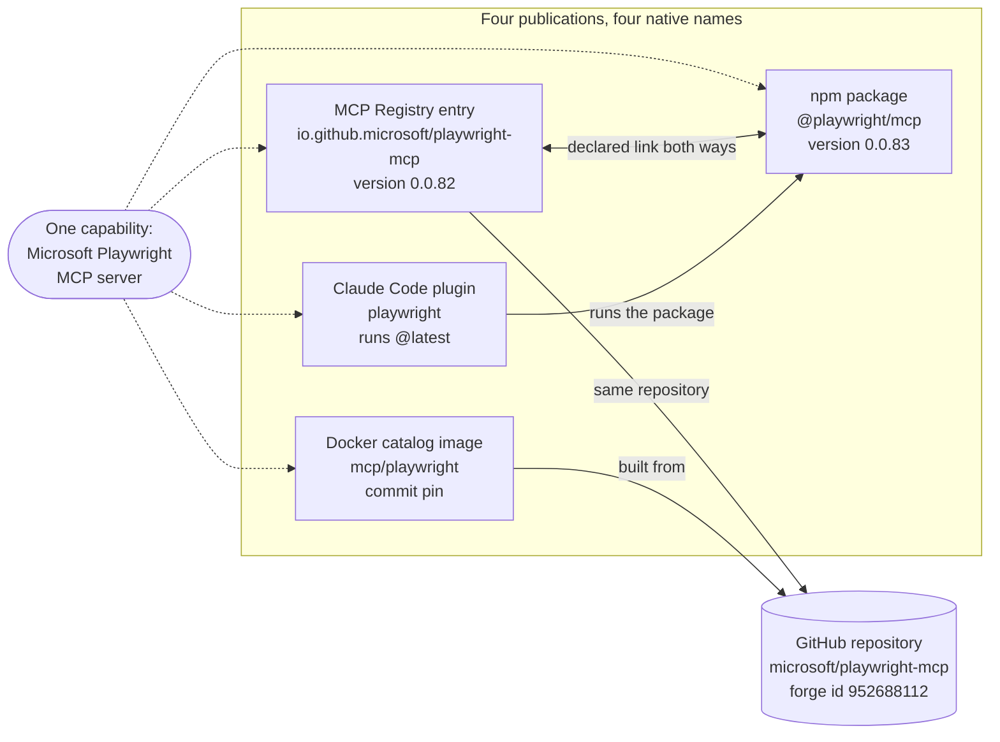

**Method.** 📏 Seven groups of entries were judged to be the same capability, giving 14 true pairs.
Then simple rules that use only metadata were scored:

| Rule | Correct pairs | False pairs | Missed (of 14) |
|---|---|---|---|
| Declared links only (the record says "this package is me") | 11 | 0 | 3 |
| Same repository **and** same path | 7 | 0 | 7 |
| **Declared links + same repository and path** | **14** | **0** | **0** |
| Same native name only (the control) | 4 | **2** | 10 |

**What made it work.** 📏 The MCP Registry requires each package to *prove* it belongs to the server
through a back-link (for example `mcpName` in `package.json`). Following those declared links means
no guessing. The repository needs the *path* too, because one repository can hold many capabilities.

**Why names fail.** 📏 Two different Agent Skills are both called `webapp-testing`, with identical
descriptions, but they differ in runtime (Python vs Node.js), files, and license. Name matching
merged them, which is wrong.

**Derivatives are recorded inconsistently:**

| Kind | Example | Where it is recorded |
|---|---|---|
| Fork, recorded by GitHub | A fork of Playwright MCP republished under another namespace | GitHub's fork flag only |
| Fork, claimed in prose | `agentic-playwright-mcp`: "an independent fork... not a Microsoft package" | README only |
| Wrapper | The `playwright` plugin only configures Microsoft's server | The plugin's `.mcp.json` |
| Replacement | Browserbase's archived server points to its hosted service | README only |

📏 The schema as it stood on 2026-10-22 allowed **one** `source` per manifest. It could not hold
four publications, and it had no field for "fork of" or "wraps".

### 7.4 J3: compare candidates and decide

📏 The 16 relevant capabilities were compared on twelve decision questions. Four had a **blocker**
(reuse cannot be justified from metadata alone):

| Capability | Blocker |
|---|---|
| Browserbase MCP server | Archived and unmaintained, yet still listed in the Docker catalog |
| anthropics `webapp-testing` skill | License given only as "see LICENSE.txt" (the file is Apache-2.0, so a detection step would resolve it) |
| devloop | No license in its registry entry |
| anthropics `pdf` skill | Proprietary ("All rights reserved"), although it is the most discoverable PDF capability in the sample |

📏 And **every** capability had gaps:
- **Limitations:** stated for none of the 16.
- **Setup:** not stated for 11 of 16. For several, probably none is needed, but no format can say
  "none needed".
- **Versions disagree across publications** for 2 capabilities.

📏 Merging all publications of a capability answered one more question for 3 of the 4
multi-publication capabilities. The main value of linking publications is removing duplicates and
spotting conflicts, not finding many more facts.

### 7.5 J4: is there enough information, and what should we ask?

📏 The research defined **completeness levels** and counted how many records reach each one from
their own metadata:

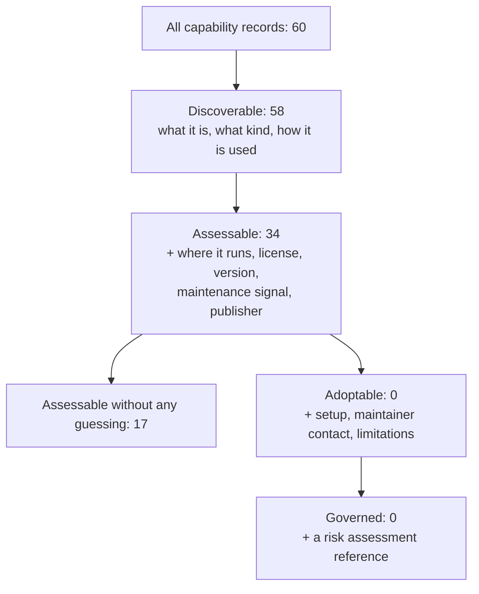

📏 Per question, how each answer was obtained:

| Question | Stated | Linked | Rule | Guess (to confirm) | Unknown (to ask) |
|---|---|---|---|---|---|
| What is it? | 58 | 0 | 0 | 0 | 2 |
| What kind? | 0 | 0 | 47 | 13 | 0 |
| Where does it run? | 36 | 0 | 24 | 0 | 0 |
| Setup | 13 | 0 | 0 | 0 | **47** |
| Limitations | 0 | 0 | 0 | 0 | **60** |
| License (terms) | 24 | 26 | 0 | 0 | 10 |
| Version | 38 | 1 | 8 | 0 | 13 |

📏 **Patterns by format:** no Agent Skill reaches "assessable", because the format has no version
field. npm packages reach it 13 times out of 14, but never without a guess, because only `mcpName`
says that a package is an MCP server.

### 7.6 Passing the schema is not the same as being useful

📏 Each record was automatically drafted into a manifest and checked against the schema **as it
stood on 2026-10-22**:

| | Assessable from metadata | Not assessable |
|---|---|---|
| **Valid** | 5 | 7 |
| **Invalid** | **29** | 19 |

📏 Only **12 of 60** drafts were valid. The most common error was a missing `lifecycleStatus` (45
drafts), a field the schema made mandatory although few sources state it. Meanwhile 29 *invalid*
drafts held enough information for a reuse assessment.

**Lesson:** the list of mandatory fields, not the data, made most real capabilities fail.

### 7.7 A2A Agent Cards in practice

📏 Of 36 public `agent-card.json` files, only **4** validate against the A2A v0.3.0 schema, and only
**4** have every field that v1.0.1 marks as required. One fully conformant card states that its host
is not actually an A2A agent.

**Lesson:** conformance shows the *shape* of a file, not that a working agent stands behind it.

🔗 **Connecting the dots.** Put §7.2 to §7.7 together and a picture appears. Finding works fairly
well from existing metadata, but it needs publisher and name kept apart, and publications grouped.
Deciding does not work yet, because the facts it needs are missing at the source. A rigid mandatory
list makes this worse by rejecting records that are actually useful. These three observations drive
the model in §11.

---

## 8. The standards landscape

### 8.1 What exists already, in one line each

| Standard | One-line explanation | Metadata or runtime? | 💡 Proposed stance |
|---|---|---|---|
| **Agent Skills** | A folder format for agent instructions | Metadata | **Reference** as a native format |
| **MCP** | Protocol between AI apps and tool servers | Runtime | **Reference**; do not copy |
| **MCP Registry `server.json`** | Directory entry for an MCP server, with verified namespaces | Metadata | **Reference**; reuse its verification as evidence |
| **MCP Server Cards** | Static description of a remote MCP server before connecting | Metadata for connection | **Reference** for endpoints |
| **A2A Agent Card** | An agent's self-description | Metadata served at runtime | **Reference**; reuse its skills and media types |
| **AI Catalog** (Linux Foundation draft) | A container for listing many kinds of AI artifacts, with trust data | Metadata envelope | **Align**: make the manifest convertible into it |
| **JSON Schema 2020-12** | A language for validation rules | Validation | **Reuse** for the schema |
| **SemVer 2.0.0** | Version numbering rules | Versioning | **Reuse** to compare versions when they parse; do not require it |
| **Package URL (purl)** | Standard package addresses | Identification | **Adopt** for package publications |
| **npm, PyPI, plugins, Docker, Actions** | Ecosystem-specific package or listing formats | Metadata | **Reference**, one crosswalk each |
| **OASF** | A taxonomy for agent abilities | Metadata | **Evaluate** with Mission 2 |
| **Backstage** | Internal software catalogue format | Metadata | Likely shape of internal catalogues (not sampled) |

### 8.2 Metadata versus runtime: who answers which question

This separation is central. 📘 The manifest is a **description**, not a way to run anything: being
able to describe a capability does not mean anyone can run it remotely.

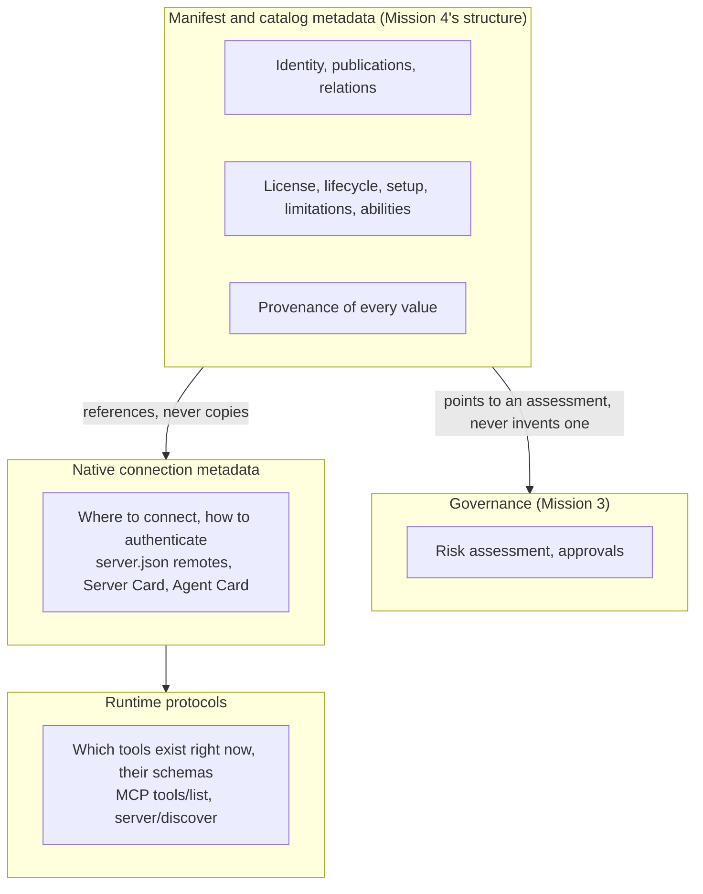

📏 Why tools stay out of the manifest: the MCP Server Cards proposal notes that tools "can vary by
authenticated user, session, configuration", so a static document cannot list them reliably.

### 8.3 The gaps only a common manifest fills

💡 Mission 4 should define only what no existing format provides:
1. One record that groups **all publications** of a capability, with **relations** to forks,
   wrappers, and replacements.
2. **Cross-format reuse facts with provenance**: license and its scope, lifecycle signals, setup
   (including "none"), limitations, input and output types.
3. **Explicit value states**: unknown, declared none, conflicting, unverified.
4. **Completeness levels** tied to the journeys.
5. The **link to governance**, with the rule that unassessed is never low.

🔗 **Connecting the dots.** "Reference, don't restate" is not only tidy; it is evidence-driven.
Copies drift: one capability already shows three versions at once (§7.3).

---

## 9. What counts as one capability?

📘 Mission 4 defines a capability as "an independently adoptable AI-related asset, tool, service, or
solution that can be described and managed as a distinct unit." The research turned "independently
adoptable" into three tests.

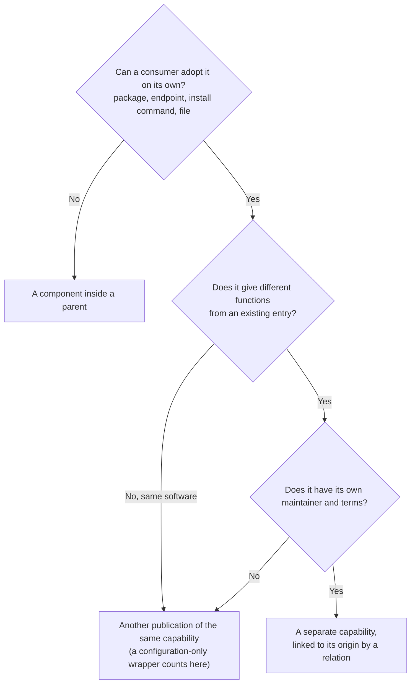

📏 💡 Boundary cases found in the sample, with the proposed treatment:

| Case | Proposed treatment |
|---|---|
| A plugin that only configures someone else's server | Same capability; a publication with a `wraps` relation |
| A library that is also an MCP server and a hosted service (browser-use) | One capability, three publications |
| Two skills with the same name and description (`webapp-testing`) | Two capabilities |
| A fork republished under another namespace | A separate capability with a `fork_of` relation |
| An archived server replaced by a hosted service (Browserbase) | Two capabilities; the old one deprecated with a `replacedBy` |
| One repository holding many skills or plugins | Each path is its own capability |
| An A2A agent with several skills | One capability; its A2A skills are *abilities*, not capabilities |

❓ Still open: is a pure wrapper its own inventory entry for Mission 2? Where does a bundle end and
its components begin?

📏 Do different types need different metadata? **No.** The core is the same for every type. What
differs is concentrated in four concepts (interface, runtime, setup, dependencies), and the native
format holds the details.

---

## 10. Identity, lifecycle, and versioning

### 10.1 Separate three things

💡 The research's main identity proposal is to keep three things apart:

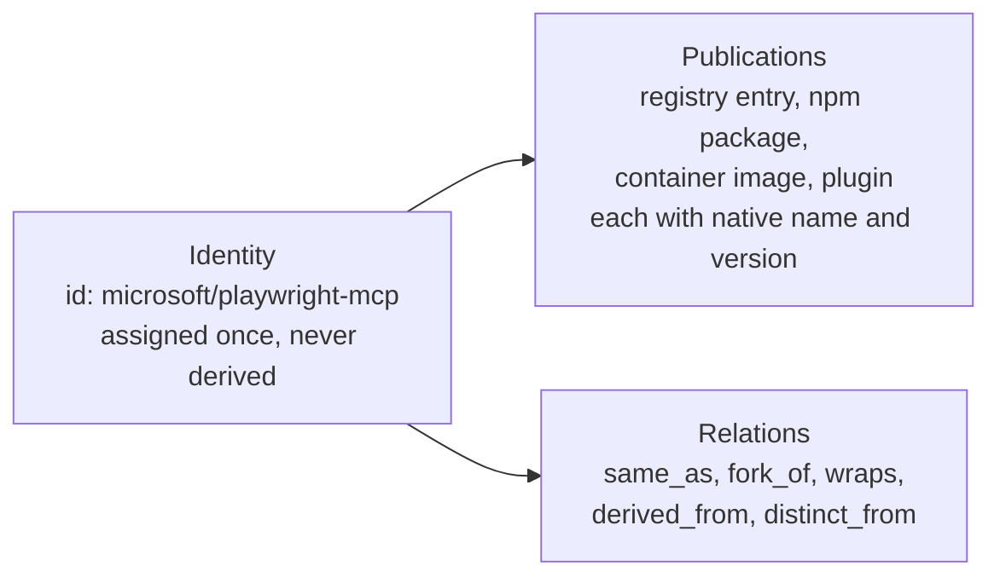

📏 **Why the id must be assigned, not derived.** Every attempt to build an id from something that can
change failed in at least one real case:
- **Repository URL:** a repository was renamed; the stored URL went stale, while GitHub's numeric
  repository id stayed the same.
- **Name:** two publishers ship different skills both called `pdf`.
- **Package name:** each channel has its own name for the same capability.

📏 The id pattern in the 2026-10-22 draft rejected real, registry-verified namespaces that start with
a digit (for example `io.github.0xmortuex`). The revision accepts them.

### 10.2 Identifier options compared

| Approach | Survives a rename? | Handles several publications? | Main risk |
|---|---|---|---|
| Native name as id | Partly | No | Ties identity to one channel |
| Readable namespaced id (`namespace/name`, the POC's choice) | Yes, if assigned once | Yes, with publications listed | Someone must allocate namespaces |
| URN (`urn:air:publisher:namespace:name`, AI Catalog) | Yes | Yes | Needs the publisher's authorisation; the draft may change |
| Opaque catalog id (a UUID) | Yes | Yes | Unreadable; two catalogs may assign different ids |
| Forge repository id | Yes | No | Identifies a repository, not a capability; good **evidence** for linking |

💡 Because publications are carried separately, the readable-id-versus-URN choice affects only
allocation and stability, not discovery or linking. It can stay provisional. ❓ Who allocates
namespaces is open (with Missions 5 and 2).

### 10.3 Lifecycle: declared versus observed

📏 Real sources signal lifecycle in many ways, and no source records a successor in machine-readable
form. A registry's `active` means "listed", not "maintained".

💡 So the model separates two things:
- **Observed signals** that a channel reports, recorded per publication with their source and date.
  They can change at any time, in any direction.
- **An owner's declared status** (`lifecycleStatus`), which is optional and follows a transition
  table.

💡 The owner-declared transitions (a POC proposal, still to be confirmed by the identifier and lifecycle research, with Mission 3):

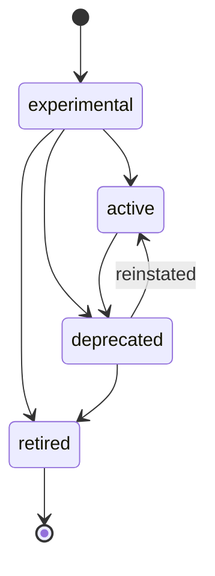

📘 Lifecycle, risk, and approval are separate concepts. "Active" never means "approved".

### 10.4 Two kinds of version

| | `schemaVersion` | `capabilityVersion` and publication versions |
|---|---|---|
| Version of what? | The rules (the schema) | The capability itself |
| Format | Quoted `"MAJOR.MINOR"`, now `"0.1"` | SemVer for `capabilityVersion`; any native scheme per publication |
| Who changes it | Mission 4 | The capability's publishers |

📏 What the sample showed about capability versions:
- Schemes vary: SemVer (38 records), PEP 440, commit pins (8), tags, dates, and none at all (13,
  including all 11 skills).
- 15 of the 28 registry and npm versions are below 1.0.0, where SemVer promises nothing about
  compatibility.
- Versions drift between publications: 0.0.82 in the registry versus 0.0.83 on npm.

💡 Record each publication's native version **with its scheme**. Compare versions only when both
parse. Never require SemVer.

📏 For `schemaVersion`, independent standards agree with the POC's rules. The AI Catalog draft, for
example, also uses Major.Minor, ignores unknown fields in a newer minor version, and rejects unknown
major versions.

🔗 **Connecting the dots.** The identifier and lifecycle research was framed as "pick an id format". The evidence says the urgent
question is different: model publications and relations first. Once those exist, the id format is a
smaller decision.

---

## 11. The proposed model

### 11.1 Five principles, each from evidence

| Principle | The evidence behind it |
|---|---|
| 1. **Reference** native metadata; restate only what consumers need across formats | Copies drift: three versions of one capability at once (§7.3) |
| 2. **Separate** identity, publications, and relations | Up to four publications per capability; names collide; URLs go stale (§7.3, §10.1) |
| 3. Every value carries its **provenance** and its **state** | Consumers must tell stated facts from guesses and gaps (§7.5) |
| 4. **Require only what every source can supply**; report levels for the rest | One unsupplied mandatory field made 45 of 60 drafts invalid (§7.6) |
| 5. Lifecycle is **observed**; governance is **referenced** | No source supplies risk; "active" is not "approved" (§10.3) |

### 11.2 Mandatory fields: from ten candidates to six

📘 Before this research, Mission 4 had listed ten fields as *candidates* for being mandatory, on the
understanding that early research would check them before anything was fixed. 💡 After the research, the revised draft (2026-10-23) makes six mandatory:

| Field | Still mandatory? | Why |
|---|---|---|
| `schemaVersion` | ✅ Yes | Tells the validator which rules apply |
| `id` | ✅ Yes | The stable key |
| `name` | ✅ Yes | Every source has one (60 of 60) |
| `capabilityType` | ✅ Yes | Always derivable from the format |
| `source` | ✅ Yes | Every record has a location |
| `riskTier` | ✅ Yes | Default `unassessed`, which asserts nothing |
| `description` | ➡️ Moved to the "discoverable" level | 2 of 60 records have none |
| `owner` | ➡️ Moved to levels (name: assessable; contact: adoptable) | Often only derivable |
| `lifecycleStatus` | ➡️ Optional owner declaration; observed signals count instead | 45 of 60 drafts failed on it |
| `lastUpdated` | ➡️ Optional; means "date of this record" | It had two meanings (§6.4) |

### 11.3 Completeness levels: a ladder instead of a wall

Instead of rejecting every record that lacks some facts, the validator **reports how far up the
ladder a record gets**, and exactly what the next rung needs. A process (for example Mission 5's
submission step) can require a level when it wants to, using `--require-level`.

| Level | Adds | Who usually supplies it |
|---|---|---|
| (valid) | The six mandatory fields | Automatic |
| **Discoverable** | A description and an interface | Automatic, from native metadata |
| **Assessable** | Runtime, license, a version, a lifecycle signal, an owner | Mostly automatic; guesses must be confirmed |
| **Adoptable** | Setup (an empty list means "none needed"), an owner contact, limitations (an empty list means "none known") | The capability owner |
| **Governed** | An assessed risk tier with its assessment reference | Mission 3 and the governance owners |

🔗 **Connecting the dots.** This is how the model handles the gap from §6.2. The levels a machine can
fill come first, and the levels that need people come last. The validator turns "what is missing"
into a to-do list for the owner, which is exactly what J4 asked for.

### 11.4 Value states: saying "I don't know" honestly

💡 No sampled format can tell these apart, yet consumers need to:

| State | Meaning | How the manifest records it |
|---|---|---|
| stated / linked / derived | We have a value, and we know where it came from | The value, plus a `provenance[]` entry |
| declared none | The owner says there is none | An empty list `[]` |
| unknown | Nobody says | The field is omitted (`null` is never allowed) |
| conflicting | Sources disagree | Kept per publication; the validator reports the disagreement |
| unverified | Claimed, not checked | A relation with `verified: false`; reported by the validator |
| unassessed (risk) | No risk assessment recorded | `riskTier: unassessed`, **never** read as low |

### 11.5 The schema, as a diagram

These two diagrams show the main parts of schema 0.1 as revised on 2026-10-23 (💡 a POC proposal). In
each box, the left column is the data type and the right column a short note. Fields marked
"required" are the six mandatory ones (plus `source.type`); everything else is optional and counts
toward completeness levels. Read `||--o{` as "one manifest has zero or more of these", and `|o--o|`
as "zero or one".

**Part A: identity and where the capability lives.** These entities answer J2 ("is this the same
capability?") and J4 ("where did this value come from?").

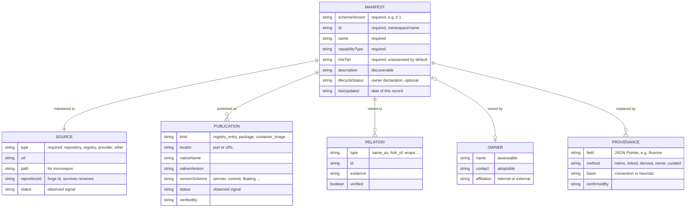

**Part B: what a team needs to use it.** These entities answer J3 ("can we reuse it here?") and
carry the link to governance.

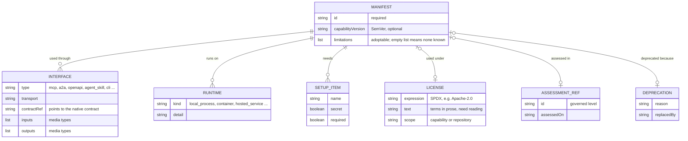

Other optional fields not drawn above: `keywords`, `documentation`, `maturity`, `intendedAudience`, `platformCompatibility`,
`costInformation`, `supportedUseCases`, `dependencies`, `components`, `embeddedComponents`, `parent`,
and `x-` extension fields.

### 11.6 A real example, shortened

This is the project's manifest for Microsoft's Playwright MCP server, trimmed for reading. Every value comes from the
2026-10-22 snapshot.

```yaml
schemaVersion: "0.1"
id: microsoft/playwright-mcp          # assigned, not derived from a URL or a native name
name: Playwright MCP                  # the only curated value
capabilityType: mcp_server
source:
  type: repository
  url: https://github.com/microsoft/playwright-mcp
  repositoryId: "952688112"           # survives a rename
publications:                         # one capability, four places, three version schemes
  - { kind: registry_entry,    locator: io.github.microsoft/playwright-mcp, nativeVersion: "0.0.82", versionScheme: semver, status: active }
  - { kind: package,           locator: pkg:npm/%40playwright/mcp,          nativeVersion: "0.0.83", versionScheme: semver }
  - { kind: container_image,   locator: docker.io/mcp/playwright,           nativeVersion: "2d446f9...", versionScheme: commit }
  - { kind: marketplace_entry, locator: playwright@claude-plugins-official, nativeVersion: latest, versionScheme: floating }
owner: { name: Microsoft Corporation, contact: https://github.com/microsoft/playwright-mcp/issues, affiliation: external }
license: { expression: Apache-2.0, scope: capability }
riskTier: unassessed                  # no assessment recorded: not low, not approved
interfaces:
  - { type: mcp, transport: stdio }   # tools are discovered at runtime, not listed here
runtime:
  - { kind: local_process, detail: "Node.js >=18, npx @playwright/mcp" }
  - { kind: container,     detail: docker.io/mcp/playwright }
provenance:
  - { field: /license,       method: native,  source: "npm package.json license" }
  - { field: /capabilityType, method: derived, basis: convention, source: "listed in the MCP Registry" }
  # ... one entry per value
```

**What the validator says about it:** it is valid, and it reaches the **assessable** level. To reach
**adoptable**, it still needs `setup` and `limitations`, which no public source states. It also
reports, as *unverified*, that the publications state different versions.

---

## 12. How the proof-of-concept validator works

### 12.1 Architecture

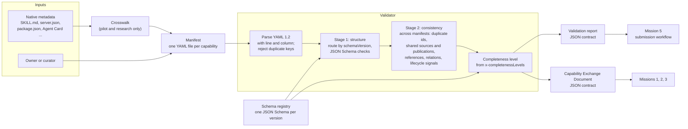

### 12.2 What happens when you run `validate`

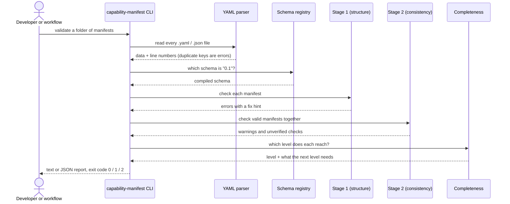

### 12.3 Three kinds of finding

| Severity | Meaning | Example |
|---|---|---|
| **error** | The manifest breaks the rules and is invalid | `MISSING_REQUIRED_FIELD /riskTier` |
| **warning** | Valid, but something is probably wrong | A shared publication under two different ids |
| **unverified** | The check could not be done: **neither passed nor failed** | `RISK_UNASSESSED`, `SOURCE_NOT_CHECKED` |

The "unverified" severity exists so that "not checked" is never mistaken for "passed".

The POC also showed why parsing details matter: a common Python YAML parser reads a file
containing `riskTier: high` followed by `riskTier: low` as `low`, silently. The validator treats
duplicate keys as errors.

### 12.4 The commands

| Command | What it does |
|---|---|
| `validate <path...>` | Checks manifests; reports errors, warnings, unverified checks, and the completeness level. `--require-level` enforces a level |
| `compat <previous> <next>` | Compares two revisions of one capability and says which version bump the change requires |
| `schema-compat <previous> <next>` | Compares two versions of the *schema* and classifies each change as breaking, additive, relaxation, or annotation-only |
| `export <path...>` | Writes a Capability Exchange Document for other missions; it contains no rankings or approvals |
| `docs` | Generates the field dictionary from the schema |

🔗 **Connecting the dots.** The validator is where the research becomes testable. In the next section
the same 60 records are run through it, so the claims of §11 can be checked against the evidence of
§7.

---

## 13. Before and after: what the revision changed

📏 The same 60 records were validated three times:

| Run | Drafting | Schema | Valid drafts |
|---|---|---|---|
| A | The original mapping | 0.1 as of 2026-10-22 | **12 of 60** |
| B | The same mapping | Revised 0.1 (2026-10-23) | **57 of 60** |
| C | Drafts with publications, provenance, and observed lifecycle signals | Revised 0.1 | **58 of 60** |

📏 **What the revised validator achieved on its own (run C):**
- **Identity:** its duplicate-publication and duplicate-source warnings linked **all 14** judged
  same-capability pairs, with **no** false link. That matches the best rule from §7.3.
- **Levels reached:** invalid 2, none 2 (no description), discoverable 25, assessable 31,
  adoptable 0, governed 0. These agree with the research's own measurement for 56 of the 60 records.
- **What to ask owners next:** for adoptable, limitations (31), an owner contact (31), and setup (23);
  for assessable, a version (13), a license (8), a lifecycle signal (4), and an owner (3).
- **Guesses to confirm:** 54 heuristic values are reported as unconfirmed.

📏 **Why `description` stopped being mandatory.** With `description` mandatory, two Docker entries
become invalid. Stage 2 skips invalid manifests, so the Docker build of the Playwright server is no
longer linked to its other publications, and identity drops from 14 to 11 pairs.

📏 **Verification on 2026-10-23:** all 206 automated tests passed; an independent Python validator
agreed on all 16 examples; and every manifest that was valid under the old draft stayed valid.

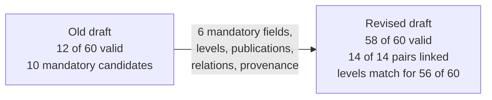

---

## 14. Trade-offs, risks, and what this does not prove

### 14.1 Trade-offs

| Choice | Benefit | Cost |
|---|---|---|
| Reference native metadata instead of copying it | No drift; less to maintain | Consumers must follow references, or a catalog must cache them |
| Several publications per capability | Matches reality; removes duplicates from discovery | More complex records that must be kept current |
| Provenance on every value | Honest uncertainty; targeted curation | Larger records; tooling needed to write them |
| Completeness levels | Every capability can enter, and records improve over time | Consumers must handle partial records |
| Assigned ids | Stable across renames | Someone must run an allocation process |
| Aligning with the AI Catalog draft | Interoperability with the MCP and A2A ecosystems | The draft may change, and Mission 4 does not control it |

### 14.2 Risks

| Risk | Mitigation |
|---|---|
| Public capabilities do not represent internal ones | Iteration 2 with internal capabilities |
| One judge biased the relevance and identity judgments | A second judge on the same pool |
| Owners find the adoptable level too costly to fill | Measure owner effort before requiring it anywhere |
| Guessed values get trusted as facts | Provenance on every value; heuristic values flagged |
| Native formats keep changing | One versioned crosswalk per format |
| Scope creep into search, ranking, or crawling | Keep the harness a test instrument; those belong to Missions 1 and 2 |

### 14.3 What the results do **not** show

- That internal capabilities behave the same way.
- That these completeness levels suit Missions 1, 2, and 5.
- That owners will actually supply setup and limitations.
- That the drafts' guessed values are correct (nobody has confirmed them).

🔗 **Connecting the dots.** Good research says where its evidence stops. These limits are exactly what
the experiments in §16 are designed to test.

---

## 15. Open questions

❓ None of these is decided.

| # | Question | Who decides |
|---|---|---|
| U1 | Adopt completeness levels instead of a fixed mandatory set before publishing 0.1? (Applied to the draft; still to confirm) | Mission 4, with Mission 5 |
| U2 | Fold `source` into `publications[]`? | Identifier and lifecycle research; Mission 4 |
| U3 | Readable namespaced id or URN? Who allocates namespaces? | Identifier and lifecycle research, with Missions 5 and 2 |
| U4 | Is a configuration-only wrapper a publication or its own inventory entry? | Metadata-model research, with Mission 2 |
| U5 | Which vocabulary for abilities, if any (free text, A2A-style, OASF)? | Metadata-model research, with Missions 1 and 2 |
| U6 | How are owner declarations of lifecycle constrained, and by whom? | Identifier and lifecycle research, with Mission 3 |
| U7 | Publish the manifest as an AI Catalog entry type, or only make it convertible? | Standards research; Mission 4 |
| U8 | How much curation effort per capability is acceptable? | Mission 4, with Mission 5 |
| U9 | Will Missions 1 and 2 accept partial (levelled) records? | Missions 1 and 2 |
| U10 | Is "declared none" for setup and limitations only the owner's word, or verifiable? | Metadata-model research |

---

## 16. Next steps and experiments

### 16.1 Before publishing schema 0.1

💡 Recommendations 1-5 were applied to the draft on 2026-10-23 as POC proposals; the research workstreams
still need to confirm them.

1. Decide the requiredness model: completeness levels instead of ten mandatory fields.
2. Model publications and relations.
3. Add provenance and value states.
4. Add license (with scope) and documentation.
5. Fix the id pattern; keep the id format provisional.
6. Keep runtime details (such as tool lists) out of the manifest.

### 16.2 Experiments that reduce uncertainty

| # | Experiment | Answers | Effort |
|---|---|---|---|
| E1 | Re-run the harness on 10-20 **internal** capabilities with Missions 1 and 2 | Do internal capabilities behave like public ones? (U9) | 1-2 weeks |
| E2 | A second judge and reworded queries | How biased is J1? | 1-2 days |
| E3 | Convert 10 records into an AI Catalog document | What does the envelope lose? (U7) | 1 day |
| E4 | Ask 5 owners to fill the adoptable facts, and time it | Curation effort (U8) | 1 week elapsed |
| E5 | Re-snapshot the same records after two weeks | How fast do publications drift? | 1 hour plus the wait |
| E6 | Draft abilities from documentation; owners confirm them | Is assisted drafting accurate enough? (U5) | 2-3 days |

### 16.3 What to avoid (over-engineering)

💡 Debating fields that no journey needed (maturity, cost, audience, tech stack); designing tool-level
schemas; choosing ids before publications are modelled; per-type requirement profiles; building
search or ranking beyond the test harness.

---

## 17. The whole story on one page

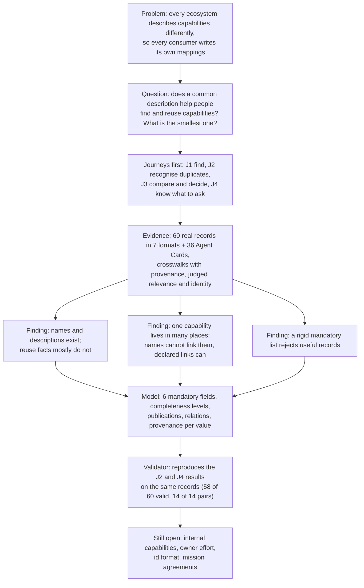

**In five sentences.**
1. AI capabilities arrive in many formats that disagree, so Mission 4 is designing one common
   description and the rules around it.
2. Instead of designing fields first, the research tested four real user journeys on 60 real
   capabilities.
3. It found that the facts needed to *find* a capability usually exist, the facts needed to *decide*
   on it usually do not, and one capability is often published in several places under different
   names.
4. The proposed model therefore requires only what every source can supply, reports a completeness
   level for the rest, and records every publication, relation, and value source.
5. On the same records, the revised validator accepts 58 of 60 drafts and links every judged
   duplicate, but internal capabilities and owner effort are still untested.

---

## 18. Test yourself

Try to answer each question before reading the answer.

**1. Why is matching capabilities by name a bad way to find duplicates?**
Different capabilities can share a name (two `webapp-testing` skills), and one capability has
different names in different places (`io.github.microsoft/playwright-mcp`, `@playwright/mcp`,
`playwright`). Name matching made 2 false pairs and missed 10 of 14 true ones.

**2. What is the difference between "valid" and "assessable"?**
Valid means the manifest follows the schema's rules. Assessable means it holds enough facts to start
a reuse decision. Before the revision, 29 invalid drafts were assessable and 7 valid drafts were not.

**3. Why does the manifest not list an MCP server's tools?**
Tools are a runtime concern: they can change by user, session, or configuration, so a static file
cannot list them reliably. The manifest references the native contract instead.

**4. A manifest says `riskTier: unassessed`. Can a team treat the capability as low risk?**
No. Unassessed means no assessment is recorded. It is never low risk and never approved. Risk
decisions belong to Mission 3.

**5. Why did keeping the namespace apart from the name improve search precision for GitHub (N2)?**
Every GitHub-verified registry entry starts with `io.github.`, so a search for "github" matched all of
them. Treating the namespace as the publisher removed those false hits: precision rose from 36% to 62%.

**6. Why was `description` moved out of the mandatory set, when 58 of 60 records have one?**
Two records lacked one. With it mandatory, those records became invalid and were skipped by the
cross-manifest checks, so one publication of the Playwright server lost its links. Moving it to the
discoverable level kept every record checkable.

**7. Which journey's facts must come from people rather than from existing metadata?**
J3's adoption facts: setup (including "none needed"), limitations, and owner contact. That is why no
record reaches "adoptable" without owner input.

---

## 19. Where to read more

The external standards mentioned in this page, as retrieved on 2026-10-22.

| Standard | Link |
|---|---|
| Agent Skills specification | https://agentskills.io/specification |
| Model Context Protocol, versioning | https://modelcontextprotocol.io/specification/versioning |
| MCP Server Cards (SEP-2127) | https://modelcontextprotocol.io/seps/2127-mcp-server-cards |
| MCP Registry `server.json` reference | https://github.com/modelcontextprotocol/registry/tree/main/docs/reference/server-json |
| A2A v1.0.1 specification | https://github.com/a2aproject/A2A/tree/v1.0.1/specification |
| AI Catalog (editor's draft) | https://github.com/Agent-Card/ai-catalog/blob/main/specification/ai-catalog.md |
| JSON Schema | https://json-schema.org/specification |
| Semantic Versioning 2.0.0 | https://semver.org/spec/v2.0.0.html |
| Package URL (ECMA-427) | https://github.com/package-url/purl-spec |
| Backstage descriptor format | https://backstage.io/docs/features/software-catalog/descriptor-format |
